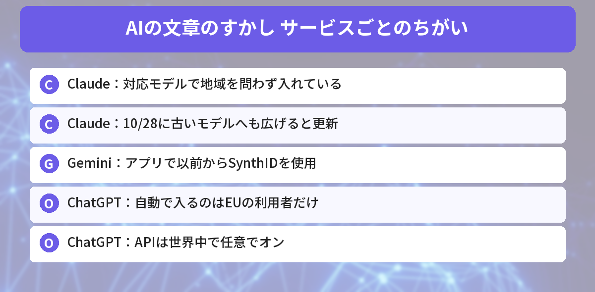
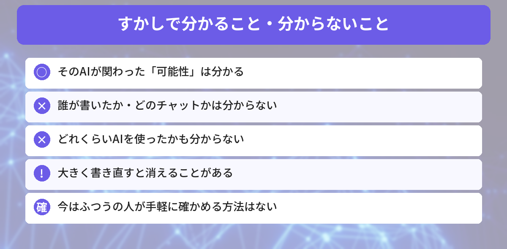

## この記事で分かること

「ClaudeやChatGPTの文章には見えないすかしが入る」って聞いたの。レポートを手伝ってもらったら、ばれちゃうってこと？日本でも入るの？


AIの文章に「AIが関わった」という見えないしるしを入れる話だね。サービスによって入れ方や地域がちがうんだ。日本でどうなるのか、何が分かって何が分からないのかを整理するね。


こんな疑問はありませんか？
- 日本で使っても、すかしは入るの？
- すかしで、誰が書いたか分かっちゃうの？
- 書き直したら消えるの？

この記事は、Anthropicのヘルプ「[How Claude marks AI-generated content](https://support.claude.com/en/articles/16266773-how-claude-marks-ai-generated-content)」（2026年10月28日更新）、OpenAIの発表「[Our approach to EU text provenance rules](https://openai.com/index/eu-text-provenance/)」、報道をもとにまとめています（2026年10月30日に確認）。

## 「見えないすかし」とは？
AIが文章を書くとき、**単語の選び方に、人には分からない統計的なしるし**を入れるしくみです。

- 見た目や意味、読みやすさは変わらない
- 隠れた文字が入るわけではない
- 専用の道具で調べると、「そのAIが関わった可能性」が分かる

きっかけは、EUの「**AI法（AI Act）**」です。AIが作ったものを、機械で見分けられるようにするルールがあり、AI会社が対応を進めています。

画像のすかしについては、[AI画像の見分け方（C2PA・SynthID）の記事](/posts/ai-image-detection-c2pa-synthid/)で解説しています。



## サービスごとのちがい

| サービス | 文章のすかし | 地域 |
|------|------|------|
| **Claude** | 2026年8月2日以降の対応モデルで入れている。それより前のモデルにも広げる（10月28日のヘルプ更新） | **地域を問わず** |
| **Gemini** | アプリで以前からSynthIDのすかしを使っている | アプリ |
| **ChatGPT** | 10月5日に発表。「数週間以内に」入れる | **EUの利用者だけ**（APIは世界中で任意でオン） |

### Claude
Anthropicは、EUのルールに合わせる取り組みの一環として、**モデルそのもの**にすかしを入れています。そのため、Claudeのアプリでも、AWSやGoogle Cloudなどから使っても、対応モデルなら入ります。対応モデルには、Claude Opus 5.5、Sonnet 5.5、Haiku 5.5などがあります。

画像などのファイルには、C2PA（コンテンツの出どころを記録するしくみ）の情報もつけています。

### ChatGPT
OpenAIは「textGrain」というしくみを発表しました。ChatGPTとCodexで自動で入るのは**EUの利用者だけ**です。開発者向けのAPIでは、世界中の利用者が**自分で選んでオン**にできます（最初はオフ）。


じゃあ、日本でChatGPTを使うぶんには、今は入らないんだね。でもClaudeは入るんだ。


そういうこと。ただ、すかしがあってもなくても、「AIに手伝ってもらったら正直に書く」ルールの学校や会社は多いよ。すかしより、そのルールを先に確かめよう。


## すかしで分かること・分からないこと
### 分かること
- その文章に、**そのAIが関わった可能性**

### 分からないこと
- **誰が書いたか**：Anthropicは、すかしに個人を特定する情報は入っておらず、特定の人や会社、チャットにはたどれないと説明しています
- **どれくらいAIを使ったか**：考えたのが人で、言い回しだけ直したのか、全部AIに書かせたのかは分かりません

### 消えることもある
- コピーしたり、少し直したりしても**残ることがある**
- **大きく書き直すと消えることがある**
- だから、「すかしがない＝AIを使っていない」証明にはなりません

## ふつうの人が確かめられる？
今のところ、**ふつうの利用者が手軽に確かめる方法はありません**。

- Claudeのすかしの確認は、**規制当局、報道機関、ファクトチェック団体、研究者、教育機関**など、条件を満たす組織向けの限定公開です
- 画像などのファイルについたC2PAの情報は、Anthropicの無料の確認ツールで調べられます

## 気をつけたいこと
- 学校のレポートや仕事の文書では、**AIを使ってよいか、使ったら書くべきか**のルールを先に確かめる
- すかしは「AIの関わり」を見る**手がかりの1つ**で、決めつけの材料ではない
- 大事な文章は、AIの答えをそのまま使わず、自分で読み直して直す




Claudeは日本でも入って、ChatGPTは今はEUだけ。誰が書いたかまでは分からない、なんだね。


その通り。すかしを気にするより、AIを使うときのルールを守って、自分の言葉で仕上げるのがいちばん安心だよ。


## まとめ
- AIの文章に、単語の選び方で見えない「すかし」を入れる動きが広がっている
- Claudeは2026年8月以降の対応モデルで地域を問わず入れている。10月28日に古いモデルへも広げるとヘルプを更新
- Geminiはアプリで以前からSynthIDのすかしを使っている
- ChatGPTはEUの利用者だけに数週間以内に入れる（10月5日発表）。日本は今は対象外
- 分かるのは「AIが関わった可能性」だけ。誰が書いたかは分からず、大きく書き直すと消えることもある

---
### あわせて読みたい
- [【2026年最新】AI画像の見分け方 — OpenAIのC2PA＋SynthID対応で何が変わる？](/posts/ai-image-detection-c2pa-synthid/)
- [【OpenAI】「ネットにつながずに学習」と発表 ChatGPTのWeb検索は使えなくなる？](/posts/openai-training-no-internet/)
