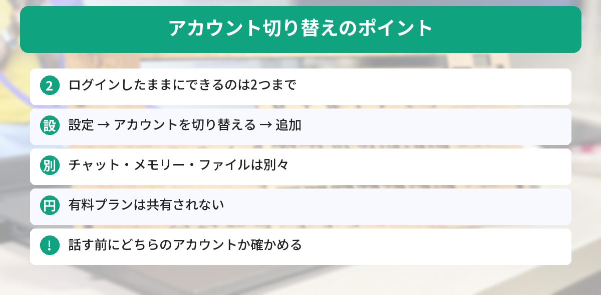
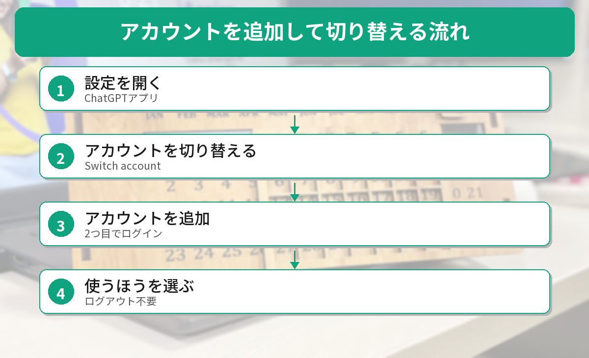

## この記事で分かること

会社のChatGPTと自分のChatGPT、スマホで使い分けたいのに、毎回ログアウトしてログインし直してたの。めんどうなんだよね…。


10月30日から、スマホのアプリでも2つのアカウントをボタンひとつで切り替えられるようになってきたよ。ただ、切り替えても共有されないものがあるから、そこも説明するね。


こんな疑問はありませんか？
- スマホで2つのアカウントを使い分けられるの？
- 切り替えたら、チャットや有料プランはどうなるの？
- 会社のアカウントで気をつけることは？

この記事は、OpenAIの[ChatGPTリリースノート](https://help.openai.com/en/articles/6825453-chatgpt-release-notes)（2026年10月30日）とヘルプ記事「Using multiple ChatGPT accounts on web and mobile」、[Gadget Hacksの記事](https://smartphones.gadgethacks.com/news/chatgpt-multiple-accounts-on-mobile-what-changes-what-stays/)をもとにまとめています（2026年11月4日に確認）。筆者はスマホの実機で表示をまだ確かめられていないため、画面の名前は発表と報道をもとにしています。

## 何が変わったの？
ChatGPTの「アカウントの切り替え」は、**Web版ではすでに使えていました**。10月30日から、**iPhone・Androidのアプリにも順番に配られています**。

| 項目 | 内容 |
|------|------|
| 対象 | Web版、iPhone・Androidアプリ |
| 同時にログインできる数 | **2つまで** |
| 使えるのは | 一度に**1つだけ**（切り替えて使う） |
| 2つ目のアカウント | 無料で作れる。最初は無料プラン |
| 提供の状況 | スマホは**順番に配っている途中** |



## 設定のしかた

### スマホ（iPhone・Android）
1. ChatGPTアプリで［**設定**］を開く
2. ［**アカウントを切り替える（Switch account）**］を選ぶ
3. ［**アカウントを追加**］を選ぶ
4. もう1つのアカウントでログインする（新しく作ることもできる）

切り替えるときは、もう一度［設定］→［アカウントを切り替える］を開いて、使いたいほうを選びます。

### Web版
左下などにある**アカウントのメニュー**を開いて［アカウントを追加］を選びます。切り替えるときも、同じメニューから選ぶだけです。


設定を開いても「アカウントを切り替える」が見当たらないよ？


スマホは順番に配っている途中だから、まだ届いていないのかも。アプリを最新にして、少し待ってみよう。会社のアカウントだと、管理者がオフにしていることもあるよ。


## 切り替えても共有されないもの
2つのアカウントは、**同じアプリに入っているだけで、中身は完全に別**です。切り替えても、次のものは移りません。

- **チャットの履歴**
- **メモリー**（ChatGPTが覚えていること）
- **アップロードしたファイル**
- **設定**
- **有料プラン（サブスクリプション）**

たとえば、仕事用で話した内容を、個人用のChatGPTは覚えていません。

## 気をつけたいこと
### 1. 話しはじめる前に、どちらのアカウントか確かめる
いま使っているアカウントで、会話の保存先や、守るべきルールが決まります。OpenAIも、**会話を始める前や買い物の前に、どちらのアカウントか確かめる**よう案内しています。仕事の資料を個人用にうっかり貼らないようにしましょう。

### 2. 会社のアカウントの中身は、会社のルールで扱われる
会社が管理するアカウントで作った会話やファイルは、**会社のルールで管理され、管理者が見られる**ことがあります。あとで個人用に切り替えても、それは変わりません。また、会社をやめてアカウントが止められると、その会話は見られなくなることがあります。

個人用のアカウントは、**会社のメールではなく、自分のメールアドレス**で作っておくと安心です。

### 3. 有料プランは「アカウントごと」
- プランは、払ったアカウントだけのものです。切り替えても共有されません
- スマホで払ったプランは、**AppleやGoogle Playのアカウント**と、**払ったChatGPTのアカウント**の両方にひもづきます
- Google Playでは、すでに1つのChatGPTアカウントで払っていると、**同じGoogle Playのアカウントで別のChatGPTアカウントのプランを買えない**ことがあると報じられています

2つ目のアカウントにお金を払う前に、どちらのアカウントがいまのプランを持っているか確かめておきましょう。

### 4. 通知は両方から届くことがある
報道によると、2つのアカウントの両方から通知が届くことがあります。使っていないほうの通知をタップすると、そのアカウントに**自動で切り替わります**。

ChatGPTの守りを固めたい人は、[ロック付きチャットの記事](/posts/chatgpt-locked-chats/)や[アカウント乗っ取り対策の記事](/posts/chatgpt-account-security/)もあわせて読んでみてください。




設定から2つ目を追加して、話す前にどっちのアカウントか確かめる。プランは共有されない、だね！


その通り。個人用は自分のメールアドレスで作っておくと、あとで困らないよ。


## まとめ
- ChatGPTのスマホアプリで、2つのアカウントを切り替えられるようになってきた（10月30日から順番に提供）
- ［設定］→［アカウントを切り替える］→［アカウントを追加］で設定する
- 同時にログインできるのは2つまで。使えるのは一度に1つ
- チャット・メモリー・ファイル・有料プランはアカウントごとに別々
- 話す前にどちらのアカウントか確かめる。個人用は自分のメールアドレスで作る

---
### あわせて読みたい
- [【ChatGPT】ロック付きチャットの使い方 PINで会話を隠す方法と注意点](/posts/chatgpt-locked-chats/)
- [【ChatGPT】アカウント乗っ取り対策！Advanced Account Securityの設定方法](/posts/chatgpt-account-security/)
