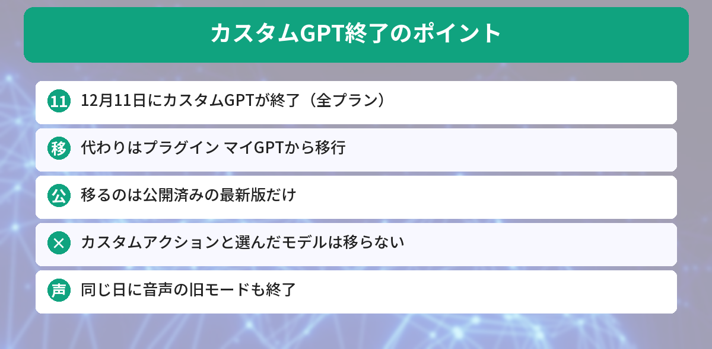
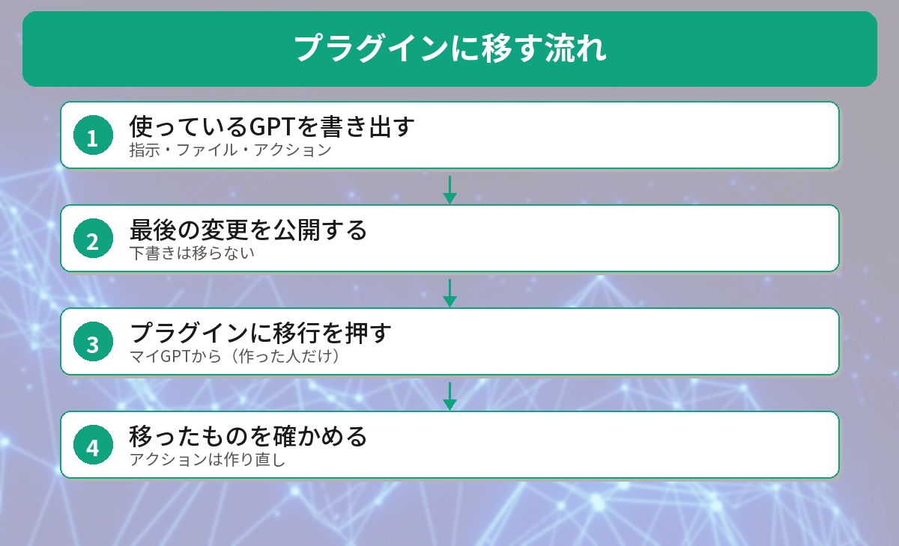

## この記事で分かること

仕事で使ってるGPTがあるんだけど、「12月で終わる」って表示が出てきたの。消えちゃうの？


そう、カスタムGPTは12月11日に終わるんだ。代わりに「プラグイン」に移せるよ。ただ、移らないものもあるから、あと2週間ちょっとのうちに確かめておこう。


こんな疑問はありませんか？
- いつ、何が使えなくなるの？
- どうやって移すの？
- 移らないものは？

この記事は、OpenAIのヘルプ「[Custom GPT retirement and migration FAQ](https://help.openai.com/en/articles/20001519-custom-gpt-retirement-and-migration-faq)」「[Retiring Advanced and Standard Voice in ChatGPT](https://help.openai.com/en/articles/20001638-retiring-advanced-and-standard-voice-in-chatgpt)」と、[TechRepublicの記事](https://www.techrepublic.com/article/news-chatgpt-custom-gpt-retirement-migration/)をもとにまとめています（2026年11月24日に確認）。筆者は自分のアカウントの移行画面ではまだ確かめられていないため、画面の名前はヘルプと報道をもとにしています。

## いつ、何が終わるの？
| 日付 | できごと |
|------|------|
| **2026年12月11日** | **カスタムGPTとGPTのページが終了**（すべてのプラン） |
| 2026年12月11日 | 音声の**Advanced voice・Standard voiceも終了**（Live voiceに自動で切りかえ） |
| 2027年2月 | 一部の会社向けワークスペース（FedRAMPや延期が認められたところ）の終了日 |

- 12月11日までは、移していないGPTは**ふつうに使えて、直せます**
- 過去の**会話は履歴に残ります**
- 会社のEnterpriseワークスペースでは、**10月26日から新しいGPTを作れなく**なっています

Googleでも、Geminiの「Gem」が「スキル」に切りかわりました（[Gemの記事](/posts/gemini-gems-readonly-nov17-delete-dec17/)）。同じような流れです。



## プラグインに移す流れ

### ステップ1: 使っているGPTを書き出す
自分が使っているGPTの、**名前・指示・知識ファイル・つないでいるアプリ・カスタムアクション**をメモします。

### ステップ2: 最後の変更を「公開」する
移されるのは、**公開済みの最新版**だけです。下書きのままの変更は移りません。直したいところがあれば、直して公開しておきます（「公開」はだれでも見られる状態にするという意味ではありません）。

### ステップ3: ［プラグインに移行］を押す
［**マイGPT**］を開き、移したいGPTで［**プラグインに移行**］を選びます。移せるのは、**GPTを作った人**です。

### ステップ4: 移ったものを確かめる
| GPTで | プラグインでは |
|------|------|
| 指示 | **スキル** |
| 知識ファイル | **参照ファイル** |
| つないだアプリ | **アプリ** |
| カスタムアクション | **移らない** |
| 選んでいたモデル | **移らない** |

いくつか質問して、**前と同じように答えてくれるか**を試しておきましょう。


人が作ったGPTを使っているだけのときは？


移せるのは作った人だけなんだ。作った人に聞くか、よく使う指示を自分でメモして、プラグインやプロジェクトで作り直そう。


## 気をつけたいこと
- **カスタムアクション**（外のサービスにつなぐ設定）は移りません。代わりのアプリがあるか確かめ、なければ作り直しが必要です
- 移したあと、元のGPTは**読み取り専用**になります
- 移したプラグインは、**答え方が少し変わる**ことがあります
- 会社のワークスペースでは、移す権限や日程が会社ごとにちがうことがあります。管理者の案内を確かめてください

## 音声の旧モードも12月11日に終了
ChatGPTの音声では、**Advanced voice**と**Standard voice**も12月11日で終わります。［設定］→［音声］で選べなくなり、使っていた人は自動で**Live voice**になります。Live voiceは2026年7月から標準になっていて、OpenAIによると、音声を使う人のほとんどがすでにLive voiceを使っています。

ChatGPTの使い方は、[ChatGPTのはじめの一歩の記事](/posts/chatgpt-first-step/)でも紹介しています。




12月11日までに、公開してから［プラグインに移行］。カスタムアクションは移らないから自分で確かめる、だね！


その通り。ギリギリだとあわてるから、今週中に一度ためしておこう。


## まとめ
- ChatGPTのカスタムGPTは、2026年12月11日に終了。すべてのプランが対象
- 代わりはプラグイン。［マイGPT］→［プラグインに移行］で移せる（作った人だけ）
- 移されるのは公開済みの最新版。指示→スキル、知識ファイル→参照ファイル、アプリ→アプリ
- カスタムアクションと、選んでいたモデルは移らない
- 同じ日に音声のAdvanced・Standard voiceも終わり、Live voiceに切りかわる

---
### あわせて読みたい
- [【Gemini】Gemは11/17で使えなくなり12/17に削除 消えるファイルと今やること](/posts/gemini-gems-readonly-nov17-delete-dec17/)
- [【ChatGPT】スマホで2つのアカウントを切り替えられる！仕事用と個人用の使い分け方と注意点](/posts/chatgpt-account-switching-mobile/)
