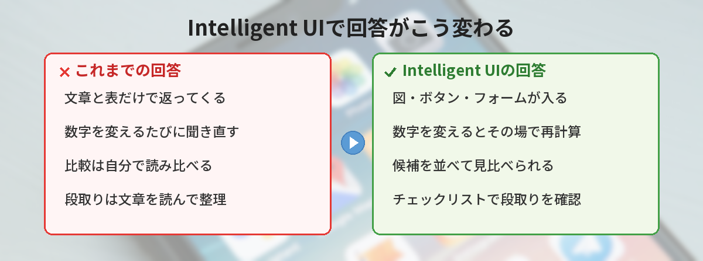
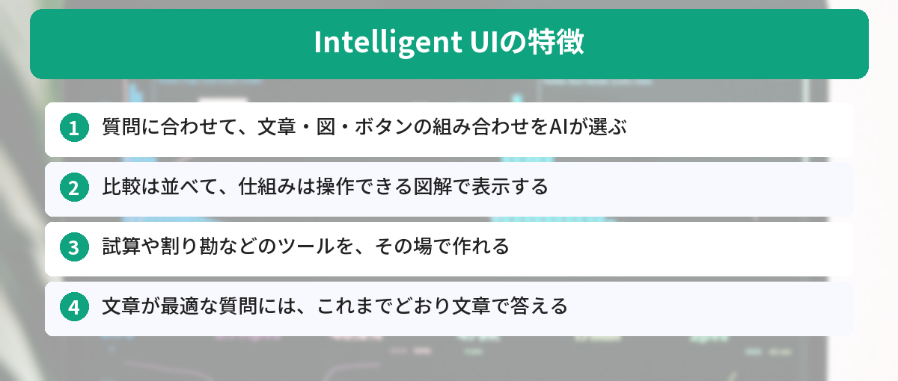
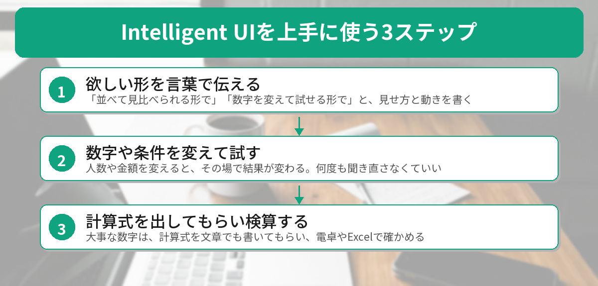
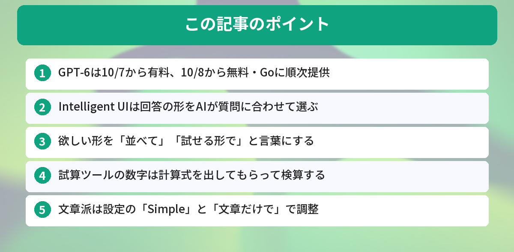

## この記事で分かること


ChatGPTに献立を相談したら、チェックリストとか、人数を変えるボタンとかが出てきてびっくりしたの…！これって何？前みたいな普通の文章には戻せないの？



それは10月から始まったGPT-6の新機能「Intelligent UI」だね。質問に合わせて、図やボタンを回答の中に組み込んでくれるんだ。うまく頼むと便利だし、表示を控えめにする設定もあるよ。




ChatGPTを開いたら、回答の見た目が急に変わっていた。そんな人が増えています。

- 「質問しただけなのに、ボタンや入力欄の付いた答えが返ってきた」
- 「文章だけでいいのに、図が入って読みにくい」
- 「ニュースで見た新機能が、自分の画面には出てこない」

結論から言うと、これはGPT-6の新機能「Intelligent UI（インテリジェントUI）」です。**回答の形を、AIが質問に合わせて選ぶ機能**で、比べる・試算する・段取りを立てる質問で特に役立ちます。文章中心がいい人は、設定で表示を控えめにできます（完全にゼロにはできません）。この記事では、OpenAIの発表と公式ヘルプをもとに、中身と頼み方、戻し方を整理します。



## GPT-6とIntelligent UIとは

### 10月7日から全ユーザーに順次提供

OpenAIは2026年10月7日（現地時間）、ChatGPTの新モデル「GPT-6」を全ユーザー向けに提供し始めました。OpenAIの発表によると、提供の順番と使われるモデルは次のとおりです。

| プラン | 提供開始 | 使われるモデル |
|---|---|---|
| Plus / Pro / Business / Enterprise | 10月7日から | GPT-6 Sol |
| 無料 / Go | 10月8日から | GPT-6 Luna |

どちらのモデルも、日常の会話向けに調整されています。対象はChatGPTの「Chat」で、「Work」と「Codex」で使うモデルは変わりません。Enterpriseで使えるかどうかは、管理者の設定によります。前の世代のモデルについては、[GPT-5.5の解説記事](/posts/gpt55-whats-new/)も参考にしてください。

### Intelligent UIは「回答の形」をAIが選ぶ機能

Intelligent UIでは、GPT-6が質問の内容に合わせて、文章・図・タップできるボタン・入力フォーム・グラフ・その場で操作できる部品の組み合わせを判断します。

- 比較の質問なら、項目を並べて表示する
- 仕組みの説明なら、操作できる図解を使う
- 文章が一番伝わる質問なら、これまでどおり文章で答える

OpenAIは、使い道として次の3つを挙げています。

1. **日常の答えを見やすくする**: レシピと調理のタイムラインを並べる、旅行の立ち寄り先を地図に表示する
2. **学習に使う**: 数字を変えて結果の変化を確かめる、問題を1ステップずつ解く
3. **その場でツールを作る**: 貯金の増え方の試算、食事代の割り勘、会話の中で遊べるゲーム

OpenAIの公式ブログでは、友人を招いて料理をふるまう計画を相談した例が紹介されています。GPT-6は、料理の画像を入れたメニューに加えて、人数を変えると材料の量を計算し直す機能や、段取りを確認できるチェックリストを回答の中に表示していました。



### 「考えながら答え始める」ようにもなった

GPT-6は、考え続けながら回答を書き始められるようになりました。まず役に立つ答えを出し、考えを進めながら詳しく付け足していく形です。

OpenAIの社内評価では、Web検索が必要な質問で、GPT-6 Instantは前のGPT-5.6 Instantより平均44%早く答え始めるとされています。あくまで公式発表の数字ですが、待ち時間が減るのはうれしいポイントです。


じゃあ、私が何か変な設定をしたから出てきたわけじゃないんだね。



そう、特別なプロンプトもいらないよ。ただ「こういう形で見たい」と言葉で伝えると、狙った形にしやすくなるんだ。次で具体的な頼み方を紹介するね。


## Intelligent UIの上手な頼み方

特別なプロンプトは必要ありません。ただ、欲しい形を言葉にすると、思ったとおりの答えになりやすくなります。

### 例1: 献立や段取りを立てる

```text
週末に4人分のカレーとサラダを作ります。
材料と調理の順番が、ひと目で分かる形でまとめてください。
人数を変えたら、材料の量も変わるようにしてください。
```

「ひと目で分かる形で」「人数を変えたら」のように、見せ方と動きを伝えるのがコツです。

### 例2: お金の試算をする

```text
毎月2万円を年利3%で積み立てたら、10年後にいくらになるか試算してください。
毎月の金額と年数を変えて試せる形にしてください。
使っている計算式も、文章で書き添えてください。
```

試算ツールは便利ですが、表示された数字をそのまま信じるのは危険です。**計算式を文章でも出してもらい、電卓やExcelで確かめる**習慣をつけると安心です。実際にお金を動かす判断は、金融機関などの公式情報で確認してください。家計の相談の基本は、[ChatGPTで家計管理を効率化する方法](/posts/chatgpt-household-budget/)でも紹介しています。

### 例3: いくつかの候補を比べる

```text
スマホの料金プランを3つ比べたいです。
月額、データ量、通話の条件を、並べて見比べられる形にしてください。
```

「並べて」「見比べられる形で」と伝えると、比較の形で返ってきやすくなります。

### 「図解して」より「操作できる形で」

「図解して」と頼むと、画像を描く機能と区別がつきにくいことがあります。ボタンや入力欄のある形が欲しいときは、「操作できる形で」「タブで切り替えられるように」など、**動きを言葉にする**と伝わりやすくなります。



## 文章だけに戻したいときの設定

「図やボタンはいらない。文章で読みたい」という人もいると思います。その場合は、表示を控えめにする設定があります。

### 設定で控えめにする（Web版）

OpenAIの公式ヘルプでは、Web版の設定で次のように選ぶ方法が案内されています。

1. ChatGPTをWebブラウザで開き、設定を開く
2. 「パーソナライズ（Personalization）」を開く
3. 「Layout and Visuals」の項目で「Simple」を選ぶ

これで、図や操作できる部品が減ります。ただし公式ヘルプにも書かれているとおり、**一部は表示されることがあり、文章だけにする専用のモードはありません**。なお、日本語表示では項目名が違う場合があります。

### その場で頼む・毎回の指示にする

設定が見つからないときや、その質問だけ文章で欲しいときは、質問の最後にひと言添えます。

```text
図やボタンは使わず、文章だけで答えてください。
```

毎回書くのが面倒なら、カスタム指示に「回答は基本的に文章で」と書いておく方法もあります。効き方は質問によって変わりますが、試す価値はあります。設定のしかたは[ChatGPTのカスタム指示の設定方法](/posts/chatgpt-custom-instructions/)で解説しています。回答の長さも整えたい人は、[回答が長すぎるときのプロンプト術](/posts/chatgpt-prompt-shorter-answer/)もどうぞ。


設定で減らせるんだ！でも、完全に文章だけにはできないんだね。



そうなんだ。だから「設定でSimpleにする」と「その場で『文章だけで』と頼む」を組み合わせるのが現実的だよ。


## 自分の画面に出ないときのチェックポイント

ニュースを見たのに、自分のChatGPTでは変化を感じない。そんなときは、次の点を確認してみてください。

- **順次提供の途中**: 全世界で順番に広げているので、届くまでに時間差があります
- **「Chat」で使っているか**: 今回の更新はChatが対象で、WorkやCodexは変わりません
- **旧デスクトップアプリを使っていないか**: 旧アプリ（ChatGPT Classic）では表示されないという報告があります。まずはWeb版で試すのが確実です
- **Proの推論オプションを使っていないか**: 公式ヘルプによると、GPT-6 Astra（Proプラン向けの推論オプション）はIntelligent UIに対応していません
- **文章が最適な質問ではないか**: 文章で十分な質問には、これまでどおり文章で答えます
- **会社のアカウント（Enterprise）ではないか**: 管理者の設定によっては使えません

## 調べて分かった良い点・気をつけたい点

OpenAIの発表や公式ヘルプ、使った人の報告を読み比べて、良い点と気をつけたい点を整理しました。

### 良い点

- 数字を変えて試せるので、何度も聞き直さなくてよくなる
- 比較や段取りが、ひと目で分かる形で返ってくる
- 勉強では、手を動かしながら仕組みを理解できる
- 無料版にも順次届いている

### 気をつけたい点

- **ツールの数字は検算が必要**: 作られた計算ツールの表示に誤りがあったという報告もあります。OpenAI自身も、デザインの判断にはまだ改善の余地があるとしています
- **文章を使い回したい人には不向きなことも**: 図や部品が入ると、文章だけをコピーしにくくなります
- **見え方に差がある**: 提供のタイミングや使うアプリによって、表示のされ方が変わります

### 気づき

日本語の解説記事は、ニュースの紹介が中心のものが多く、表示を控えめにする設定の手順まで書いたものはほとんど見当たりませんでした。便利な機能ほど、「合わない人の戻し方」も知っておくと安心して試せます。

## こんな人におすすめ / 文章派の人へ

### Intelligent UIが役立つ人

- 家計や積立の試算、旅行の計画など、条件を変えながら考えたい人
- 商品やプランを比べて選びたい人
- 勉強で、図を動かしながら理解したい人

### 文章のほうが合う人

- 回答をコピーして、メールや資料にそのまま使う人
- 長い説明を、じっくり読みたい人

文章派の人は、先ほどの「Simple」の設定と、「文章だけで答えて」のひと言を組み合わせるのがおすすめです。

## よくある質問（FAQ）



### Q: 無料版でもIntelligent UIは使えますか？
A: はい。OpenAIの発表によると、無料プランとGoプランにも10月8日から順次提供されています。無料版では、GPT-6 Lunaが使われます。

### Q: Intelligent UIを完全にオフにできますか？
A: 公式ヘルプによると、文章だけにする専用のモードはありません。Web版の設定で「Simple」を選ぶと図や部品は減りますが、一部は表示されることがあります。

### Q: 図やボタンを出すために、特別なプロンプトは必要ですか？
A: 必要ありません。GPT-6が質問に合わせて判断します。「並べて見比べられる形で」「数字を変えて試せる形で」など、欲しい形を伝えると狙いやすくなります。

### Q: 計算ツールの結果は信用していいですか？
A: お金や仕事に関わる数字は、必ず確かめてください。計算式を文章でも出してもらい、電卓やExcelで検算すると安心です。

### Q: WorkやCodexも変わりましたか？
A: 今回の更新はChatが対象です。OpenAIの発表によると、WorkとCodexで使うモデルは変わっていません。


勝手に出てきてびっくりしたけど、「数字を変えて試せる形で」って頼めば、私でも使いこなせそう！読みにくいときは「文章だけで」って書けばいいんだね。



その通り！便利なところは使って、合わないところは設定やひと言で調整する。新しい機能とは、そのくらいの付き合い方がちょうどいいよ。


## まとめ

- GPT-6は、10月7日から有料プラン、10月8日から無料・Goプランに順次提供（Chatが対象）
- Intelligent UIは、文章・図・ボタンなど回答の形を、AIが質問に合わせて選ぶ機能
- 「並べて」「数字を変えて試せる形で」など、欲しい形を言葉にすると狙いやすい
- 試算ツールの数字は、計算式を出してもらって検算する
- 文章派は、Web版の設定「Simple」と「文章だけで」のひと言で控えめにできる

---
### あわせて読みたい
- [【ChatGPT】カスタム指示の設定方法 ― 毎回同じ説明をしなくて済む裏技](/posts/chatgpt-custom-instructions/)
- [【ChatGPT】回答が長すぎる？1行追加で的確にする5つのプロンプト術](/posts/chatgpt-prompt-shorter-answer/)

<!-- affiliate -->
## 関連リソース

GPT-6の新機能はまだ本になっていないため、ChatGPTの基本を固められる評価の高い1冊を選びました。

**できるChatGPT 改訂2版**（インプレス）<br>
ChatGPTの基本操作から、CanvasやDeep Researchなどの機能の使い方まで解説した「できる」シリーズの改訂版です。

- <a href="https://af.moshimo.com/af/c/click?a_id=5490814&amp;p_id=54&amp;pc_id=54&amp;pl_id=27059&amp;url=https%3A%2F%2Fitem.rakuten.co.jp%2Fbook%2F18544423%2F" rel="nofollow sponsored noopener" referrerpolicy="no-referrer-when-downgrade" target="_blank">できるChatGPT 改訂2版（楽天市場）</a>
- <a href="https://af.moshimo.com/af/c/click?a_id=5490817&amp;p_id=170&amp;pc_id=185&amp;pl_id=27060&amp;url=https%3A%2F%2Fwww.amazon.co.jp%2Fdp%2F4295024260" rel="nofollow sponsored noopener" referrerpolicy="no-referrer-when-downgrade" target="_blank">できるChatGPT 改訂2版（Amazon）</a>
<!-- /affiliate -->
