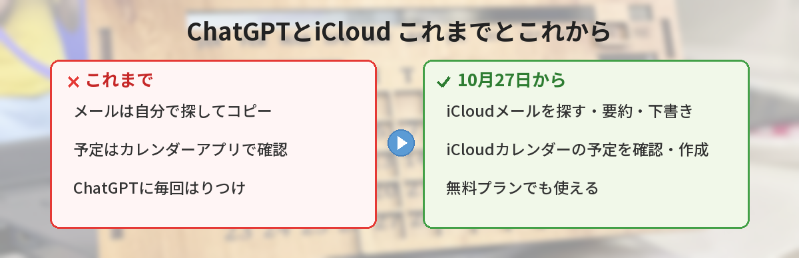
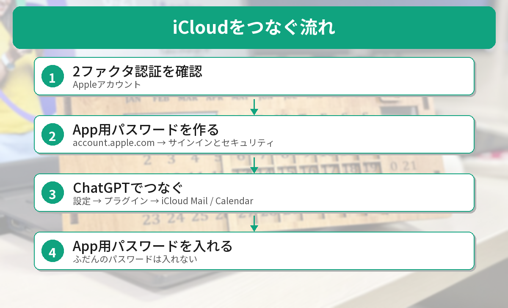

## この記事で分かること

iPhoneのメールとカレンダーがChatGPTにつながったって聞いたの。私、無料プランだけど使えるの？Apple IDのパスワードを入れるのはちょっとこわいな…。


10月27日に追加された「iCloudメール」と「iCloudカレンダー」のプラグインだね。無料プランでも使えるよ。それに、ふだんのパスワードじゃなくて、専用の「App用パスワード」を作って入れるしくみなんだ。順番に説明するね。


こんな疑問はありませんか？
- 何ができるようになったの？
- 無料プランでも使える？
- つなぐとき、どのパスワードを入れればいいの？

この記事は、ChatGPT公式Xの発表（2026年10月27日）と、MacRumors・Digital Trendsなどの報道をもとにまとめています（2026年10月28日に確認）。筆者はiCloudのアカウントでの実機確認はできていないため、画面の名前は報道をもとにしています。

## 何ができるようになったの？
ChatGPTから、**iCloudのメールとカレンダー**を使えるようになりました。

### iCloudメールでできること
- 特定の人からのメールを探す
- 最近のやりとりを要約する
- 返信の下書きを作る、メールを送る
- iCloudの連絡先を調べる

### iCloudカレンダーでできること
- 予定を確かめる（iPhoneのカレンダーアプリに出る予定）
- 予定を作る・変える

たとえば「来週の打ち合わせの確認メールを探して、カレンダーの予定とかぶっていないか見て」と頼めば、メールとカレンダーの両方を見て答えてくれます。



## 使える人
- **すべてのプラン**（無料プランも含む）
- **Web・デスクトップ・iPhoneのアプリ**で使える
- 世界に順番に広がっている途中なので、まだ出てこない人もいます

## つなぐ前に「App用パスワード」を作る

iCloudのプラグインは、ふだんのApple IDのパスワードではなく、**App用パスワード**を使います。これは、ほかのアプリにiCloudを使わせるための専用のパスワードです。

### ステップ1: 2ファクタ認証がオンか確かめる
App用パスワードを作るには、Appleアカウントの**2ファクタ認証**がオンになっている必要があります。

### ステップ2: App用パスワードを作る
1. ブラウザで **account.apple.com** を開いてサインインする
2. ［**サインインとセキュリティ**］を開く
3. ［**App用パスワード**］を選ぶ
4. 「ChatGPT」など、わかりやすい名前をつけて作る
5. 表示されたパスワードをメモする（あとで見られないことがあります）

### ステップ3: ChatGPTでつなぐ
1. ChatGPTの［**設定**］→［**プラグイン**］を開く
2. 「**iCloud Mail**」と「**iCloud Calendar**」を、それぞれつなぐ
3. メールは、**@icloud.com・@me.com・@mac.com** のアドレスを入れる
4. カレンダーは、**Appleアカウントのメールアドレス**を入れる（メールのアドレスとちがうことがあります）
5. パスワードの欄には、ステップ2で作った**App用パスワード**を入れる


ふだんのパスワードを入れなくていいなら、ちょっと安心かも。


そうだね。App用パスワードは、あとから取り消せるのもポイントだよ。やめたくなったら、Appleアカウントの設定で消せばいいんだ。


## 気をつけたいこと
### 読めるのはiCloudのメールだけ
iPhoneのメールアプリに**GmailやOutlookを入れていても、それは読めません**。対象はiCloudのメールだけです。Gmailも使いたい場合は、Gmailのプラグインを別につなぎます。

### 送信もできるので、確かめてから
このプラグインは、**メールを送ったり予定を作ったりもできます**。大事なメールは、送る前に内容をよく確かめましょう。心配なときは「**下書きだけ作って**」と頼むのがおすすめです。

### メールの中身をAIに見せることになる
メールやカレンダーには、住所や予定など大事な情報が入っています。会話をAIの改善に使わせたくない人は、ChatGPTの［設定］→［データ コントロール］の「すべての人のためにモデルを改善する」を確かめておきましょう。人に見られたくない会話は、[ロック付きチャット](/posts/chatgpt-locked-chats/)でかくすこともできます。

## やめたいときは
1. ChatGPTの［設定］→［プラグイン］で、iCloud Mail・iCloud Calendarの接続を切る
2. account.apple.com の［サインインとセキュリティ］→［App用パスワード］で、ChatGPT用のパスワードを取り消す

GoogleのGeminiで似たことをする方法は、[GeminiとGoogleマップの連携の記事](/posts/gemini-maps-personal-intelligence/)でも紹介しています。




無料でも使えて、つなぐときはApp用パスワード。送る前にはちゃんと確かめる、だね！


その通り。まずは「今週の予定を教えて」みたいな、読むだけのお願いから試すと安心だよ。


## まとめ
- ChatGPTに、iCloudメールとiCloudカレンダーのプラグインが2026年10月27日（米国時間）に追加された
- 無料プランを含むすべてのプランで、Web・デスクトップ・iPhoneのアプリから使える
- メールの検索・要約・下書き・送信、予定の確認・作成・変更ができる
- つなぐには、Appleアカウントで作る「App用パスワード」を使う。ふだんのパスワードは入れない
- 読めるのはiCloudのメールだけ。GmailやOutlookは対象外

---
### あわせて読みたい
- [【ChatGPT】ロック付きチャットの使い方 PINで会話を隠す方法と注意点](/posts/chatgpt-locked-chats/)
- [【Google】Gmailや写真が広告に使われる？10月のプライバシーポリシー変更と止め方](/posts/google-privacy-policy-gemini-ads/)
