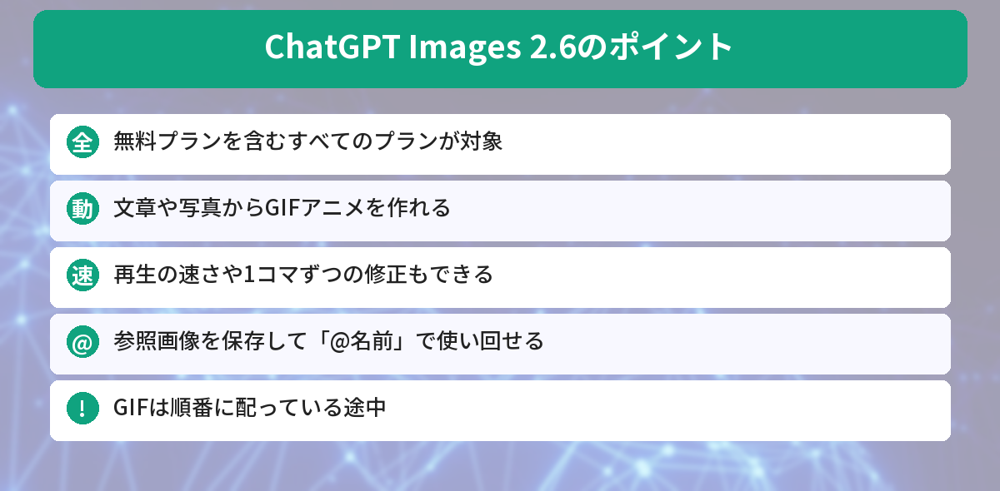
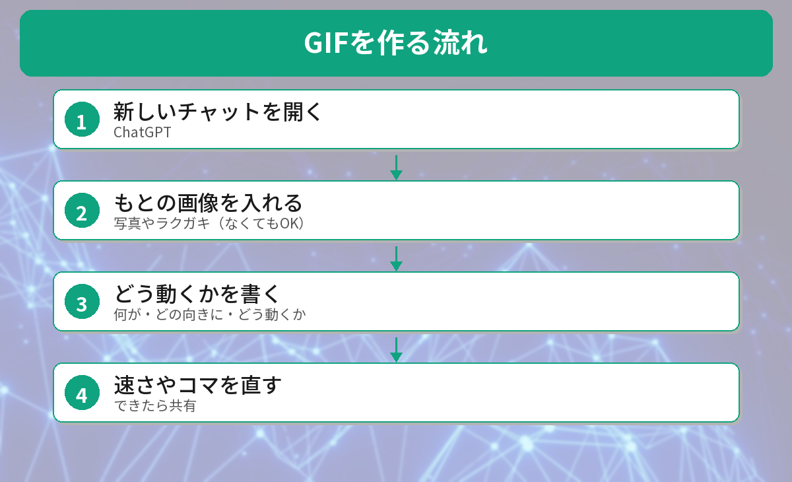

## この記事で分かること

ChatGPTで、うちのねこの写真を動かせるようになったって聞いたの！本当？


本当だよ。11月4日の「Images 2.6」で、GIFアニメが作れるようになったんだ。ねこの写真を保存して、何度も使い回すこともできるよ。



こんな疑問はありませんか？
- GIFってどうやって作るの？
- 無料プランでも使える？
- 写真を保存するって、どういうこと？

この記事は、OpenAIの発表と[ChatGPTリリースノート](https://help.openai.com/en/articles/6825453-chatgpt-release-notes)、[heiseの記事](https://www.heise.de/en/news/ChatGPT-Images-2-6-adds-GIFs-SVGs-and-speed-11512895.html)、[Fello AIの記事](https://felloai.com/chatgpt-images-2-6/)をもとにまとめています（2026年11月6日に確認）。筆者はまだ実際にGIFを作れていないため、画面の名前は発表と報道をもとにしています。

## 何が変わったの？
| 項目 | 内容 |
|------|------|
| 公開 | 2026年11月4日 |
| 対象 | **すべてのプラン（無料も）**、Web・パソコン・スマホ |
| 新機能1 | **GIFアニメを作れる** |
| 新機能2 | **参照画像を保存して使い回せる** |
| 速さ | 画像を作る速さが**約50%アップ**（OpenAI発表） |
| GIFの提供 | **順番に配っている途中** |

前の版「Images 2.5」は9月8日に出たばかりで、2か月たたずに次の版が出ました。



## GIFアニメを作る


### ステップ1: 新しいチャットを開く
ChatGPTで新しいチャットを開きます。

### ステップ2: もとの画像を入れる（なくてもOK）
写真、ラクガキ、ロゴなどをアップロードすると、それが最初の1コマになります。画像がなくても、文章から絵を描いてもらえます。

### ステップ3: 「どう動くか」を書く
いちばんのコツは、**何が、どの向きに、どう動くか**を書くことです。

```text
このねこが、のびをして、あくびをして、また丸くなるGIFを作って
```

「ねこ」だけだと、何を動かせばいいのか伝わりません。

### ステップ4: 速さやコマを直す
できたGIFは、**再生の速さを変えたり**、**1コマずつ直したり**できます。くり返し再生されるので、そのまま共有できます。


「GIFを作って」って頼んでも、ふつうの画像しか出てこないよ？


GIFは順番に配っている途中だから、まだ届いていないのかも。アプリを最新にして、少し待ってみよう。


## 参照画像を保存する
ペット、自分、よく描くキャラクターの写真に**名前をつけて保存**できます。

たとえば、犬の写真を「ペッパー」として保存しておくと、次のチャットで

```text
@ペッパー を水彩画ふうに描いて
```

のように頼めます。**写真をアップロードし直す必要がありません**。


毎回ねこの写真を探して入れてたから、これは助かる！


うん。ただ、保存した写真はChatGPTに預けることになるから、人に見られたくない写真は入れないでおこう。


## 気をつけたいこと
- **他人の顔や写真**は、その人の許可なく使わない。勝手に動かしたGIFを公開するとトラブルのもとになります
- **文字や細かいレイアウト**、**同じキャラクターを何枚も同じ姿で描くこと**は、まだ苦手だとOpenAIも認めています
- 作った画像には、AIで作ったことを示す**C2PAの情報**と、目に見えない**SynthIDのすかし**が入っていると報じられています

AIの「すかし」については、[AIの文章のすかしの記事](/posts/ai-text-watermark-chatgpt-claude-gemini/)でも解説しています。




「何がどう動くか」を書いて頼む。よく使う写真は名前をつけて保存、だね！


その通り。人の写真は許可をもらってから使おうね。


## まとめ
- ChatGPTの画像生成が11月4日に「Images 2.6」になった。無料プランを含む全プランが対象
- 文章や写真から、くり返し動くGIFアニメを作れる。速さや1コマずつの修正もできる
- GIFは順番に配っている途中で、まだ使えない人もいる
- ペットや自分の写真を参照画像として保存し、「@名前」で使い回せる
- 他人の写真は許可なく使わない。文字や細かいレイアウトはまだ苦手

---
### あわせて読みたい
- [【2026年最新】ChatGPT Images 2.0の使い方！無料でも使える画像生成の進化ポイント](/posts/chatgpt-images-2-guide/)
- [【2026年版】ChatGPTで画像を編集する方法 ― テキスト指示だけでデザイン修正](/posts/chatgpt-image-edit/)
