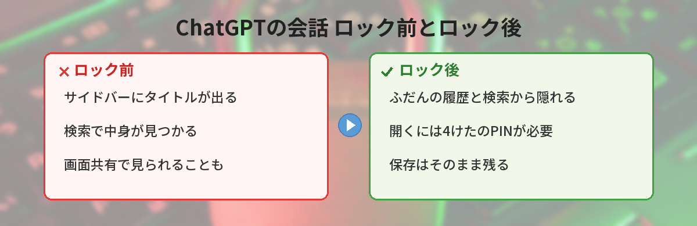
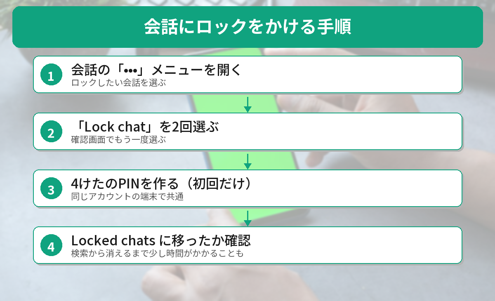
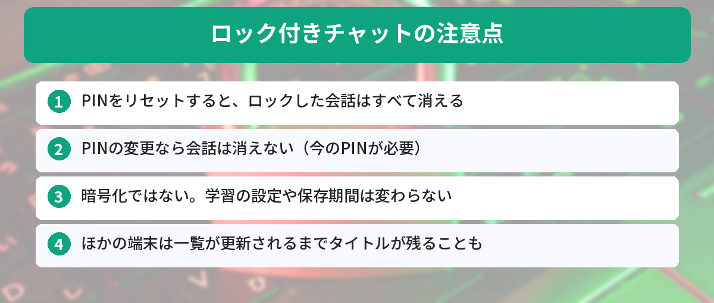

## この記事で分かること

会社のミーティングで画面共有したら、サイドバーに体調の相談をした会話のタイトルが出ちゃって焦ったの…。ChatGPTって、会話を隠せないの？


10月20日から「ロック付きチャット」が順次使えるようになったよ。会話ごとにPINをかけて、履歴から隠せるんだ。ただ、PINを忘れたときの決まりがかなり厳しいから、そこを先に押さえておこう。


こんなことで困っていませんか？
- 画面共有のときに、サイドバーの会話のタイトルを見られたくない
- 家族とPCやタブレットを一緒に使っていて、相談した内容を見られたくない
- 消したくはないけれど、目に入る場所には置いておきたくない会話がある

この記事では、OpenAIの[公式ヘルプ「Using locked chats in ChatGPT」](https://help.openai.com/en/articles/20001411)とリリースノート（2026年10月21日に確認）をもとに、使い方と注意点を整理します。画面の表示名は英語版のヘルプのものです。日本語の画面では表記が少しちがう場合があります。

## ロック付きチャットとは？
ロック付きチャット（Locked chats）は、**選んだ会話をアカウントに保存したまま、ふだんの履歴・ピン留め・検索から隠す機能**です。開くには、4けたの「アカウントPIN」を入力します。iPhoneならFace IDやTouch ID、Androidなら端末のロック解除でも開けます。

### 使えるプランと端末
- **プラン**：無料・Go・Plus・Pro・Business・Enterprise・Edu（順次配信中）
- **端末**：Web版、iPhone・Androidのアプリ、新しいデスクトップアプリ（Mac・Windows）

会話の「•••」メニューに「Lock chat」が出ない場合は、まだ自分のアカウントに配信されていません。



## 会話にロックをかける方法
初めて使うときは、今ある会話にロックをかけるところから始めます。

### ステップ1:「•••」メニューを開く
ロックしたい会話の「•••」（その他のメニュー）を開きます。

### ステップ2:「Lock chat」を2回選ぶ
「Lock chat」を選び、確認画面でもう一度「Lock chat」を選びます。

### ステップ3: PINを作る（初回だけ）
初めてのときは「Create a PIN」と出るので、**4けたの数字**を2回入力します。2回目以降は、作ったPINを入力するだけです。

### ステップ4: ロックされたことを確認する
会話は「Locked chats」に移り、ふだんの履歴と検索からタイトルと中身が消えます。**検索結果から消えるまでには少し時間がかかる**ことがあります。

## ロックした会話の開き方と閉じ方
### 開くとき
1. 「Projects（プロジェクト）」を選ぶ
2. 「Locked chats」を選ぶ
3. PINを入力する（対応するスマホでは顔認証・指紋認証も使える）
4. 開きたい会話を選ぶ

ここから**新しい会話を始めることもできます**。最初からロックした状態で話したいときに便利です。

### 閉じるとき
使い終わったら「Lock now」を選ぶと、すぐにロックされます。自動でロックされるタイミングは端末でちがいます。

- **Web版**：ページを再読み込みする、タブを閉じる、しばらくそのタブから離れる
- **スマホのアプリ**：ロック付きチャットの画面から離れて**1分**、またはアプリを裏に回して1分


じゃあ、ミーティングの前にロックしておけば、画面共有しても安心だね！


基本はそう。ただ、ほかの端末でChatGPTを開きっぱなしにしていると、一覧が更新されるまでタイトルが残っていることがあるんだ。共有する前に、ほかの画面も一度更新しておくと確実だよ。


## いちばん大事な注意点：PINを忘れると会話が消える
公式ヘルプで、もっとも強く注意されているのがここです。

### PINのリセット＝ロックした会話の全削除
PINを忘れただけでは、会話は消えません。でも、**PINをリセットすると、ロックしたすべての会話**と、その中だけに保存されたファイルや記憶が**完全に削除**されます。元に戻す方法はなく、OpenAIのサポートでも復元できません。会社の管理者が代わりに解除することもできません。

### PINの変更なら消えない
今のPINを覚えている場合は、「設定」→「Security and login（セキュリティとログイン）」→「Account PIN」から変更できます。こちらは会話が消えません。

### 何度も間違えると一時的に開けなくなる
PINを何度も間違えると、しばらく入力できなくなります。思い出せないからといって、すぐにリセットしないようにしましょう。

## ロックしても変わらないこと
ロック付きチャットは「見えなくする」機能です。次のことは変わりません。

- **暗号化はされない**（エンドツーエンド暗号化や、別の金庫を作る機能ではない）
- **会話の保存期間は変わらない**
- **「すべての人のためにモデルを改善する」の設定はそのまま**。学習に使われたくない場合は、この設定を別にオフにする
- **ロックする前にChatGPTが覚えたこと（メモリー）は消えない**
- 開ける人は、中身をコピーできる

PINより先に、アカウントそのものを乗っ取られないことも大切です。対策は[Advanced Account Securityの設定方法](/posts/chatgpt-account-security/)で、メモリーの扱い方は[メモリー機能の設定例](/posts/chatgpt-memory-tips/)で紹介しています。

## ロックできない会話もある
次のような会話には「Lock chat」が出ません。

- 一時チャット、アーカイブした会話、グループチャット
- 共有リンクから作った会話
- 予定（スケジュールされたタスク）がついている会話
- 会議の録音がある会話

また、ロックした会話は**アーカイブ・ピン留め・移動・共有ができません**。プロジェクトの中の会話をロックすると、そのプロジェクトから外れ、プロジェクトの指示やファイルも使われなくなります。

## 一時チャットとどう使い分ける？
- **一時チャット**：履歴に残さない。モデルの改善にも使われない。あとから読み返せない
- **ロック付きチャット**：会話を保存したまま、PINで開けるようにする。学習の設定はふだんどおり

「その場だけの相談」なら一時チャット、「あとで読み返したいけど人には見られたくない」ならロック付きチャット、と考えると選びやすいです。メモリーが過去の会話をどう使うのか気になる人は、[メモリーが過去の会話から文脈を引き出す仕組み](/posts/chatgpt-memory-sources/)もあわせてどうぞ。




「•••」から「Lock chat」で隠せて、PINをリセットしたら全部消えちゃうんだね。PINはちゃんとメモしておく！


それがいちばん大事。あと、ロックは暗号化じゃないから、本当に学習に使われたくないなら設定も見直しておこうね。


## まとめ
- 2026年10月20日から、ChatGPTのロック付きチャットが無料プランを含めて順次使える
- 会話の「•••」→「Lock chat」でロック。開くときは「Projects」→「Locked chats」でPINを入力
- PINのリセットは、ロックした会話すべての削除と同じ。戻せない
- ロックは「見えなくする」機能で、暗号化や学習の停止ではない
- 保存しない相談は一時チャット、保存して隠したい会話はロック付きチャット

---
### あわせて読みたい
- [ChatGPTのメモリ機能、何を覚えさせればいい？ ― 仕事が楽になる設定例5つ](/posts/chatgpt-memory-tips/)
- [【ChatGPT】音声に日本語の声「ひまり」「りんどう」追加 変え方と上限](/posts/chatgpt-voice-japanese-himari-rindo/)
