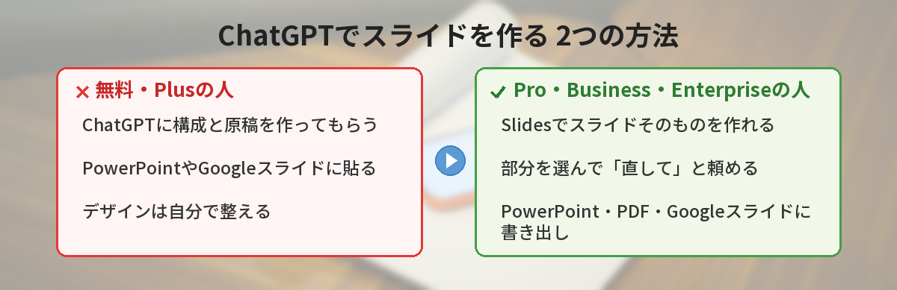
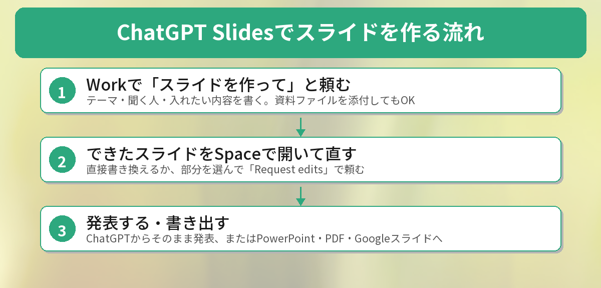

## この記事で分かること

「ChatGPTでスライドが作れるようになった」ってニュースを見て、来週の発表に使おうと思ったの。でも、私の画面のどこを探しても出てこない…


それは使い方のせいじゃなくて、使えるプランが限られているからなんだ。どのプランで使えるのかと、無料版でスライドを作るときの代わりの方法を説明するね。



こんなことで困っていませんか？

- 「ChatGPT Slides」の話を聞いたけど、自分のChatGPTに見当たらない
- 無料版やPlusでも、ChatGPTで発表資料を作れるのか知りたい
- スライド作りを手伝ってもらいたいけど、何から頼めばいいか分からない

結論から言うと、**ChatGPT Slidesを使えるのは、Pro・Business・Enterpriseプランで、「Space」が使える人だけ**です（この記事を書いた2026年10月18日時点）。無料版やPlusの人は、ChatGPTに構成と原稿を作ってもらい、PowerPointやGoogleスライドに貼る方法が現実的です。

## ChatGPT Slidesとは？

ChatGPT Slidesは、ChatGPTの中で発表用のスライドを作り、そのまま直したり、チームで一緒に編集したりできる機能です。OpenAIのリリースノートでは、会話やファイル、構成メモから作り始めたり、見本のスライドを渡してデザインや配置を真似させたりできると紹介されています。

9月29日のOpenAIの開発者向けイベント「DevDay」で、共同作業の場「Space」とあわせて予告され、10月中旬から対象のアカウントに順次提供が始まりました。

### できること

公式ヘルプによると、主に次のことができます。

- 文字、画像、図形、表、グラフをスライド上で直接編集する
- 直したい部分を選んで「Request edits（編集を頼む）」を押し、ChatGPTに直してもらう
- 同じスライドを、チームの人と同時に編集する
- コメントで相談し、@でChatGPTやメンバーを呼ぶ
- ChatGPTの画面からそのまま発表する
- PowerPoint（.pptx）、PDF、Googleスライドに書き出す


「この部分だけ短くして」って、選んで頼めるのは便利そう！


そうなんだ。全部を作り直してもらうんじゃなくて、気になるところだけ直せるのがポイントだね。


## 使えるプランと条件

| 項目 | 内容 |
|------|------|
| 使えるプラン | ChatGPT Pro・Business・Enterprise（Spaceが使えること） |
| 使えないプラン | 無料版、Go、Plus（10月18日時点） |
| 提供状況 | 対象のアカウントに順次提供中。出てこない場合は、まだ届いていない可能性あり |
| Windowsの注意 | 必要な部品（MXC）がないWindowsのデスクトップアプリでは、共同編集のSlidesではなくPowerPointファイルで作る形になる。Windows 10は非対応 |

Windowsのデスクトップアプリで共同編集のSlidesを使えないときは、Web版のChatGPTを使うように案内されています。

## ChatGPT Slidesの使い方



### 1. Workで頼む、またはSpaceで作り始める

ChatGPTの「Work」を開いて、スライドを作ってほしいと頼みます。テーマ、聞く人、入れたい内容を書き、元になる資料ファイルを添付することもできます。「Space」から「Create > Slide」を選んで、白紙やテンプレートから始める方法もあります。

公式ヘルプでは、次のような頼み方が例に挙がっています。

```
このメモから、6枚のプロジェクト報告スライドを作って。
進み具合、リスク、次にやることを入れて。
デザインと配置は、添付したテンプレートに合わせて。
```

### 2. できたスライドを直す

スライドの文字や表を直接書き換えるか、直したい部分を選んで「Request edits」を押し、どう直してほしいかを書きます。「このスライドを短くして」「新しいデータでグラフを更新して」のように頼めます。

### 3. 発表する・書き出す

ChatGPTの画面からそのまま発表できます。Web版では、PowerPoint、PDF、Googleスライドに書き出せます。書き出したあとは、文字や数字、レイアウトが崩れていないか必ず確認しましょう。

## 無料版・Plusでスライドを作る方法

Slidesが使えなくても、ChatGPTは発表資料づくりの心強い相棒になります。おすすめは、**ChatGPTに「中身」を作ってもらい、見た目はPowerPointやGoogleスライドで整える**方法です。

### ステップ1: 構成を作ってもらう

```
「AIで仕事を時短する方法」について、社内向けに10分で発表します。
聞く人はAIをほとんど使ったことがない人です。
スライド8枚分の構成を、各スライドのタイトルと箇条書き3つで作ってください。
```

### ステップ2: 1枚ずつ原稿を作ってもらう

構成ができたら、「3枚目の箇条書きを、話す原稿にして。1分で話せる長さで」のように、1枚ずつ頼みます。

### ステップ3: PowerPointやGoogleスライドに貼る

できた文字を、PowerPointやGoogleスライドのテンプレートに貼ります。デザインはテンプレートに任せると、短い時間でも見た目が整います。

無料で使えるスライド作成ツールについては、[AIでプレゼン資料を自動作成する方法 ― 無料ツール3選](/posts/ai-presentation-maker/)でくわしく紹介しています。長い資料を先に要約したいときは、[ChatGPTでPDFを要約する方法](/posts/chatgpt-pdf-summary/)も参考にしてください。


中身を作ってもらうだけでも、ずいぶん楽になりそう！


発表でいちばん時間がかかるのは「何をどの順番で話すか」を決めるところだからね。そこを任せるだけでも効果は大きいよ。


## 公式ヘルプを読んで気づいたこと

この記事を書くにあたって、筆者はOpenAIのリリースノートとヘルプ記事を読み比べました。気づいたことが3つあります。

### 「スライドが作れる」の見出しだけでは分からない

ニュースの見出しだけを読むと「誰でも使える」ように見えますが、ヘルプには対象プランがはっきり書かれていました。新機能のニュースを見たら、まず「どのプランが対象か」を確かめるのがおすすめです。10月はGPT-6の新機能も話題になりましたが（[GPT-6で回答に図やボタンが出る！](/posts/chatgpt-gpt6-intelligent-ui/)）、こちらは無料版も対象でした。

### Windows 10ではフル機能が使えない

Windows 10は、共同編集のSlidesに必要な部品に対応していません。会社のパソコンがWindows 10のままの人は、Web版を使う必要があります。

### 最後は人の目で確認する

公式ヘルプでも、共有や発表の前に文字・数字・レイアウトを確認するよう書かれています。ChatGPTが作った数字やグラフは、元の資料と合っているか必ず見直しましょう。

## よくある質問（FAQ）

### Q: 無料版でChatGPT Slidesは使えますか？
A: 2026年10月18日時点では使えません。対象はPro・Business・Enterpriseプランで、Spaceが使える人です。

### Q: Plusプランでも使えませんか？
A: 10月18日時点の公式ヘルプでは、Plusは対象プランに含まれていません。

### Q: 対象プランなのに出てきません。
A: 順次提供中のため、まだ届いていない可能性があります。しばらく待ってから確認してください。

### Q: 作ったスライドはPowerPointで使えますか？
A: Web版から、PowerPoint（.pptx）、PDF、Googleスライドに書き出せます。

### Q: 無料版でもスライド作りに使えますか？
A: 構成や原稿づくりに使えます。できた文字をPowerPointやGoogleスライドに貼る方法がおすすめです。


Slidesは上のプラン向けで、私は構成と原稿を作ってもらって、Googleスライドに貼ればいいんだね！


その通り！数字やグラフだけは、元の資料と合っているか最後に確かめてね。


## まとめ

- ChatGPT Slidesは、ChatGPTの中でスライドを作り、直し、チームで共同編集できる新機能
- 使えるのはPro・Business・EnterpriseでSpaceが使える人。無料版・Go・Plusは対象外（10月18日時点）
- 部分を選んで「Request edits」で直せる。PowerPoint・PDF・Googleスライドに書き出せる
- Windows 10のデスクトップアプリでは共同編集のSlidesは使えず、Web版の利用が案内されている
- 無料版・Plusは、構成と原稿をChatGPTに作ってもらい、PowerPointやGoogleスライドに貼るのがおすすめ

確認日：2026年10月18日（出典：OpenAIヘルプセンター「Creating and collaborating on slides in ChatGPT」、ChatGPTリリースノート）

---
### あわせて読みたい
- [【2026年版】AIでプレゼン資料を自動作成する方法 ― 無料ツール3選](/posts/ai-presentation-maker/)
- [【ChatGPT】GPT-6で回答に図やボタンが出る！使い方と文章だけに戻す方法](/posts/chatgpt-gpt6-intelligent-ui/)
