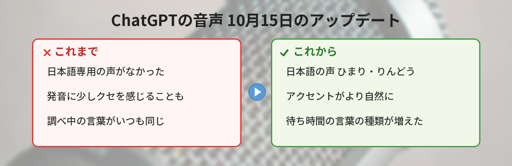
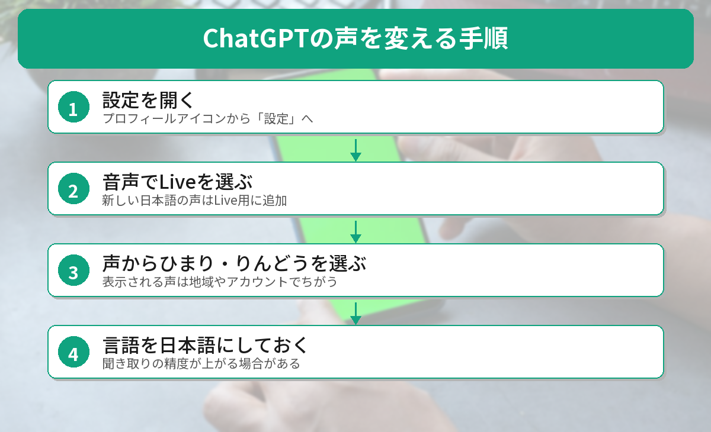
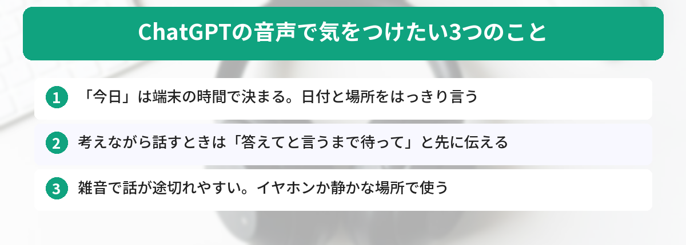

## この記事で分かること

ChatGPTと声でおしゃべりできるのは知ってたけど、日本語の新しい声が増えたって聞いたの。どこで変えるの？無料でも使える？


10月15日のアップデートで「ひまり」と「りんどう」という日本語の声が追加されたんだ。設定の「音声」から選べるよ。無料プランでも使えるけど、話せる時間に上限があるから、そこも一緒に見ていこう。


こんなことで困っていませんか？
- ChatGPTの音声が、なんとなく外国の人が話す日本語っぽくて聞き取りにくい
- 新しい声が追加されたと聞いたのに、どこで変えるのか分からない
- 無料のままで、どれくらい話せるのか知りたい

この記事では、2026年10月20日時点のOpenAI公式ヘルプとリリースノートをもとに、声の変え方と使える時間を整理します。

## ChatGPTの音声に何が追加された？
OpenAIは2026年10月15日のリリースノートで、音声会話の新しいモデル「GPT-Live-1.1」と、その軽量版「GPT-Live-1.1 Quip」の配信を始めたと発表しました。主な変更は3つです。

### 日本語の声が2つ増えた
公式ヘルプの声の一覧には、日本語の声として**ひまり（Himari）**と**りんどう（Rindō）**が載っています。日本語のほかに、フランス語・ドイツ語・ヒンディー語・韓国語・メキシコのスペイン語などにも、それぞれ2つずつ声が追加されました。英語には「Bubbie」という声が1つ増えています。

### アクセント（なまり）が自然になった
リリースノートでは、各言語のアクセントがより自然になったと説明されています。今までの声は英語を話す人の声がベースのため、日本語の発音に少しクセを感じる人もいました。日本語の声を選ぶと、この違和感が小さくなることが期待できます。

### 調べものの最中の「待ち時間の一言」が増えた
Liveで質問をすると、ChatGPTがWebで調べることがあります。そのあいだに入る短い言葉の種類が増え、同じ言い回しのくり返しが減ったとされています。



## 声を「ひまり」「りんどう」に変える方法
声の変更は、スマホのアプリでもWeb版でも同じ場所から行います。

### ステップ1: 設定を開く
自分のプロフィールアイコン（または名前）をタップかクリックして、「設定」を開きます。アプリのバージョンによってボタンの位置が少しちがうことがあります。

### ステップ2:「音声（Voice）」でLiveを選ぶ
設定の中の「音声」を開き、音声の種類で**Live**を選びます。新しい日本語の声は、Live用の声として追加されています。

### ステップ3:「声（Voice）」から選ぶ
同じ「音声」の画面で「声」を開き、「ひまり」か「りんどう」を選びます。選んだあとに音声会話を始めると、その声で話してくれます。

### ステップ4: ついでに「言語」も日本語にしておく
同じ画面の「言語」を日本語にしておくと、こちらの話す言葉を聞き取る精度が上がる場合があります。ふだん日本語で話す人は、ここも確認しておきましょう。


話している途中で声を変えたら、それまでの会話は消えちゃうの？


消えないよ。同じチャットの中で、新しい音声通話として始め直す仕組みなんだ。話した内容は文字でチャットに残っているよ。


## 無料プランでどれくらい話せる？プラン別の上限
Liveで話せる時間は、プランごとに決まっています。上限は「直近24時間」で数えられ、上限に達するとChatGPTが知らせてくれます。

| プラン | 使えるモデル | 24時間あたりの上限 |
|------|------|------|
| 無料 | GPT-Live-1.1 Quip | 回数制限あり（変わることがある） |
| Go | GPT-Live-1.1 Quip | 3時間 |
| Plus | GPT-Live-1.1 | 3時間 |
| Pro（月100ドル） | GPT-Live-1.1 | 15時間 |
| Pro（月200ドル） | GPT-Live-1.1 | 無制限（不正利用の防止ルールあり） |

出典は[OpenAIの公式ヘルプ「ChatGPT Voice」](https://help.openai.com/en/articles/20001274)です（2026年10月20日に確認）。

### 「Quip」と「1.1」は何がちがう？
QuipはGPT-Live-1.1の小さい版（mini）です。OpenAIは性能の細かい差を公表していません。ちょっとした質問や英会話の練習なら、まずは無料のQuipで試して、物足りなければ有料プランを考える、という順番で十分です。

## Live・Advanced・Standardのちがい
「音声」の設定には、Live以外にも選択肢があります。目的に合わせて選びましょう。

- **Live**: 聞くのと話すのを同時にできるので、途中で口をはさんでも自然に会話が続きます。Web検索やメモリー、画像の送信にも対応しています。**ビデオと画面共有は使えません**
- **Advanced**: ひとつ前のリアルタイム音声です。スマホのアプリで**カメラの映像や画面を見せながら話したいとき**はこちらを選びます
- **Standard**: こちらの話した言葉を文字にしてから答える、順番待ちの方式です

「カメラで冷蔵庫の中を見せて、献立を相談したい」ような使い方は、Liveではなく**Advanced**に切り替える必要があります。ここは間違えやすいポイントです。

## 実際の使い方で気をつけたい3つのこと
公式ヘルプを読んでいて、つまずきやすいと感じた点を3つ紹介します。

### 1. 「今日」「明日」は端末の時間で決まる
音声会話では、スマホやブラウザのタイムゾーンをもとに「今日」「明日」を判断します。予定や天気など日付が大事な質問では、「10月21日の東京の天気」のように日付と場所をはっきり言うと安心です。

### 2. 考えながら話したいときは「待って」と先に伝える
Liveはこちらが黙ると話し始めることがあります。会話の最初に「私が答えてと言うまで待って」と伝えておくと、考えをまとめながら話しやすくなります。それでも、周りの音で反応してしまうことはあります。

### 3. 周りがうるさいと、急に話が途切れる
雑音や別の人の声があると、ChatGPTが割り込まれたと判断して話すのをやめることがあります。イヤホンを使うか、静かな場所で話すのがおすすめです。iPhoneなら、通話中にコントロールセンターの「マイクモード」で「声を分離」をオンにする方法も公式で紹介されています。


音声で話した内容って、ずっと保存されるの？ちょっと気になる…


LiveとAdvancedの音声は、文字起こしと一緒に30日間保存されるよ。チャットを消すと、音声も30日以内に消える仕組みなんだ。学習に使われたくないなら、「データコントロール」の設定も見ておこう。


## どんな人に向いている？
日本語の声が増えたことで、とくに次のような人は試す価値があります。

- 文字を打つより、話して考えを整理したい人
- 家事や移動中に、手を使わずに調べものをしたい人
- 英会話の練習相手がほしい人（日本語の声で説明を聞き、英語で練習する、という使い分けもできます）

一方で、正確な数字や手順を何度も見返したい作業は、文字のチャットのほうが向いています。Liveでは答えが文字でもチャットに残るので、話したあとに読み返す使い方もできます。

声で使えるほかのAIツールは[無料で使える音声AIのまとめ](/posts/ai-voice-tools/)で、ChatGPTの基本の使い方は[ChatGPTの始め方](/posts/chatgpt-first-step/)で紹介しています。音声の技術的な仕組みに興味がある人は、[GPT-Realtime-2の解説](/posts/gpt-realtime-2-voice-api/)もどうぞ。




設定の「音声」でLiveを選んで、声を「ひまり」か「りんどう」にすればいいんだね。無料でも試せるなら、さっそくやってみる！


そうそう。カメラを使いたいときはAdvancedに切り替える、ということだけ覚えておけば大丈夫だよ。


## まとめ
- 2026年10月15日から、ChatGPTの音声「Live」に日本語の声「ひまり」「りんどう」が順次追加されている
- 声は 設定 → 音声 → 声 で変更できる。表示される声は地域やアカウントでちがう
- 無料はGPT-Live-1.1 Quipを回数制限つき、Plusは24時間あたり3時間まで
- カメラや画面共有を使いたいときは、LiveではなくAdvancedを選ぶ
- 日付が大事な質問は、日付と場所をはっきり言うと安心

---
### あわせて読みたい
- [【2026年版】無料で使える音声AI 5選 ― 文字起こし・読み上げ・声の変換](/posts/ai-voice-tools/)
- [ChatGPTのメモリ機能、何を覚えさせればいい？ ― 仕事が楽になる設定例5つ](/posts/chatgpt-memory-tips/)
