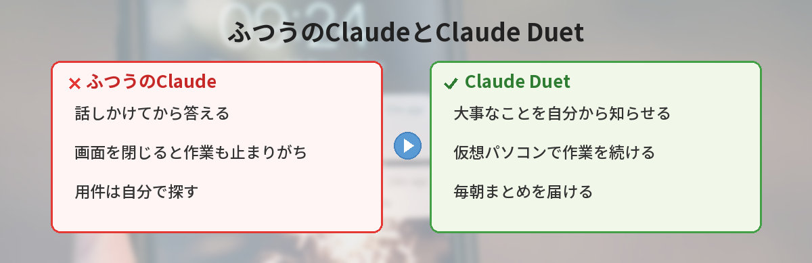
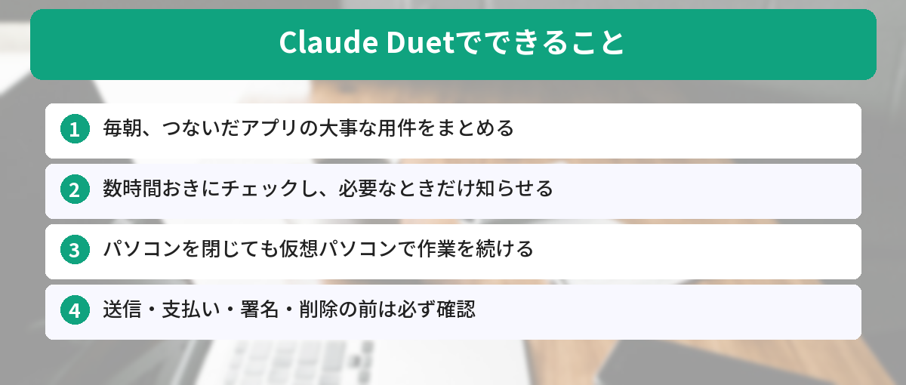
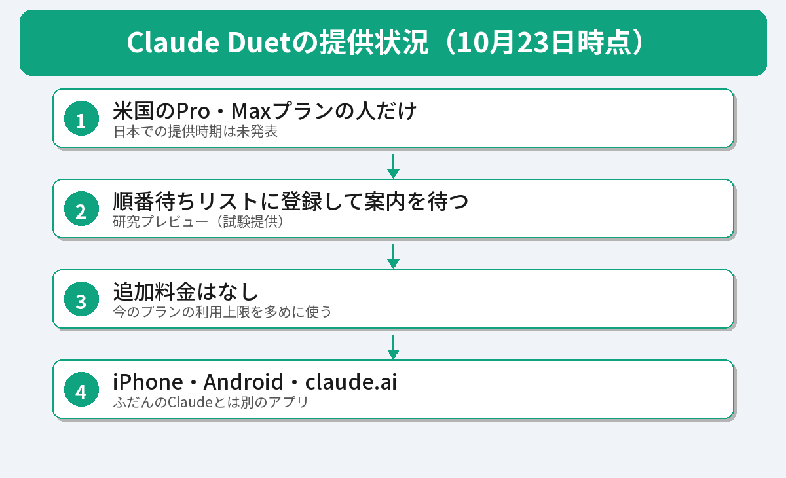

## この記事で分かること

「Claude Duet」っていう、自分から動くAIが出たってニュースで見たの。それって、私のスマホのClaudeでも使えるの？


10月21日に発表された新しいアプリだね。話しかける前に「これ、見ておいたほうがいいよ」って知らせてくれるのが特ちょうなんだ。ただ、今使えるのはアメリカの有料プランの人だけ。何ができるのか、日本ではどうなのかを整理するね。


こんな疑問はありませんか？
- 「自分から動くAI」って、ふつうのチャットと何がちがうの？
- 日本で使えるの？お金はかかるの？
- 勝手にメールを送ったり、お金を使ったりしないか心配

この記事は、[Anthropicの公式発表「Introducing Claude Duet」](https://claude.com/resources/articles/claude-duet)と、Claudeのリリースノート（2026年10月23日に確認）をもとにまとめています。

## Claude Duetとは？
Claude Duet（クロード デュエット）は、**Claudeが自分から動いてくれるAIエージェントのアプリ**です。エージェントとは、ただ答えるだけでなく、作業を自分で進めてくれるAIのことです。くわしくは[AIエージェントとは？の記事](/posts/ai-agent-what-is-it/)で解説しています。

公式発表では、Claude Duetを次のように説明しています。

- やるべきことを、こちらが聞く前に知らせてくれる
- 頼んだ作業をこなしてくれる
- こちらが席を外しても作業を続ける
- 代わりに何かをする前に、こちらに確認する

使っているAIモデルは「Claude Opus 5.5」です。対象は、やることが多い**仕事をしている人や小さな会社の経営者**とされています。



## 何ができる？

### 毎朝、大事な用件をまとめて届けてくれる
つないだアプリ（メールやSlackなど）から、その日の大事な用件を短くまとめて、毎朝届けてくれます。日中も**数時間おき**にアプリを見て、こちらが対応すべきことがあるときだけ知らせてくれます。

### パソコンを閉じても作業が続く
Claude Duetは**専用の仮想パソコン（ブラウザつき）**で作業します。そのため、自分のパソコンやスマホの電源を切っていても、頼んだ作業が進みます。終わったら通知が届きます。

### 6,000以上のアプリとつながる
Claudeのマーケットプレイスにある6,000以上のコネクターやプラグインを使えるとされています。公式の例では、次のような使い方が紹介されています。

- GmailやSlackの見落としたメッセージを探して、返信を手伝う
- 会計ソフトで未払いの請求書を確認して、催促メールの下書きを作る
- 求人の文章を下書きして、承認したらLinkedInに投稿する
- Canvaで商品の宣伝用の投稿を作る

紹介されている例は、**ほとんどが仕事用のアプリ**です。公式も「チケットの予約など、個人の用事はまだ得意ではない」と書いています。


秘書さんみたい！でも、勝手にメールを送られたら困るなあ…。


そこはちゃんと考えられているよ。大事なことをする前には、必ず確認してくれる決まりなんだ。次で説明するね。


## 安全面はどうなっている？
公式発表では、安全のしくみがくわしく書かれています。

### 大事なことは必ず確認してから
**メッセージの送信、支払い、書類への署名、削除**をする前には、何をするかを見せて、こちらの承認を待ちます。

### 承認してもできないこと
**株などの売買や、口座から口座へのお金の移動**は、承認してもできない決まりです。

### パスワードを直接見ない
ログインのしくみは、パスワードやログイン用の情報をClaude Duetが**直接見ない**設計になっています。

### 大事な情報を守るしくみ
クレジットカードの番号や、公的な身分証の情報などは、送らないようにする専用のチェックが入っています。健康やお金の情報は、こちらがはっきり指示したときだけ送ります。

## 日本で使える？料金は？

### 日本ではまだ使えない
2026年10月23日時点で、Claude Duetを使えるのは次の人だけです。

- **米国**の
- **Pro・Maxプラン**の加入者で
- **順番待ちリスト（ウェイトリスト）**に登録した人

日本での提供時期は発表されていません。

### 料金は「今のプランの上限を使う」
研究プレビューの間は、Pro・Maxプランに**追加料金なし**で含まれます。ただし、ふだんのClaudeと**同じ利用上限**を使います。数時間おきのチェックや、資料作りなどの大きな作業も上限に数えられるので、ふつうのチャットより早く上限に達することがあります。

### 使えるアプリ
iPhone・Androidの専用アプリと、claude.aiで使えます。今のところ、ふだんのClaudeのアプリとは**別のアプリ**です。

## 日本で今すぐ似たことをするには
Claude Duetと同じではありませんが、「決まった時間にまとめを作ってもらう」ことは、今の日本でもできます。

- **Gemini**：「予約アクション」で、毎朝の予定やメールのまとめを作らせる。やり方は[Geminiの「今日のまとめ」の記事](/posts/gemini-daily-brief-japan/)で紹介しています
- **Claude**：Pro・Maxプランなら、決まった時間に作業を動かす「スケジュール」機能があります

ClaudeとChatGPTなどのちがいは、[Claudeとは？の記事](/posts/claude-what-is-it/)でも説明しています。




自分から知らせてくれる秘書みたいなAIで、今はアメリカの有料プランの人だけなんだね。日本に来るのが楽しみ！


そうだね。日本で使えるようになったら、またすぐ紹介するよ。それまでは、Geminiの予約アクションで朝のまとめを試してみるのもおすすめだよ。


## まとめ
- Claude Duetは、Anthropicが2026年10月21日に公開した「自分から動くAIアシスタント」のアプリ
- 毎朝のまとめ、数時間おきのチェック、パソコンを閉じても続く作業が特ちょう
- 送信・支払い・署名・削除の前には必ず確認。株の売買やお金の移動はできない
- 今使えるのは米国のPro・Max加入者でウェイトリストに登録した人だけ。日本ではまだ使えない（10月23日時点）
- 追加料金はないが、今のプランの利用上限を多めに使う

---
### あわせて読みたい
- [【Gemini】「今日のまとめ」が出てこない？日本で使えない理由と代わりの方法](/posts/gemini-daily-brief-japan/)
- [【Gemini】回答を自分好みにする「カスタム指示」の使い方 日本で使える範囲](/posts/gemini-custom-instructions-customize/)
