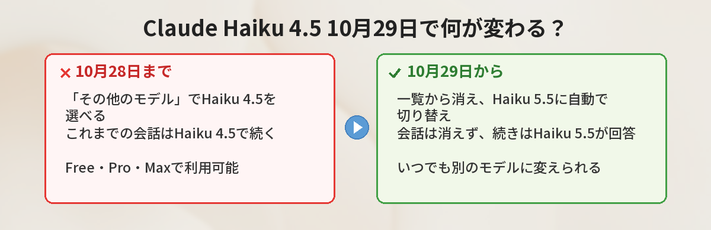
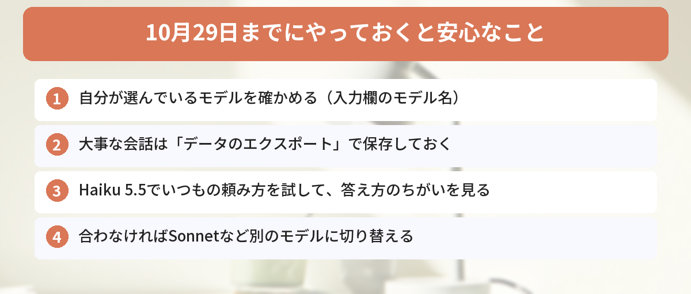

## この記事で分かること

Claudeで軽くて速いHaiku 4.5を使ってたんだけど、「10月29日でなくなる」って見たの…。今までの会話も消えちゃうの？


会話は消えないから安心して。10月29日からは、モデルの一覧からHaiku 4.5がなくなって、新しいHaiku 5.5に切り替わるんだ。何が変わるか、順番に見ていこう。


こんなことで不安になっていませんか？

- 「Haiku 4.5がなくなる」と聞いて、これまでの会話が消えないか心配
- 使い慣れたモデルが変わると、答え方が変わってしまわないか気になる
- 自分が今どのモデルを使っているのか、そもそも分からない

結論から言うと、**これまでの会話は消えません**。2026年10月29日からHaiku 4.5がモデルの一覧から消え、選んでいた人は自動でHaiku 5.5に切り替わります。この記事では、Anthropicの公式ヘルプをもとに、変わることと、今のうちにやっておくと安心なことをまとめます。

## 何が変わる？公式発表のポイント

Anthropicは2026年10月15日、ヘルプセンターで次のように発表しました。

| 項目 | 内容 |
|------|------|
| いつ | 2026年10月29日 |
| 何が | Claude Haiku 4.5がモデルの一覧（モデルセレクター）から消える |
| 対象のプラン | Free・Pro・Max |
| 対象の場所 | 通常のチャット、Claude Cowork、Claude Design（デスクトップ版・スマホアプリを含む） |
| 代わり | Claude Haiku 5.5 |

10月28日までは、モデルの一覧の「その他のモデル（More models）」から、これまでどおりHaiku 4.5を選べます。10月29日からは一覧に表示されなくなり、Haiku 4.5を選んでいた人は、自動でHaiku 5.5に切り替わります。

### 影響を受けない使い方

公式ヘルプによると、次の使い方ではHaiku 4.5はそのまま使えます。

- Claude Code
- TeamプランやEnterpriseプラン
- 開発者向けのClaude Platform（API）

つまり今回の変更は、**個人向けのFree・Pro・Maxプランでチャットを使っている人**が対象です。


私は無料プランでチャットしてるだけだから、まさに対象なんだね。


そうだね。でも、やることは少ないよ。まず「自分が何のモデルを使っているか」を確かめるところから始めよう。


## これまでの会話はどうなる？

公式ヘルプでは、次のように説明されています。

- Haiku 4.5で話した会話はアカウントに残り、**何も削除されない**
- 10月29日以降にその会話の続きを書くと、**Haiku 5.5が答える**
- 会話の途中でも、いつでも別のモデルに切り替えられる。切り替えは、Claudeの次の返事から反映される

会話を手元にも残しておきたい人は、Claudeのデータのエクスポート機能を使えば、いつでも保存できます。

## Haiku 5.5はどんなモデル？

Claude Haiku 5.5は、2026年10月7日に登場した新しい小型モデルです。Anthropicのリリースノートでは、「これまでで最も安く、最も速く、最も高性能な小型モデル」と紹介されています。

Haikuは、Claudeのモデルの中で「速くて軽い」役割のシリーズです。じっくり考える難しい作業はOpusやSonnet、すぐに答えてほしい日常の質問はHaiku、という使い分けが基本になります。Claudeのモデルの全体像は、[Claudeの特徴と使い方](/posts/claude-what-is-it/)で解説しています。


新しいほうが性能がいいなら、変わってもいいことなのかな？


基本的にはそうだね。ただ、モデルが変わると答え方のクセが少し変わることはあるんだ。いつも使っている頼み方で一度試してみると安心だよ。


## 10月29日までにやっておくと安心なこと

### 1. 自分が使っているモデルを確かめる

メッセージの入力欄の近くに、今選んでいるモデルの名前が表示されています。ここに「Haiku 4.5」と出ていなければ、今回の変更で何かが変わることはほとんどありません。

### 2. 大事な会話を保存しておく

会話は消えませんが、仕事のメモや長いやりとりを手元に残しておきたいなら、設定からデータをエクスポートしておくと安心です。

### 3. Haiku 5.5でいつもの頼み方を試す

今のうちに、モデルの一覧からHaiku 5.5を選んで、いつもの頼み方で答えを比べてみましょう。「前より長い」「前より短い」など気になる点があれば、「3行で」「箇条書きで」のように条件を足すと調整できます。

### 4. 合わなければ別のモデルに切り替える

答えの深さが足りないと感じたら、SonnetやOpusに切り替える手もあります。9月に出た上位モデルについては、[Claude Opus 5.5が登場 何が変わったか試した](/posts/claude-opus-5-5-review/)でまとめています。

## 公式発表を読んで分かったこと

この記事を書くにあたって、筆者はAnthropicのヘルプ記事とリリースノートを読み比べました。気づいたことが2つあります。

### 「なくなる」のは一覧からだけ

一部のニュースの見出しは「Haiku 4.5が終了」と書いていますが、公式ヘルプのタイトルは「Haiku 4.5がモデルセレクターから外れる」です。Claude CodeやAPIでは使い続けられるので、「Haiku 4.5そのものが完全に終わる」わけではありません。

### 発表から切り替えまでは2週間

発表は10月15日、切り替えは10月29日で、間は2週間です。AIのモデルは、このくらいの短い期間で入れ替わることがあります。ChatGPTやGeminiでも、10月はモデルの入れ替えが続きました（[Gemini 4 Argonは無料版で使える？](/posts/gemini-4-argon-free-or-pro/)）。お知らせを見かけたら、「自分が使っているものか」をまず確かめるクセをつけておくと、あわてずに済みます。

## よくある質問（FAQ）

### Q: Haiku 4.5で話した会話は消えますか？
A: 消えません。10月29日以降も会話はアカウントに残り、続きを書くとHaiku 5.5が答えます。

### Q: 10月29日以降、Haiku 4.5は一切使えなくなりますか？
A: Free・Pro・Maxプランのチャット、Claude Cowork、Claude Designのモデル一覧からは消えます。Claude Code、Team・Enterpriseプラン、Claude Platform（API）では引き続き使えます。

### Q: 何か設定を変える必要はありますか？
A: 必要ありません。Haiku 4.5を選んでいた場合は、自動でHaiku 5.5に切り替わります。

### Q: Haiku 5.5の答えが合わないときは？
A: 会話の途中でも、モデルの一覧からSonnetなど別のモデルに切り替えられます。切り替えは次の返事から反映されます。

### Q: 会話を手元に残す方法はありますか？
A: Claudeのデータのエクスポート機能で、いつでも保存できます。


会話は消えないし、何もしなくても5.5に切り替わるんだね。念のため、今のうちに5.5も試してみる！


それがいちばんだね。大事な会話はエクスポートしておけば、もっと安心だよ。


## まとめ

- 2026年10月29日、Claude Haiku 4.5がFree・Pro・Maxプランのモデル一覧から消える
- 選んでいた人は自動でHaiku 5.5に切り替わる。設定の変更はいらない
- これまでの会話は消えない。続きはHaiku 5.5が答え、いつでも別のモデルに変えられる
- Claude Code、Team・Enterprise、APIではHaiku 4.5を引き続き使える
- 不安なら、今のうちにHaiku 5.5を試して、大事な会話はエクスポートしておく

確認日：2026年10月17日（出典：Claudeヘルプセンター「Claude Haiku 4.5 is leaving the model selector」、Claudeリリースノート 2026年10月7日）

---
### あわせて読みたい
- [【Claude】ChatGPTとの違いは？Claudeの特徴と使い方を解説](/posts/claude-what-is-it/)
- [【Claude】100ページのPDFを一瞬で要約する方法](/posts/claude-long-document/)
