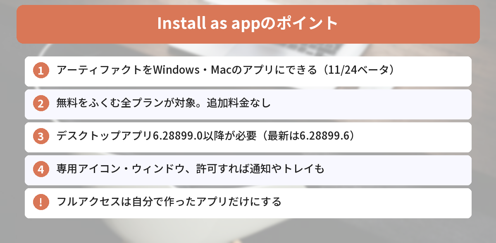
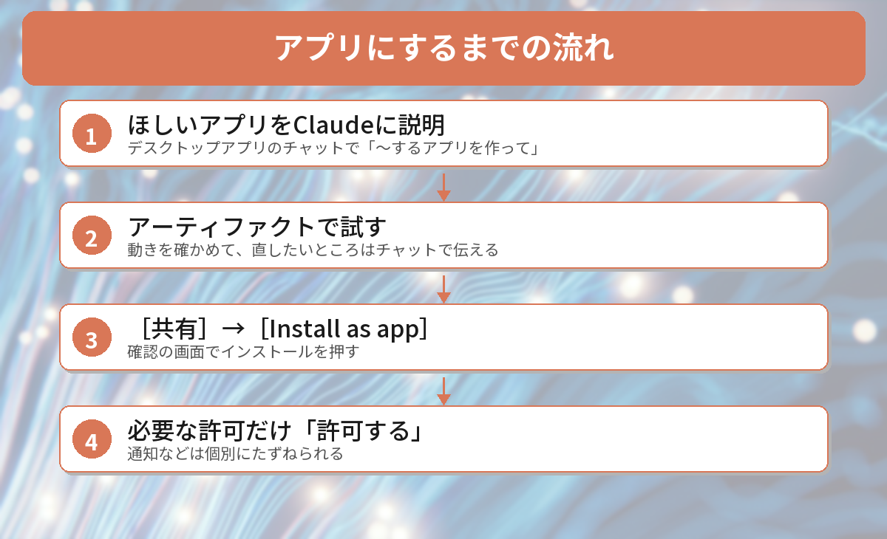

## この記事で分かること

Claudeに作ってもらったツールが、パソコンのアプリになるって聞いたの！プログラミングできなくても大丈夫？


大丈夫。11月24日に出た「Install as app」で、メニューから選ぶだけなんだ。ただ、アプリにあたえる「許可」には気をつけたいところがあるから、そこも説明するね。



こんな疑問はありませんか？
- アーティファクトをアプリにすると、何がうれしいの？
- 自分のプランで使える？
- 安全に使うにはどうすればいい？

この記事は、Claudeのヘルプ「[Install an artifact as an app](https://support.claude.com/en/articles/18516354-install-an-artifact-as-an-app)」、Claude公式の解説「[Turn artifacts into Mac and Windows apps](https://claude.com/resources/articles/install-as-app)」と、[ITmedia NEWSの記事](https://www.itmedia.co.jp/news/article/2611/25/2000003431/)をもとにまとめています（2026年11月26日に確認）。

## Install as appとは
| 項目 | 内容 |
|------|------|
| 発表 | 2026年11月24日（米国時間）、ベータ版 |
| 対象プラン | **無料をふくむ全プラン**（順番に提供） |
| 使えるところ | **Windows・Mac**のClaudeデスクトップアプリ（**6.28899.0以降**） |
| 使えないところ | ブラウザ版、スマホ、Linux |
| 追加料金 | なし。ただし作るときと使うときに**ふだんの利用量**を使う |

アーティファクトは、Claudeとのチャットの中で作る**グラフやWebページ、ちょっとしたツール**のことです。これまではClaudeの画面の中で開くものでしたが、インストールすると**ふつうのアプリと同じ**ように使えます。



### アプリにすると何が変わる？
- **専用のアイコンとウィンドウ**で開く（Claudeの画面を開かなくていい）
- 元のアーティファクトを直すと、**アプリも自動で新しくなる**
- 許可すれば、**通知**、**キーボードショートカット**、**ほかの窓の上に表示**、Windowsの**タスクトレイのアイコン**が使える
- Claudeや**コネクタ**（GmailやGoogleカレンダーなどとのつなぎこみ）も、アーティファクトと同じように使える
- **リンクを送ると、ほかの人もインストールできる**

Anthropicの社員が作った例として、画像エディタ、フォルダのファイルを整理するツール、パソコンの使用状況をタスクトレイに出すツールなどが紹介されています（公式の製品ではありません）。


「毎朝の予定をまとめるページ」を作って、アプリにしておくこともできるのかな。


できるよ。コネクタでカレンダーとつなげば、アイコンをクリックするだけで開けるようになる。アプリを開くときは、ネットにつながっていて、Claudeにサインインしている必要があるけどね。


## 手元のWindowsで確かめてみた
2026年11月26日に、このWindows 11のパソコンで、Claudeのデスクトップアプリの**配布ファイルのバージョン**を確かめました（このパソコンにはClaudeのデスクトップアプリは入っていません）。

```powershell
curl.exe -sI https://claude.ai/api/desktop/win32/x64/msix/latest/redirect
```

返ってきたダウンロード先は次の通りです。

```text
https://downloads.claude.ai/releases/win32/x64/6.28899.6/Claude-…msix
```

- いま配られている最新のWindows版は **6.28899.6**
- Install as appに必要な **6.28899.0以降** を満たしている
- これから入れる人は、最新版を入れればそのまま使える

すでに入れている人は、メニュー（☰）→［**Help**］→［**Check for Updates**］で更新できます（ヘルプに書かれている英語の表示名です）。

## 使い方


### ステップ1: ほしいアプリをClaudeに説明する
デスクトップアプリのチャットで「〜するアプリを作って」と頼みます。たとえば「25分ごとに休けいを知らせるタイマー」のように、何をしたいかを書けばOKです。

### ステップ2: アーティファクトで試す
できたアーティファクトを開いて、思った通りに動くか確かめます。直したいところは、チャットで伝えます。

### ステップ3: 「Install as app」を選ぶ
アーティファクトの［**共有**］メニューから［**Install as app**］を選び、確認の画面で［インストール］を押します。どの方法でも、インストールの前に必ず確認が出ます。

### ステップ4: 許可を選ぶ
アプリが通知などを使おうとすると、そのたびに「許可する」「許可しない」をたずねられます。必要なものだけ許可しましょう。

［Install as app］が見つからないときは、デスクトップアプリを更新してください。Team・Enterpriseプランでは、管理者が有効にしていない場合もあります。

## 許可は3段階 「フルアクセス」は慎重に
| 段階 | アプリができること |
|------|------|
| 何も許可しない | ブラウザでできることだけ |
| 個別に許可 | 通知、キーボードショートカット、ほかの窓の上に表示、タスクトレイのアイコン |
| **フルアクセス** | **確認なしにプログラムを動かす、ファイルを読む・変える・消す** |

- 許可は**そのバージョンだけ**に有効です。アプリが更新されると（自分で直したときも）、もう一度たずねられます
- ただし、アプリがほかのWebサイトから部品を読みこんでいる場合、その部分は**たずねられないまま変わる**ことがあります
- **フルアクセスをあたえられるのは、自分で作ったアプリ**か、Team・Enterpriseで同じ組織の人が作ったアプリだけです
- Anthropicは、**インストール前にアプリをチェックしていません**。作った人がわからないときは、警告が出ます


フルアクセスにすると、ファイルを消すこともできちゃうんだ…。


そう。だから人からもらったアプリは、通知くらいにしておこう。許可はあとから取り消すこともできるよ。


## いまはできないこと
- **Claude Docs・Slides・Sheets**のテンプレートから作ったアーティファクトや、古い形式のアーティファクトはインストールできない
- インターネットにつながっていないと開けない
- 米国の医療情報の法律（HIPAA）に対応した組織などでは使えない

ClaudeのSheetsやWhiteboardsについては、[ホワイトボードと表計算の記事](/posts/claude-meetings-whiteboards-sheets/)で紹介しています。




デスクトップアプリを最新にして、作ったツールを［共有］→［Install as app］。フルアクセスは自分のアプリだけ、だね！


その通り。まだベータ版だから、大事な仕事に使う前に少し試してみるといいよ。


## まとめ
- Anthropicは11月24日、アーティファクトをWindows・Macのアプリにできる「Install as app」をベータ公開
- 無料をふくむ全プランが対象。Claudeデスクトップアプリ6.28899.0以降が必要
- 11月26日時点のWindows版の配布ファイルは6.28899.6で、条件を満たしている
- 専用のアイコンとウィンドウで開き、許可すれば通知やタスクトレイも使える
- フルアクセスは、自分で作ったアプリだけにする。Anthropicは事前にアプリをチェックしていない

---
### あわせて読みたい
- [【Claude】ホワイトボードと表計算が使える！「Whiteboards」「Sheets」は有料プランで・会議に入るMeetingsも](/posts/claude-meetings-whiteboards-sheets/)
- [【Claude】ChatGPTとの違いは？Claudeの特徴と使い方を解説](/posts/claude-what-is-it/)
