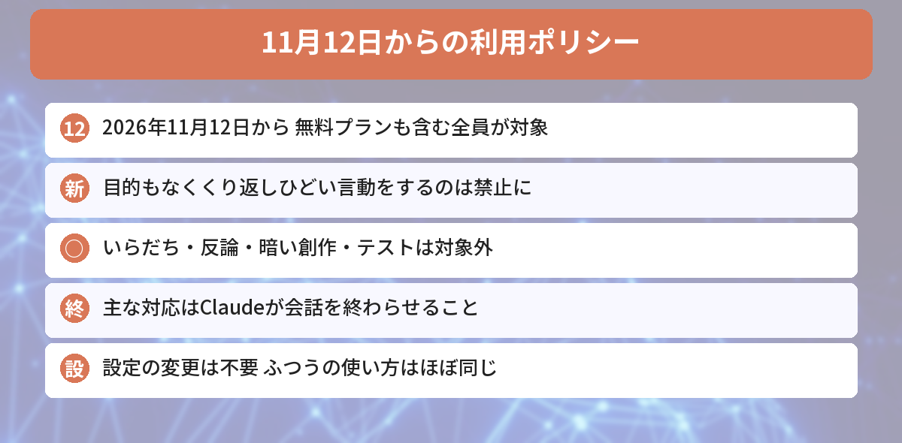
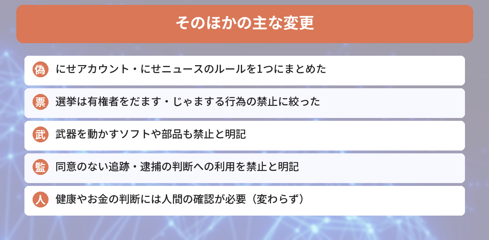

## この記事で分かること

「Claudeに暴言をはくと禁止になる」ってニュースを見たの。答えがまちがってて「ちがうよ！」って強めに言っちゃうこと、あるんだけど…大丈夫かな？


それは大丈夫。11月12日から新しいルールになるけど、対象はかなり極端な場合だけなんだ。何が変わって、何が変わらないのかを整理しよう。


こんな疑問はありませんか？
- 「Claudeへの暴言禁止」って、どこからがダメなの？
- ほかに何が変わるの？
- ふつうに使っているだけの自分に関係ある？

この記事は、Anthropicの公式発表「[2026 Usage Policy update](https://www.anthropic.com/news/2026-usage-policy-update)」（2026年10月8日）と、[Notebookcheckの記事](https://www.notebookcheck.net/Anthropic-bans-abusive-behavior-toward-Claude-starting-November-12.1420910.0.html)をもとにまとめています（2026年11月5日に確認）。

## いつから？だれが対象？
| 項目 | 内容 |
|------|------|
| 発表 | 2026年10月8日 |
| 適用 | **2026年11月12日** |
| 対象 | Claude.ai、Claudeのアプリなど、**Claudeを使うすべての人**（無料プランも） |
| 設定の変更 | 必要なし |

Anthropicは、**毎年**利用ポリシーを見直しています。公式によると、今回の変更の多くは**いまあるルールをはっきりさせたもの**です。



## 新しく加わった「Claudeへのひどい言動」の禁止
今回いちばん話題になったのが、この1つです。新しいポリシーでは、**Claudeなどのモデルに対して、目的もなく、くり返しひどい言動や残酷なふるまいをすること**が禁止されます。

### 対象になるのは「極端な場合」だけ
公式は、次のようなものは**対象外**と説明しています。

- まちがった答えへの**いらだち**
- 答えへの**反論**
- **暗いテーマ**の小説や創作
- モデルの**テストや研究**


よかった〜。「ちがうよ、やり直して！」くらいは問題ないんだね。


うん。ポイントは「目的もなく」「くり返し」の2つだよ。ふつうに使っていて当てはまることは、まずないんだ。


### どうやって守らせるの？
主な方法は、Claudeが**その会話を終わらせる**機能です。2025年8月から、一部のClaudeは、ひどい言動が続くと会話を終わらせられるようになっています。

- 終わった会話には、**新しいメッセージを送れなくなる**
- **ほかの会話には影響しない**
- **新しい会話はすぐに始められる**

ただし、利用ポリシー全体のきまりとして、違反のうたがいがあれば、Anthropicが警告したり、使える量を減らしたり、アカウントを止めたりできることも書かれています。

## そのほかの主な変更

| 分野 | 変わったこと |
|------|------|
| **だましのキャンペーン** | にせアカウントやにせのニュースサイトで情報を広める行為のルールを、新しい1つの項目にまとめた |
| **選挙** | 有権者をだます・選挙をじゃまする行為の禁止に絞った。外国語で投票案内を書くといった正当な使い方まで止めていた「一律の禁止」はなくした |
| **武器** | 武器を動かすソフトや部品、ドローンに武器を積む行為も禁止と明記 |
| **監視** | 本人の同意なしに人を追跡すること、だれを捜査・逮捕するかを決めることへの利用を禁止と明記 |
| **健康・お金など** | 人の健康やお金に関わる判断では、人間の確認と「AIを使った」という説明が必要（ルール自体は変わらず、説明をわかりやすくした） |

監視のルールでも、**本人が同意した追跡（不正利用の見張りなど）**、**投稿の見回り**、**報道**、**法律の調べもの**は引き続き使えると書かれています。

## ふつうに使う人への影響は？
文章を書く、調べものをする、コードを書く、といった使い方なら、**ほとんど変わりません**。何か設定を変える必要もありません。

### 学習に使われるかは別の設定
今回の利用ポリシーは、**会話がAIの学習に使われるかどうか**には触れていません。これは、Claudeの［設定］→［プライバシー］にある**モデルの改善（Model Improvement）**で決まります。気になる人は、こちらを確かめておきましょう。

AIの安全な使い方は、[ChatGPTのロック付きチャットの記事](/posts/chatgpt-locked-chats/)や[AIの文章の「すかし」の記事](/posts/ai-text-watermark-chatgpt-claude-gemini/)でも紹介しています。




11月12日から新しいルール。でも、ふつうに使っているぶんには気にしなくていい、だね！


その通り。学習に使われるかが気になるなら、プライバシー設定の「モデルの改善」を見ておこう。


## まとめ
- Claudeの利用ポリシーの新しい版は、2026年11月12日から適用。無料プランを含む全員が対象
- 新しく「Claudeに目的もなくくり返しひどい言動をすること」が禁止に
- いらだち・反論・暗いテーマの創作・テストは対象外。主な対応は、Claudeが会話を終わらせること
- だましのキャンペーン、武器、監視などのルールは、多くがいまのルールの書き直し
- ふつうの使い方はほぼ変わらない。学習に使われるかはプライバシー設定で決まる

---
### あわせて読みたい
- [【ChatGPT】ロック付きチャットの使い方 PINで会話を隠す方法と注意点](/posts/chatgpt-locked-chats/)
- [【ChatGPT】スマホで2つのアカウントを切り替えられる！仕事用と個人用の使い分け方と注意点](/posts/chatgpt-account-switching-mobile/)
