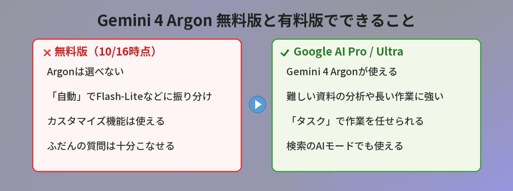
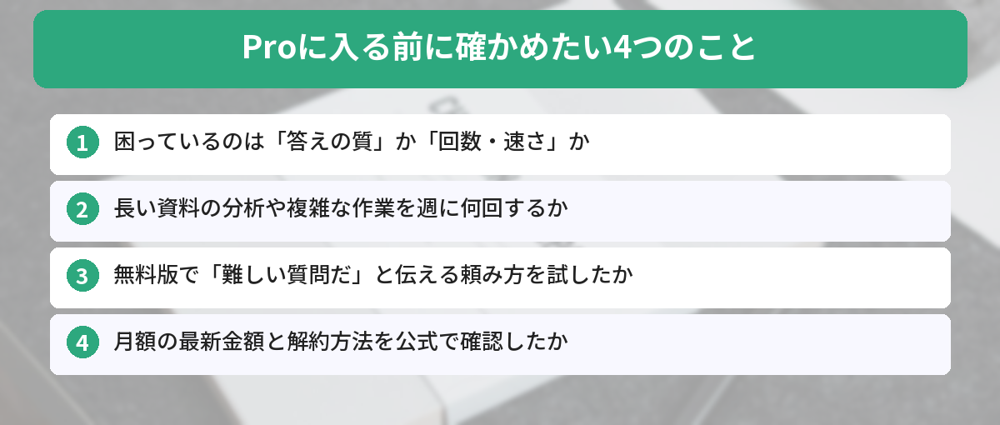

## この記事で分かること

「Gemini 4 Argon」っていう新しいのが出たってニュースで見たの。私の無料のGeminiも、もう賢くなってるの？


残念だけど、今のところArgonが使えるのは有料プランの人だけなんだ。でも、無料版でも変わったところはあるし、有料にすべきかどうかの見分け方もあるよ。順番に説明するね。


こんなことで迷っていませんか？

- 「Gemini 4 Argon」がすごいと聞いたけど、自分のGeminiで使えるのか分からない
- 無料版のままでいいのか、お金を払ってProに入るべきなのか決められない
- そもそも、今までのGeminiと何がちがうのか分からない

結論から言うと、**Gemini 4 ArgonはGoogle AI Pro・Ultraの加入者向けで、無料版では使えません**（この記事を書いた2026年10月16日時点）。そして、ふだんの調べものや文章づくりが中心なら、急いでProに入る必要はありません。この記事では、Googleの公式発表をもとに、Argonで変わったことと、Proに入るべき人の見分け方をまとめます。

## Gemini 4 Argonとは？いつから使える？

Gemini 4 Argonは、Googleが作った新しい最上位のAIモデルです。「Gemini 4」世代の最初のモデルで、複雑な作業を最初から最後まで進める力に重点が置かれています。

### 提供までの流れ

| 日付 | 出来事 |
|------|------|
| 2026年9月30日 | Googleが発表。最初はサイバーセキュリティの防御側の一部の組織だけに提供 |
| 2026年10月13日 | 一般提供を開始。GeminiアプリではGoogle AI Pro・Ultraの加入者が使えるように |
| 2026年10月14日 | Googleの日本語ブログでも「GeminiアプリにGemini 4 Argonが登場」と案内 |

Geminiアプリのリリースノート（10月13日）では、Google AI ProとGoogle AI Ultraの定期購入者を対象に、Gemini 4 Argonを全世界で展開すると書かれています。開発者向けには、Gemini APIの有料枠でも使えます。


世界中で使えるってことは、日本でも使えるんだよね？


うん、日本のProやUltraの加入者も対象だよ。ただし「無料のアカウント」は今のところ対象外なんだ。


## Argonで何が変わったのか

Googleの公式ブログでは、Argonの特徴を次のように紹介しています。

### 1. 回答がまっすぐになった

Argonは、あいまいな言い方を減らして質問に直接答え、不必要なくり返しや、決まり文句のような表現を避けるように作られています。「前置きが長くて、結局どっちなの？」と感じていた人には、うれしい変化です。

### 2. 長い作業の途中経過を教えてくれる

時間がかかる作業では、進み具合をこまめに伝えてくれるようになりました。待っている間に「今どこまで進んだのか分からない」という不安が減ります。

### 3. 複雑な仕事に強い

リリースノートでは、複雑な財務レポートの分析、あちこちにある情報からのプレゼン資料づくり、動く3Dモデルの作成などが例に挙がっています。プログラミングの力も大きく上がったと説明されています。

### 4. 「タスク」で作業を任せられる

チャット画面で「チャット」から「タスク」に切り替えると、パソコンの前にいない間もGeminiが作業を進めてくれます。ProとUltraの加入者は、Argonと合わせてこの機能も使えます。

## 無料版のGeminiは今どうなっている？

無料版では、Argonは選べません。無料版は10月9日から、質問ごとに「自動」でモデルが振り分けられる仕組みに変わっています。ほとんどの質問は速さ重視の「Flash-Lite」で答え、深く考える必要がある質問は「Flash」や「Pro」に回ることがある、という形です。

この仕組みと、無料のまま上手に頼むコツは、[Gemini無料版が急にバカになった？「自動」モードの正体と対処法](/posts/gemini-free-auto-mode/)でくわしく解説しています。

### 無料版でも使える新しいこと

10月13日のアップデートには、無料版も含めたすべての人が対象のものもあります。

- **カスタマイズ**：左側のメニューの［カスタマイズ］から、Geminiの答え方や、よく使うツールとの連携を1か所で設定できる
- **スキル**：よく使う指示を保存して、くり返し使える。11月にはGemからスキルへの自動移行がある（[Gemが11月にスキルへ移行！放置でいい人・今移すべき人](/posts/gemini-gem-to-skills-migration/)）


じゃあ無料のままでも、答え方を自分好みにするのはできるんだね。


そういうこと。「回答を短く」「箇条書きで」みたいな好みを先に設定しておくと、毎回言わなくて済むよ。


## 公式発表を読み比べて分かったこと

この記事を書くにあたって、筆者はGoogleの英語ブログ、日本語ブログ、Geminiアプリのリリースノートを読み比べました。気づいたことが2つあります。

### 「すべての人が使える」という見出しに注意

一部の地域のGoogleブログには「Gemini 4 Argonがすべての人に」という見出しがあります。ただ、本文を読むと「すべての人」は**開発者や企業がAPIで使えること**を指していて、Geminiアプリで使えるのはProとUltraの加入者です。見出しだけ読むと「無料でも使える」と勘ちがいしやすいので、気をつけてください。

### 日本語ニュースの金額はバラバラ

日本語の解説記事では、Google AI Proの月額を「2,900円」と書いたものと、ドル建てを換算して「約3,200円」と書いたものがありました。実際にいくらかかるかは、加入する前にGoogle Oneのプランページで最新の金額を確かめるのが確実です。

## Proに入るべき人・無料のままでいい人

### Proを考えてもいい人

- 長いPDFや表を分析させることが、週に何回もある
- 資料づくりや調べものなど、何段階もある作業をAIに任せたい
- 無料版で頼み方を工夫しても、答えの深さが足りないと感じる
- Gmailやドキュメントなど、Googleのサービスと合わせて仕事で使いたい

### 無料のままでいい人

- 調べものや、短い文章の下書きが中心
- 1日に数回、気軽に質問するくらい
- 頼み方を工夫すれば、今の答えで困っていない


私は旅行の計画とか、メールの下書きくらいかなぁ…。


それなら、まずは無料のままで十分だと思うよ。困ったときに「これは難しい質問だから、じっくり考えて」と書き添えるだけでも、答えが変わることがあるんだ。


### 有料プランを比べたいときは

ChatGPTやClaudeの有料プランと迷っている人は、[ChatGPTとGemini、結局どっちがいい？](/posts/gemini-vs-chatgpt/)も参考にしてください。9月に出たClaudeの新モデルについては、[Claude Opus 5.5が登場 何が変わったか試した](/posts/claude-opus-5-5-review/)でまとめています。

## よくある質問（FAQ）

### Q: 無料版のGeminiでGemini 4 Argonは使えますか？
A: 2026年10月16日時点では使えません。GeminiアプリでArgonが使えるのは、Google AI ProとGoogle AI Ultraの加入者です。

### Q: Argonはいつから使えるようになりましたか？
A: Geminiアプリでは2026年10月13日から、ProとUltraの加入者向けに順次展開されています。

### Q: 無料版が今後Argonに対応する予定はありますか？
A: 10月16日時点の公式発表では、無料版での提供時期は案内されていません。

### Q: Argonと、今までのProモデルは何がちがいますか？
A: Googleによると、Argonは質問により直接答え、長い作業の進み具合をこまめに伝え、複雑な作業やプログラミングに強くなっています。

### Q: Proに入ったら、すぐ解約できますか？
A: Googleの有料プランはGoogle Oneで管理します。料金や解約の方法は、加入前にGoogle Oneのプランページで確認してください。


Argonは有料の人向けで、無料の私はまず頼み方とカスタマイズを工夫すればいいんだね！


その通り！長い資料の分析や複雑な作業が増えてきたら、そのときにProを考えれば大丈夫。金額は加入前に公式で確かめてね。


## まとめ

- Gemini 4 Argonは、Googleの新しい最上位モデル。2026年10月13日からGeminiアプリで提供開始
- 使えるのはGoogle AI ProとGoogle AI Ultraの加入者。無料版は対象外（10月16日時点）
- 回答がまっすぐになり、長い作業の進み具合を伝え、複雑な作業やプログラミングに強い
- 無料版でも、カスタマイズやスキルは使える。頼み方の工夫で答えは変わる
- Proは「長い資料の分析や複雑な作業をよくする人」向け。金額は加入前に公式で確認

確認日：2026年10月16日（出典：Google公式ブログ「Gemini 4 Argon が Gemini アプリに登場」2026年10月14日、Geminiアプリ リリースノート 2026年10月13日）

---
### あわせて読みたい
- [【Gemini】無料版が急にバカになった？「自動」モードの正体と対処法](/posts/gemini-free-auto-mode/)
- [【Gemini】Gemが11月にスキルへ移行！放置でいい人・今移すべき人](/posts/gemini-gem-to-skills-migration/)

<!-- affiliate -->
## 関連リソース
Geminiのプランや機能のちがいを、本でまとめて確認したい方向けに、評価の高い1冊を選びました。
**Gemini完全マニュアル［第2版］**（秀和システム新社） 
プランやモデルの違い、各機能の使い方を初心者向けに解説した入門書の改訂版です。
- <a href="https://af.moshimo.com/af/c/click?a_id=5490814&amp;p_id=54&amp;pc_id=54&amp;pl_id=27059&amp;url=https%3A%2F%2Fitem.rakuten.co.jp%2Fbook%2F18638668%2F" rel="nofollow sponsored noopener" referrerpolicy="no-referrer-when-downgrade" target="_blank">Gemini完全マニュアル［第2版］（楽天市場）</a>
- <a href="https://af.moshimo.com/af/c/click?a_id=5490817&amp;p_id=170&amp;pc_id=185&amp;pl_id=27060&amp;url=https%3A%2F%2Fwww.amazon.co.jp%2Fdp%2F4798076767" rel="nofollow sponsored noopener" referrerpolicy="no-referrer-when-downgrade" target="_blank">Gemini完全マニュアル［第2版］（Amazon）</a>
<!-- /affiliate -->
