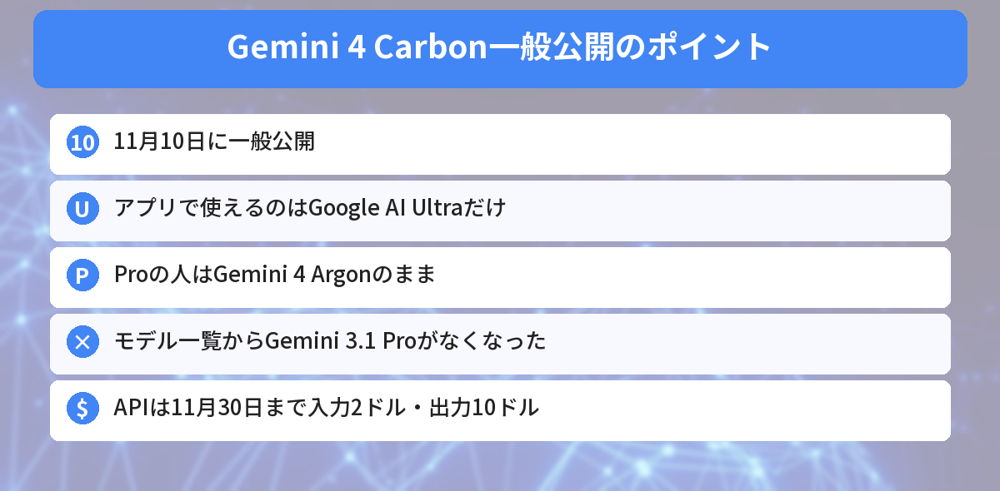

## この記事で分かること

前に「Carbonはまだ使えない」って教えてもらったけど、ついに使えるようになったって聞いたの。わたしのGeminiでも使える？


11月10日に一般公開されたよ。ただ、Geminiアプリで使えるのはいちばん上のUltraプランだけなんだ。Proの人はArgonのまま。だれが何を使えるのか、整理して説明するね。


こんな疑問はありませんか？
- だれがCarbonを使えるの？
- ArgonとCarbon、どちらを選べばいい？
- Gemini 3.1 Proはどうなったの？

この記事は、Googleの公式ブログ「[Gemini 4 Carbon is now available](https://blog.google/innovation-and-ai/models-and-research/gemini-models/gemini-4-carbon-now-available/)」と[9to5Googleの記事](https://9to5google.com/2026/11/10/gemini-app-4-carbon/)（2026年11月10日）をもとにまとめています（2026年11月12日に確認）。筆者はUltraプランに入っていないため、実際の画面では確かめられていません。

10月に書いた[Gemini 4 Carbonはいつ使える？の記事](/posts/gemini-4-carbon-when-available/)の続きです。

## だれが使えるようになったの？
| 使う人 | 使える場所 |
|------|------|
| **Google AI Ultra** | Geminiアプリ、検索のAIモード、Antigravity |
| Google AI Pro | **Carbonは使えない**（Gemini 4 Argonを使う） |
| 無料プラン | 使えない |
| 開発者（有料API） | Google AI Studio、Android Studio |
| 会社（Gemini for business） | APIやモデルの一覧から |

検索の**AIモード**では、18歳以上・対応する国の**個人アカウント**で使え、**1日の回数に上限**があります。



## ArgonとCarbonの使い分け
Geminiアプリのモデル一覧では、次のように表示されます。

| モデル | 一覧の説明 | 向いていること |
|------|------|------|
| **Gemini 4 Argon** | コードと分析 | ふだんのプログラミングや仕事の**ほとんど** |
| **Gemini 4 Carbon** | いちばん複雑な作業 | 何段階もあるむずかしいコードの直し、答えのない研究 |

Googleは、**ほとんどの仕事はArgonで十分**としています。Carbonは「モデルの頭の良さの限界を試すような作業」のためのモデルです。


じゃあ、Proのわたしは、Argonで困ってないならそのままでいいんだね。


そういうこと。Carbonのために、わざわざUltraに上げる必要はないよ。Argonでうまくいかない、とてもむずかしい作業がある人だけ考えればいいんだ。


## Gemini 3.1 Proは一覧からなくなった
今回の公開にあわせて、Geminiアプリのモデル一覧から**Gemini 3.1 Pro**がなくなったと報じられています。3.1 Proをえらんで使っていた人は、**Argon**などに切りかわります。

あわせて、Google AI Plusの人は**11月13日から**、GeminiアプリとAIモードで**Proのモデルを選べなくなる**とGoogleが案内しています。

## Carbonで強くなったこと
発表では、次のような点が紹介されています。

- 何人ものAIが手分けする**大きなプログラミング作業**（引っ越しや、原因さがし、設計の見直し）
- Webアプリを**作って、動かして、まちがいを直す**のをくり返す
- グラフ・図・表が入った**むずかしい資料を読む**作業。新しい評価「MKA」で1位
- **表・スライド・報告書**を、決められた形式どおりに作る

開発ツールのAntigravityでは、1つの指示を**複数のAIのチーム**に分けて進める「/swarm」も試験公開されています。

## 開発者向けの料金
| 期間 | 入力（100万トークンあたり） | 出力（100万トークンあたり） |
|------|------|------|
| 11月30日まで | 2ドル | 10ドル |
| 12月1日から | 4ドル | 20ドル |

Geminiのプランや料金の考え方は、[Gemini 4 Argonは無料版で使える？の記事](/posts/gemini-4-argon-free-or-pro/)でも紹介しています。




CarbonはUltraだけ。Proの人はArgonでOK。3.1 Proは一覧からなくなった、だね！


その通り。Plusの人は11月13日からProのモデルが選べなくなるから、そこも覚えておいてね。


## まとめ
- Googleは11月10日、Gemini 4 Carbonを一般公開した
- Geminiアプリ・AIモード・Antigravityで使えるのはGoogle AI Ultraだけ。Proの人はArgonのまま
- Googleは、ふだんの仕事の多くはArgonで十分、Carbonはとくにむずかしい作業向けとしている
- Geminiアプリのモデル一覧から、Gemini 3.1 Proがなくなった
- 開発者向けAPIは、11月30日まで入力2ドル・出力10ドルの特別価格

---
### あわせて読みたい
- [【Gemini 4 Carbon】Googleの新しい最強モデル いつ使える？Argonとのちがい](/posts/gemini-4-carbon-when-available/)
- [【Gemini】「メモリーの概要」で覚えられていることを見て消せる 日本ではいつ？今できる確認方法](/posts/gemini-memory-summary/)
