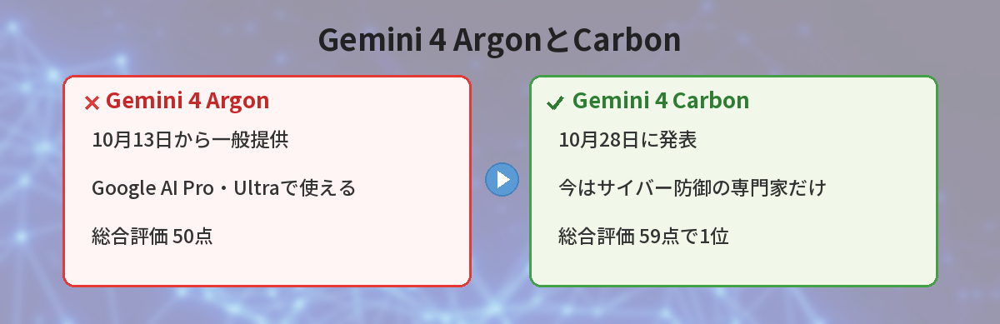
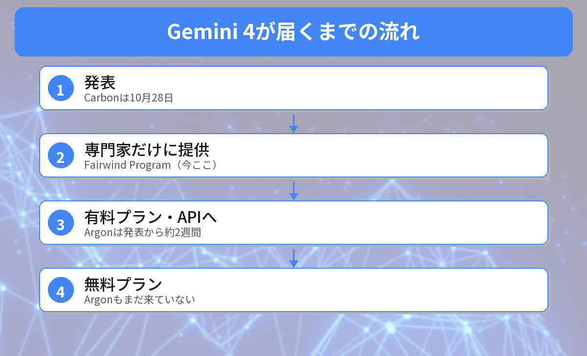

## この記事で分かること

「Geminiの新しいモデルが世界1位」ってニュースを見たの。この前Argonが出たばかりなのに、もう次？私のGeminiでも使える？


10月28日に発表された「Gemini 4 Carbon」だね。性能はたしかに今いちばん高いんだけど、今使えるのはセキュリティの専門家だけなんだ。何がすごいのか、いつ使えそうかを整理するね。


こんな疑問はありませんか？
- Carbonって何がすごいの？
- Argonとどうちがうの？
- 自分のGeminiアプリで、いつ使えるの？

この記事は、Googleのスンダー・ピチャイCEOの発表と、OfficeChai・Fello AIなどの報道をもとにまとめています（2026年10月29日に確認）。

## Gemini 4 Carbonとは？
Gemini 4 Carbonは、Googleが2026年10月28日に発表した、**Gemini 4シリーズの2つ目のモデル**です。1つ目のGemini 4 Argonから、わずか2週間ほどで出てきました。

Googleは、Carbonを**長い時間がかかる作業**や、**サイバーセキュリティの守り**、**むずかしいプログラミング**に強いモデルと説明しています。



## どれくらい賢いの？
### 第三者の総合評価で1位
AIの性能をくらべる第三者の評価「Artificial Analysis Intelligence Index v5.0」の点数です。

| モデル | 会社 | 点数 |
|------|------|------|
| **Gemini 4 Carbon** | Google | **59** |
| Claude Opus 5.5 | Anthropic | 58 |
| GPT-6 Astra | OpenAI | 57 |
| Gemini 4 Argon | Google | 50 |

### とくに強いところ
- **セキュリティ**：プログラムの弱点を見つけるテストで88.2%、直すテストで71.0%
- **長い文章を読む力**：25万〜100万トークンの長い資料のテストで96.2%（Argonは84.2%）
- **仕事のような作業**：実際の業務を自動化するテストで、ほかのモデルより高い点

一方で、パソコン操作のテストではClaude Opus 5.5、一部のプログラミングのテストではGPT-6 Astraのほうが上でした。**何でも1位というわけではありません**。


2週間でこんなに点が上がるんだ…！


AI会社どうしで、すごい速さで新しいモデルを出し合っているんだ。ただ、点数が高いことと、自分が今使えることは別の話だよ。


## いつ使えるの？

### 今は専門家だけ
Carbonを今使えるのは、Googleの「**Fairwind Program**」に参加する、**サイバー防御の専門家**だけです。弱点を見つける力が強いので、まず守る側に使ってもらい、安全対策を確かめてから広げる方針です。

### 一般向けの日付は未定
開発者、企業、一般の利用者へは順番に広げるとされていますが、**日付は発表されていません**。

### 参考：Argonのときの流れ
Argonは、次の順番で広がりました。

| 日付 | できごと |
|------|------|
| 9月30日 | 発表。最初はFairwind Programの専門家だけ |
| 10月13日 | Google AI Pro・Ultra、有料のAPIで使えるように |

Argonは発表から約2週間で有料プランに来ました。Carbonが同じペースになるかは分かりません。

## 今の私たちが使えるのは？
2026年10月29日時点で、Geminiアプリで使える**いちばん新しいGemini 4モデルはArgon**です。

- **Google AI Pro・Ultra**：Gemini 4 Argonが使える
- **無料プラン・Google AI Plus**：Argonは使えない。無料プランは「自動」モードで、主にFlash-Liteなどが使われる

Argonについては[Gemini 4 Argonの記事](/posts/gemini-4-argon-free-or-pro/)、無料プランの「自動」モードについては[無料版の自動モードの記事](/posts/gemini-free-auto-mode/)でくわしく解説しています。




Carbonは今いちばん賢いけど、使えるのはまだ専門家だけ。私が今使えるのはArgonまで、なんだね。


その通り。一般向けに来たら、またすぐ紹介するよ。それまでは、今のプランで使えるモデルを使いこなすのがおすすめだね。


## まとめ
- Googleは2026年10月28日、Gemini 4シリーズの2つ目「Gemini 4 Carbon」を発表
- 第三者の総合評価で59点の1位（Claude Opus 5.5は58、GPT-6 Astraは57）
- セキュリティと長い資料を読む力がとくに強い
- 今使えるのはFairwind Programのサイバー防御の専門家だけ。一般向けの日付は未定
- 今Geminiアプリで使える最新のGemini 4はArgon（Google AI Pro・Ultra）

---
### あわせて読みたい
- [【Gemini】Gemini 4 Argonが登場！無料版で使える？Proに入るべき人](/posts/gemini-4-argon-free-or-pro/)
- [【Gemini】無料版が急にバカになった？「自動」モードの正体と対処法](/posts/gemini-free-auto-mode/)
