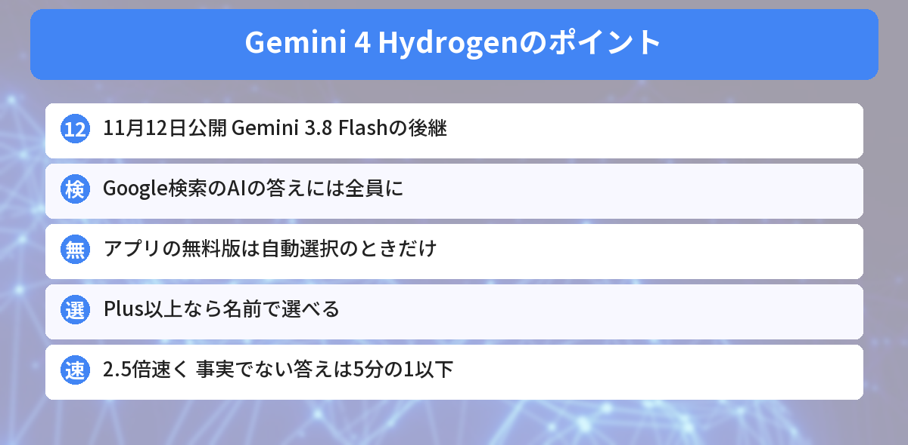
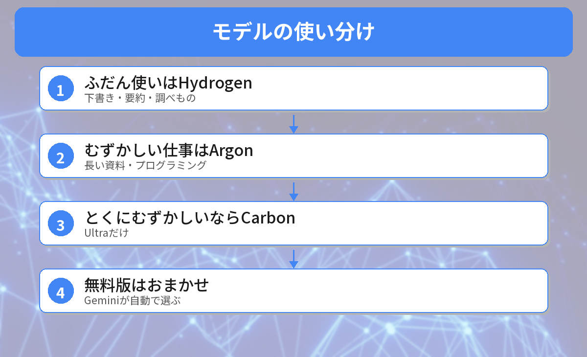

## この記事で分かること

ArgonにCarbonに、今度は「Hydrogen」…。Geminiの名前が多すぎて、もう分からないよ〜。


Hydrogenは、前の「Flash」にあたる速いモデルなんだ。しかも検索では全員に使われはじめていて、ふだんいちばん出会うモデルになりそう。プランごとに整理するね。


こんな疑問はありませんか？
- Hydrogenって何？
- 無料版でも使える？
- Argon・Carbonとどう使い分ける？

この記事は、Googleの公式ブログ「[Introducing Gemini 4 Hydrogen](https://blog.google/intl/en-in/products/introducing-gemini-4-hydrogen/)」と、[Justin McKelvey氏のまとめ](https://justinmckelvey.com/blog/gemini-4-hydrogen)（2026年11月13日）などをもとにまとめています（2026年11月16日に確認）。筆者は日本のアカウントの画面ではまだ確かめられていないため、表示の名前は発表と報道をもとにしています。

## Gemini 4シリーズの3つのモデル
| モデル | 向いていること | 公開 |
|------|------|------|
| **Gemini 4 Hydrogen** | ふだん使い（文章・要約・資料のくらべっこ） | 11月12日 |
| Gemini 4 Argon | 長くてむずかしい仕事・プログラミング | 10月13日 |
| Gemini 4 Carbon | とくにむずかしい作業 | 11月10日 |

Hydrogenは**Gemini 3.8 Flashの後継**で、名前に「Flash」がつかなくなった初めてのモデルです。



## プランごとの使え方
| 場所・プラン | Hydrogenの使え方 |
|------|------|
| **Google検索のAIの答え** | **全員**（全世界に順番に） |
| Geminiアプリ 無料版 | **自分では選べない**。自動選択のときに使われることがある |
| Google AI Plus | モデルの一覧から**名前で選べる** |
| Google AI Pro | 名前で選べる。**スプレッドシート**やAntigravityでも |
| Google AI Ultra | 名前で選べる。いちばん多く使える |
| 開発者（API） | 無料の枠あり。有料は入力1.5ドル・出力7.5ドル（100万トークンあたり） |


無料版は「選べない」けど、自動で使われることはあるんだね。


そう。それに、検索の答えには全員に使われるから、知らないうちにHydrogenの答えを読んでいることもあるよ。


## よくなったこと（Googleの発表）
- 作業を終えるのが、3.8 Flashの**2.5倍速い**
- **事実でないことを言う割合**が、**5分の1以下**に
- 第三者の評価で、標準の設定で51点（Argonは50点）
- 一度に**100万トークン**（数百ページ分）まで読める
- アップロードしたファイルや、Gmail・Googleドライブから情報を集めるのが上手に
- 「短く」「専門用語なし」といった**書き方のルールを守りやすく**

### 考える深さを4段階で選べる
Hydrogenには、考える深さの設定が**4段階**あります。いちばん深い設定にすると点数は上がりますが、**答えが出るまで時間がかかり**、使うトークンも増えるという指摘があります。

## どう使い分ける？

- **メールの下書き・要約・調べもの**：Hydrogen（速い）
- **長い資料の分析・ふつうのプログラミング**：Argon
- **ほかでうまくいかない、とてもむずかしい作業**：Carbon（Ultraだけ）

無料版の人は、特に何もしなくて大丈夫です。Geminiが内容に合わせて選んでくれます。

Carbonについては[Gemini 4 Carbon一般公開の記事](/posts/gemini-4-carbon-ultra-available/)でくわしく紹介しています。




ふだん使いはHydrogen。無料版は自動で、Plus以上なら自分で選べる、だね！


その通り。答えが速くなって、まちがいも減ったから、まずはふつうに使ってみよう。


## まとめ
- Googleは11月12日、速くて安い「Gemini 4 Hydrogen」を公開。Gemini 3.8 Flashの後継
- Google検索のAIの答えには、全員に使われはじめている
- Geminiアプリの無料版は自動選択のときだけ。Plus以上なら名前で選べる
- 3.8 Flashより2.5倍速く、事実でないことを言う割合は5分の1以下に
- ふだん使いはHydrogen、むずかしい作業はArgonやCarbon

---
### あわせて読みたい
- [【Gemini 4 Carbon】ついに一般公開！使えるのはUltraだけ ProはArgonのまま・3.1 Proは選べなくなった](/posts/gemini-4-carbon-ultra-available/)
- [【Gemini】Gemini 4 Argonが登場！無料版で使える？Proに入るべき人](/posts/gemini-4-argon-free-or-pro/)
