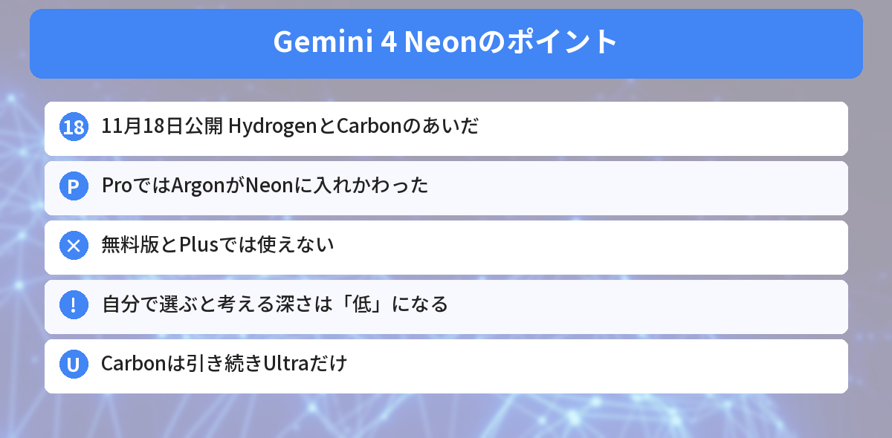
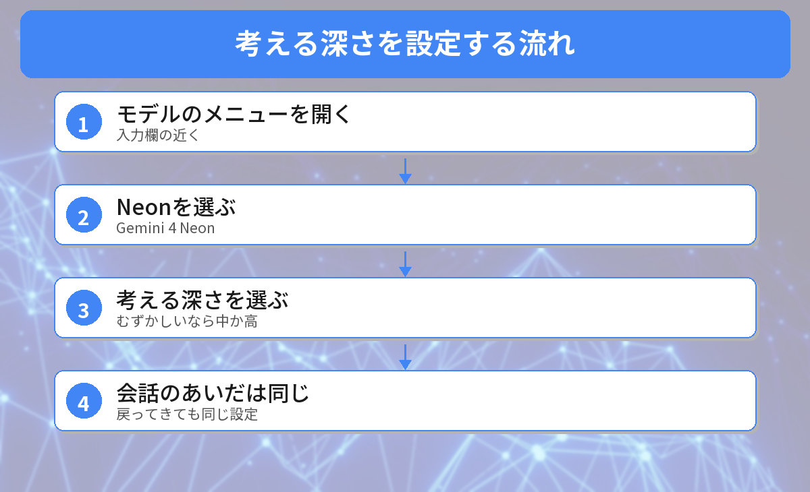

## この記事で分かること

GeminiのProを使ってるんだけど、いつも選んでたArgonが消えて「Neon」っていうのになってたの！何が起きたの？


11月18日に、ArgonがNeonに入れかわったんだ。しかも、自分でモデルを選ぶと「考える深さ」が低になる落とし穴があるよ。そこも一緒に説明するね。


こんな疑問はありませんか？
- Neonって何？Argonはどこに行ったの？
- 自分のプランで使える？
- どう設定すればいいの？

この記事は、Googleの公式ブログ「[Introducing Gemini 4 Neon](https://blog.google/innovation-and-ai/models-and-research/gemini-models/introducing-gemini-4-neon/)」と、[Notebookcheckの記事](https://www.notebookcheck.net/Gemini-4-Neon-replaces-Argon-for-Google-AI-Pro-subscribers.1454281.0.html)をもとにまとめています（2026年11月25日に確認）。筆者は日本のProアカウントの画面ではまだ確かめられていないため、画面の名前は発表と報道をもとにしています。

## Gemini 4シリーズの4つのモデル
| モデル | 向いていること | 公開 |
|------|------|------|
| Gemini 4 Hydrogen | ふだん使い（速い） | 11月12日 |
| **Gemini 4 Neon** | **むずかしい仕事・プログラミング** | **11月18日** |
| Gemini 4 Carbon | とくにむずかしい作業 | 11月10日 |
| Gemini 4 Argon | （アプリからは引退） | 10月13日 |

Neonは、Hydrogenと**Carbonのあいだ**のモデルです。Googleは「Carbonに近い頭の良さを、もっと速く」としています。



## プランごとに選べるモデル（11月25日時点）
| プラン | モデルの一覧 |
|------|------|
| 無料版 | 自動だけ |
| Google AI Plus | 自動、Hydrogen |
| **Google AI Pro** | 自動、Hydrogen、**Neon** |
| Google AI Ultra | 自動、Hydrogen、Neon、**Carbon** |

- **Argon**と**3.1 Pro**は、アプリの一覧から**なくなりました**
- Plusでは、**11月13日から**Proのモデルを選べなくなっています
- 提供は順番に進んでいるので、まだNeonが出ていない人もいます


無料版とPlusだと、Neonは使えないんだね。


そう。Proの人は、前のArgonの代わりにNeonを使う、と覚えておけばOKだよ。


## 見落としやすい「考える深さ」の設定

Googleのヘルプによると、**モデルを自分で選んで、考える深さを選ばないと「低」**になります。Argonのころと同じつもりで使うと、答えが浅く感じるかもしれません。

### ステップ1: モデルのメニューを開く
入力欄の近くにある、モデルを選ぶメニューを開きます。

### ステップ2: Neonを選ぶ
［**Gemini 4 Neon**］を選びます。

### ステップ3: 考える深さを選ぶ
- **低**：ふつうの質問、すぐ答えがほしいとき
- **中**：少しむずかしい資料の読み取りや文章づくり
- **高**：むずかしいプログラミングや分析（時間がかかり、使える量を多く使う）

### ステップ4: 会話のあいだは同じ設定
一度選ぶと、**その会話のあいだは同じモデルと深さ**が使われます。あとで同じ会話に戻ってきても同じです。

## Neonでよくなったこと（Googleの発表）
- 文章が**わかりやすく**なった
- 表・PDF・写真の**読み取りが正確**に
- 値段の比べっこなど、**Web検索をよく使う**ようになった
- 「タスク」の何段階もある作業を、**少ない量**でこなせる
- 第三者の評価で61点（Claude Opus 5.5は59点、GPT-6.2 Solは57点。Googleが選んだ比べ方）
- 隠れた指示でAIをだます攻撃のテストで、いちばん深い設定では攻撃が成功しなかった（Googleの自社テスト）

HydrogenとCarbonについては、[Hydrogenの記事](/posts/gemini-4-hydrogen/)と[Carbonの記事](/posts/gemini-4-carbon-ultra-available/)で紹介しています。




ProならArgonの代わりにNeon。むずかしいことを頼むときは、考える深さを「中」か「高」に、だね！


その通り。ふだんの質問なら「自動」のままでも大丈夫だよ。


## まとめ
- Googleは11月18日、Gemini 4 Neonを公開。HydrogenとCarbonのあいだのモデル
- Google AI Proでは、ArgonがNeonに入れかわり、Argonと3.1 Proはアプリから消えた
- 無料版とPlusでは使えない。Carbonは引き続きUltraだけ
- モデルを自分で選ぶと、考える深さは「低」になる。むずかしい作業は「中」か「高」に
- 文章のわかりやすさや、表・PDF・写真の読み取りがよくなったとGoogleは説明している

---
### あわせて読みたい
- [【Gemini 4 Hydrogen】速くて安い新モデル 無料版でも使える？検索・アプリでの使われ方まとめ](/posts/gemini-4-hydrogen/)
- [【Gemini 4 Carbon】ついに一般公開！使えるのはUltraだけ ProはArgonのまま・3.1 Proは選べなくなった](/posts/gemini-4-carbon-ultra-available/)
