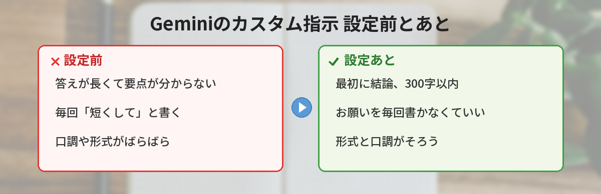
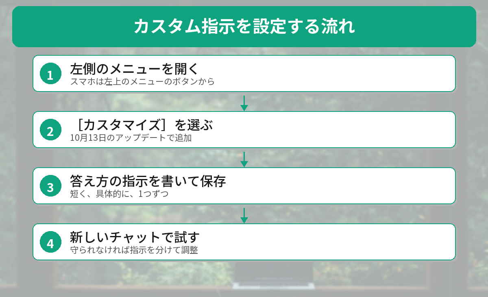
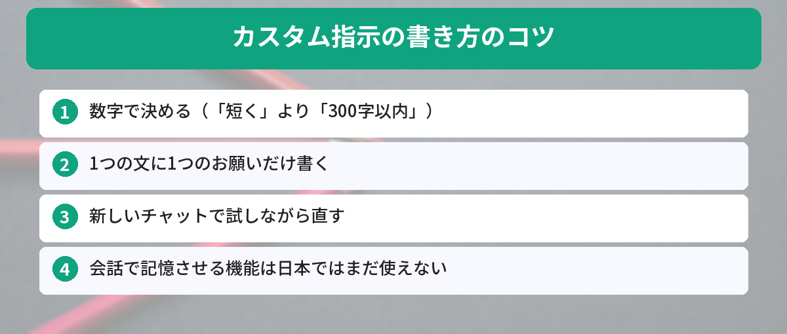

## この記事で分かること

Geminiに質問すると、いつも答えが長くて読むのが大変なの…。毎回「短くして」って書くのも面倒だし、なんとかならない？


「カスタム指示」を書いておけば大丈夫。答え方のルールを先に決めておくと、毎回お願いしなくても、そのとおりに答えてくれるんだ。10月13日のアップデートで設定する場所も分かりやすくなったよ。日本で使える範囲も一緒に見ていこう。



こんなことで困っていませんか？
- Geminiの答えが長すぎて、要点が分からない
- 「箇条書きで」「やさしい言葉で」と、毎回同じお願いを書いている
- 設定の画面を探したけれど、どこで答え方を変えられるのか分からない

この記事は、[Geminiアプリのリリースノート](https://gemini.google/release-notes/?hl=ja)と[Googleの公式ヘルプ](https://support.google.com/gemini/answer/16598625?co=GENIE.Platform%3DDesktop&hl=ja-JP)をもとに、2026年10月22日に確認した内容でまとめています。

## カスタム指示とは？
カスタム指示は、**Geminiに「いつもこう答えてね」と先に伝えておく機能**です。一度書いておくと、新しいチャットでもその指示を守って答えてくれます。

公式ヘルプでは、次のような例が紹介されています。

- すべての回答の冒頭に短い要約を加えて
- 今後は、長い段落では箇条書きを使用して
- 映画をおすすめするときは、必ずレビューサイトのスコアを含めて

ChatGPTにも同じような機能があります。ChatGPTでの書き方は[ChatGPTのカスタム指示の記事](/posts/chatgpt-custom-instructions/)で紹介しています。



## 10月13日のアップデートで何が変わった？
Googleは2026年10月13日のリリースノートで、**左側のメニューを開いて［カスタマイズ］をクリックすると、Geminiの答え方や、ふだん使うツールとの連携を1か所で設定できる**ようになったと発表しました。

- 答え方のカスタマイズ（カスタム指示）
- スキルの追加（決まった作業の手順を保存する機能）
- 40以上のアプリやサービスとの連携

この［カスタマイズ］は、ウェブ、スマホのアプリ、WindowsとmacOSのデスクトップアプリで、**すべてのユーザー向けに世界中で順次**使えるようになると案内されています。ただし、**連携できるアプリのほとんどは米国の英語向け**です。

## カスタム指示の設定のしかた


### ステップ1: 左側のメニューを開く
Geminiの画面の左側にあるメニューを開きます。スマホのアプリでは、左上のメニューのボタンから開きます。

### ステップ2:［カスタマイズ］を選ぶ
メニューの中の［カスタマイズ］を選ぶと、答え方や連携アプリの設定がまとまった画面が開きます。

### ステップ3: 答え方の指示を書く
カスタム指示の欄に、Geminiに守ってほしいルールを書いて保存します。書き方の例は次の章で紹介します。

### ステップ4: 新しいチャットで試す
新しいチャットで質問して、指示どおりに答えてくれるかを確かめます。うまくいかなければ、指示を短くしたり、分けたりして調整します。

画面の表示はアプリのバージョンや端末によって少しちがうことがあります。［カスタマイズ］が見つからない場合は、アプリを最新版にしてから探してみてください。


書く場所は分かったけど、なんて書けばいいのか迷っちゃう…。


コツは「短く、具体的に、1つずつ」。悩みごとに使える例を用意したから、そのままコピーして使ってみて。


## 悩み別：そのまま使えるカスタム指示の例


### 答えが長すぎるとき
```text
回答は300字以内にしてください。最初の1行で結論を書き、くわしい説明はそのあとに箇条書きで3つまでにしてください。
```

### 専門用語が多くて分かりにくいとき
```text
私は初心者です。専門用語を使うときは、同じ文の中でかんたんな言葉で説明してください。
```

### 仕事のメールやチャットの下書きに使うとき
```text
文章を作るときは、ていねいな「です・ます」調で、1文を短くしてください。最後に、相手にしてほしいことを1行で書いてください。
```

### 調べものに使うとき
```text
事実を答えるときは、いつの時点の情報かと、確かめた情報源を書いてください。分からないことは、分からないと答えてください。
```

### うまく書くための3つのコツ
1. **数字で決める**：「短く」より「300字以内」のほうが守られやすい
2. **1つの文に1つのお願い**：条件を詰め込みすぎると、どれかが抜けやすくなる
3. **試して直す**：一度で完ぺきを目指さず、新しいチャットで試しながら調整する

## 日本で使える機能・使えない機能
公式ヘルプを読むと、「カスタム指示」と「記憶させる機能」は条件がちがいます（2026年10月22日時点）。

| 機能 | 使える人 |
|------|------|
| カスタム指示（答え方のルール） | すべてのユーザー |
| チャットで「覚えて」と頼んで情報を記憶させる | 18歳以上・Google AIプランの加入者・個人のGoogleアカウント・**米国のみ** |
| 連携できるアプリ（40以上） | ほとんどが米国の英語向け |

つまり、日本のユーザーは、**答え方のルールを決める「カスタム指示」は使える**けれど、「私はベジタリアンだと覚えておいて」のように**会話の中で記憶させる機能は、まだ使えない**ということです。

### 仕事用アカウントとWorkspaceについて
記憶させる機能は、仕事用・学校用・管理されたGoogleアカウントでは使えないとされています。また、Google Workspace（GmailやドキュメントのGemini）のカスタム指示は、**Geminiアプリのものとは別で、同期されません**。

## カスタム指示とスキルの使い分け
9月30日から、Geminiには「スキル」という機能も入っています。

- **カスタム指示**：すべての会話に共通するルール（例：いつも300字以内で）
- **スキル**：特定の作業のときだけ使う手順のセット（例：議事録を作るときの書式）

よく使う作業はスキル、全体のルールはカスタム指示、と分けると管理しやすくなります。スキルについては[Gemが11月にスキルへ移行する話](/posts/gemini-gem-to-skills-migration/)で解説しています。GeminiとChatGPTのちがいが気になる人は[GeminiとChatGPTの比較](/posts/gemini-vs-chatgpt/)もどうぞ。




左のメニューの［カスタマイズ］で、「300字以内で、最初に結論」って書いておけばいいんだね。さっそく試してみる！


いいね。記憶させる機能はまだ日本では使えないけど、カスタム指示だけでもかなり楽になるはずだよ。


## まとめ
- カスタム指示は、Geminiに「いつもこう答えてね」と先に伝えておく機能
- 2026年10月13日から、左側のメニューの［カスタマイズ］で答え方や連携をまとめて設定できる
- 書くときは「数字で決める」「1文に1つ」「試して直す」の3つがコツ
- カスタム指示はすべてのユーザーが使える。会話で記憶させる機能は米国のみ（10月22日時点）
- 全体のルールはカスタム指示、特定の作業はスキル、と使い分ける

---
### あわせて読みたい
- [【ChatGPT】カスタム指示の設定方法 ― 毎回同じ説明をしなくて済む裏技](/posts/chatgpt-custom-instructions/)
- [【Gemini】「今日のまとめ」が出てこない？日本で使えない理由と代わりの方法](/posts/gemini-daily-brief-japan/)
