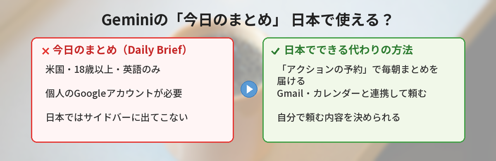
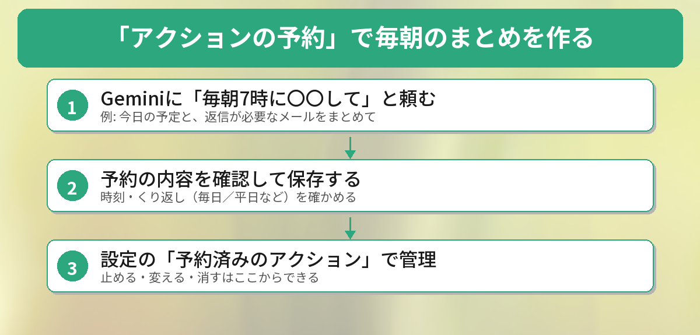

## この記事で分かること

Geminiが毎朝、予定とメールをまとめてくれる「今日のまとめ」っていう機能があるって聞いたの。でも、どこを探しても出てこない…。私の設定が悪いのかな？


設定のせいじゃないよ。「今日のまとめ」は、今のところアメリカの英語ユーザー向けなんだ。でも、日本でも使える「予約アクション」を使えば、似たまとめを毎朝届けてもらえるよ。



こんなことで困っていませんか？

- 記事やSNSで見た「Daily Brief」「今日のまとめ」が、自分のGeminiに出てこない
- メモリーやGmailの連携をオンにしても、サイドバーに表示されない
- 毎朝、予定とメールを自分で確認するのが面倒

結論から言うと、**「今日のまとめ」は2026年10月19日時点で、米国在住・18歳以上・英語のみ**の機能です。日本のアカウントでは、設定を変えても出てきません。代わりに、**「予約アクション」で「毎朝7時に、今日の予定と返信が必要なメールをまとめて」と頼む**と、近いことができます。

## 「今日のまとめ（Daily Brief）」とは？

「今日のまとめ」は、Geminiが毎朝、その日に大事なことを整理して見せてくれる機能です。2026年5月のGoogle I/Oで発表されました。Googleの公式ヘルプでは、次のように説明されています。

- Gmail、Googleカレンダー、Geminiとのチャットから大事な情報を要約する
- 「トップ オブ マインド」に、すぐ対応したほうがいい項目が並ぶ
- 「今後の見通し」に、長い目で見た目標のための次の一歩が並ぶ
- 項目ごとに、チャットで相談したり、完了にしたりできる


朝これを見るだけで1日の準備ができるなら、すごく便利そう！


そうなんだ。だから日本でも話題になったんだけど、使える条件がかなり限られているんだよ。


## なぜ日本では出てこないのか

公式ヘルプ（日本語版）に、使うための条件がはっきり書かれています。

| 条件 | 内容 |
|------|------|
| 地域・年齢 | 18歳以上で、米国内にいること |
| アカウント | 個人のGoogleアカウント（仕事用・学校用・管理対象のアカウントは不可） |
| 設定 | パーソナル インテリジェンスの対象で、Google Workspaceの接続とメモリーをオンにしていること |
| 言語 | 英語のみ |
| 使える場所 | Geminiのスマホアプリ、Web版（gemini.google.com）、Gemini Live |

いちばん大きいのは**「米国内」と「英語のみ」**の2つです。日本からアクセスしているアカウントでは、メモリーやGmailの連携をオンにしても、サイドバーに「今日のまとめ」は表示されません。Googleは「より多くの言語と国に広げていく」と案内していますが、日本での提供時期は発表されていません。

Geminiの最近の変更のうち、無料版の「自動」モードについては[Gemini無料版が急にバカになった？「自動」モードの正体と対処法](/posts/gemini-free-auto-mode/)で、新しいモデルについては[Gemini 4 Argonが登場！無料版で使える？](/posts/gemini-4-argon-free-or-pro/)で解説しています。

## 代わりの方法：予約アクションで毎朝のまとめを作る

日本でもすぐ使えるのが、**「予約アクション」**です。決まった時間に、決まったお願いをGeminiが自動で実行して、結果を届けてくれる機能です。

### 予約アクションを使う条件

公式ヘルプによると、次の条件で使えます。

- 個人のGoogleアカウント（または対象のGoogle Workspaceの仕事用・学校用アカウント）でログインしている
- 「Gemini アプリ アクティビティ」の保存がオンになっている
- 同時に有効にできる予約アクションは最大10個

段階的に提供されているため、まだ使えないアカウントもあります。

### 作り方



1. gemini.google.com かGeminiアプリを開く
2. 入力欄に、時間とくり返しを入れてお願いを書く
3. 送信すると、Geminiが予約の内容をまとめて返してくれるので、確認する

Gmailやカレンダーの中身を使うには、GeminiとGoogleアプリの接続をオンにしておきます。

### そのまま使える頼み方の例

```
毎朝7時に、今日のGoogleカレンダーの予定と、
Gmailで返信が必要そうなメールを3つまで、箇条書きでまとめて。
最後に「今日いちばん先にやること」を1つだけ提案して。
```

```
毎週月曜の朝8時に、今週の予定を一覧にして、
予定が重なっている日や、移動が多い日があれば教えて。
```


自分で頼む内容を決められるなら、逆にこっちのほうが好みに合わせられそう！


そうなんだ。「メールは3つまで」「最後に1つだけ提案」みたいに、量を決めておくと読みやすくなるよ。


### 止める・変える・消す

- 予約アクションのチャットで「時間を8時にして」と頼むと、次回から変わる
- gemini.google.com の「設定とヘルプ」→「予約アクション」から、編集や削除ができる
- しばらく使わないと、自動でオフになることがある。届かなくなったら、ここからオンに戻す

## 公式ヘルプを読んで気づいたこと

筆者は、「今日のまとめ」と「予約アクション」の日本語版ヘルプを読み比べました。気づいたことが3つあります。

### 日本語のヘルプがあっても、日本で使えるとは限らない

「今日のまとめ」のヘルプは日本語に訳されていますが、条件には「米国内」「英語のみ」と書かれています。日本語で説明が読めると「日本でも使える」と思いがちなので、条件の欄まで確認するのがおすすめです。

### 予約アクションは「少し前に」準備される

予約アクションは、指定した時間ぴったりではなく、前もって準備されます。有料のGoogle AIプランなら配信の1時間前から、プランがない場合は数時間前から準備されると書かれています。そのため、**株価のように変わりやすい情報は、受け取った時点で最新ではないことがある**と注意書きがあります。予定やメールのまとめのような使い方が向いています。

### 量を決めると読みやすい

「メールをまとめて」とだけ頼むと、長いまとめになりがちです。「3つまで」「箇条書きで」と決めておくと、朝にさっと読める長さになります。頼み方のコツは[ChatGPTの回答が長すぎる？1行追加で的確にする5つのプロンプト術](/posts/chatgpt-prompt-shorter-answer/)の考え方がGeminiでも使えます。

## よくある質問（FAQ）

### Q: 日本でGeminiの「今日のまとめ」は使えますか？
A: 2026年10月19日時点では使えません。公式ヘルプでは、18歳以上・米国内・英語のみと案内されています。

### Q: VPNを使えば表示されますか？
A: おすすめしません。条件は地域だけでなく言語やアカウントの種類もあり、利用規約の面でも心配があります。正式に日本で提供されるのを待つのが安心です。

### Q: 予約アクションは無料で使えますか？
A: 個人のGoogleアカウントで使えます。有料のGoogle AIプランかどうかで、準備が始まる時間がちがうと案内されています。

### Q: 予約アクションが届かなくなりました。
A: しばらく使わないと、自動でオフになることがあります。「設定とヘルプ」→「予約アクション」からオンに戻してください。

### Q: 会社のGoogleアカウントでも使えますか？
A: 予約アクションは、対象のGoogle Workspaceの仕事用アカウントでも使えます。「今日のまとめ」は、仕事用・学校用のアカウントでは使えません。


「今日のまとめ」は今はアメリカだけ。日本では予約アクションで「毎朝7時にまとめて」って頼めばいいんだね！


その通り！まずは1つだけ予約して、読みやすい量になるように頼み方を調整してみてね。


## まとめ

- Geminiの「今日のまとめ（Daily Brief）」は、Gmail・カレンダー・チャットから毎朝大事なことを整理する機能
- 2026年10月19日時点では、18歳以上・米国内・英語のみ。日本のアカウントでは表示されない
- 代わりに、日本でも使える「予約アクション」で、毎朝のまとめを届けてもらえる
- 「毎朝7時に」「3つまで」「箇条書きで」など、時間と量を決めて頼むと読みやすい
- 予約アクションは前もって準備されるので、変わりやすい情報には向かない

確認日：2026年10月19日（出典：Gemini アプリ ヘルプ「Gemini アプリの今日のまとめを使ってみる」「Gemini アプリでアクションを予約する」）

---
### あわせて読みたい
- [【Gemini】Gmail・Googleドキュメントと連携する方法 ― 無料で使えるAI秘書](/posts/gemini-google-workspace/)
- [【Gemini】Gemini 4 Argonが登場！無料版で使える？Proに入るべき人](/posts/gemini-4-argon-free-or-pro/)

<!-- affiliate -->
## 関連リソース
Geminiの機能を、本でまとめて確認したい方向けに、評価の高い1冊を選びました。
**Gemini完全マニュアル［第2版］**（秀和システム新社）<br>
プランやモデルの違い、各機能の使い方を初心者向けに解説した入門書の改訂版です。
- <a href="https://af.moshimo.com/af/c/click?a_id=5490814&amp;p_id=54&amp;pc_id=54&amp;pl_id=27059&amp;url=https%3A%2F%2Fitem.rakuten.co.jp%2Fbook%2F18638668%2F" rel="nofollow sponsored noopener" referrerpolicy="no-referrer-when-downgrade" target="_blank">Gemini完全マニュアル［第2版］（楽天市場）</a>
- <a href="https://af.moshimo.com/af/c/click?a_id=5490817&amp;p_id=170&amp;pc_id=185&amp;pl_id=27060&amp;url=https%3A%2F%2Fwww.amazon.co.jp%2Fdp%2F4798076767" rel="nofollow sponsored noopener" referrerpolicy="no-referrer-when-downgrade" target="_blank">Gemini完全マニュアル［第2版］（Amazon）</a>
<!-- /affiliate -->
