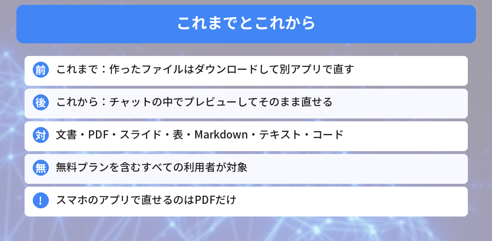
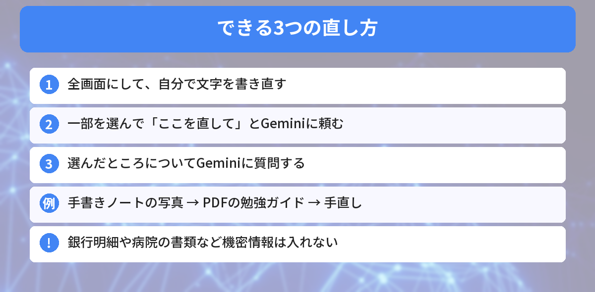

## この記事で分かること

Geminiに資料を作ってもらうと、ちょっと直したいところがあっても、いちいちダウンロードしてWordで開いてたの。めんどうなんだよね…。


10月29日から、Geminiのチャットの中でそのまま直せるようになったよ。無料プランでも使えるんだ。ただ、スマホとパソコンでできることがちがうから、そこも説明するね。


こんな疑問はありませんか？
- チャットの中で何ができるようになったの？
- 無料プランでも使える？
- スマホでも直せるの？

この記事は、Googleの公式ブログ「[You can now generate, preview, and edit documents, PDFs, presentations, spreadsheets, and more directly in Gemini](https://blog.google/innovation-and-ai/products/gemini-app/edit-files-directly/)」（2026年10月29日）と報道をもとにまとめています（2026年11月1日に確認）。筆者は日本のアカウントでの実機確認はできていないため、画面の名前は発表と報道をもとにしています。

## 何が変わったの？
Geminiは、2026年4月ごろから、会話の中でPDFやWord、Excelなどのファイルを**作って出力**できるようになっていました。ただ、直したいときは、ダウンロードして**ほかのアプリで開く**必要がありました。

10月29日からは、作ったファイルを**チャットの中でそのまま見て、直せる**ようになりました。



## できること

Geminiにファイルを作ってもらうと、返事の下にプレビューが出ます。そこから、次の3つの方法で直せます。

### 1. 自分で書き直す
**全画面**に広げて、文字を直接打ちかえられます。

### 2. 一部を選んでGeminiに頼む
直したいところを**選んで（ハイライト）**、「ここをもっとやさしい言葉にして」などと頼めます。文字だけでなく、図などの見た目も直してもらえます。

### 3. 選んだところについて質問する
選んだ部分について、「これはどういう意味？」と**質問**することもできます。

### 使い方の例
Googleが紹介している例は、**手書きの授業ノートの写真**をアップロードして、Geminiに**PDFの勉強ガイド**にしてもらい、そのあと自分で直したり、Geminiに直してもらったりする使い方です。


手書きのメモが、そのまま勉強用のPDFになるの便利！


そうだね。買い物リストや、プレゼンの下書きみたいな、ちょっとした資料づくりにも向いているよ。


## 対応するファイルと、スマホ・パソコンのちがい
| ファイル | パソコン（Web版） | スマホのアプリ |
|------|------|------|
| **PDF** | ○ | **○** |
| Googleドキュメント | ○ | × |
| Googleスプレッドシート | ○ | × |
| スライド | ○ | × |
| Markdown・テキスト | ○ | × |
| コード | ○ | × |

**スマホで直せるのはPDFだけ**です。スライドやスプレッドシートを直したいときは、パソコンで **gemini.google.com** を開きましょう。

## 使える人
- **すべての利用者**（無料プランも含む）
- **Geminiアプリが使えるすべての言語**
- Googleは「今使える」と発表していますが、順番に届くこともあるので、まだ出てこない人もいるかもしれません

## 気をつけたいこと
### 大事な書類は入れない
ファイルの中身も、**チャットの一部**として扱われます。Googleは、人に見られたり、サービスの改善に使われたりしたくない**機密情報は入れないで**と案内しています。

- 銀行の明細、給料の明細
- 履歴書や応募書類
- 病院の書類

こうしたものは、Geminiのファイルに入れないほうが安心です。会話がAIの改善に使われる設定は、「Gemini アプリ アクティビティ」で確かめられます。

### PDF編集ソフトの代わりではない
Googleの例は、どれも**Geminiが作ったファイル**を直す使い方です。すでにあるPDFを細かく編集するソフトの代わりとは考えないほうがよさそうです。

Geminiの回答を自分好みにする方法は、[カスタム指示の記事](/posts/gemini-custom-instructions-customize/)でも紹介しています。




無料でも使えて、スマホはPDFだけ、パソコンならスライドや表も直せるんだね！


その通り。まずは買い物リストみたいな、見られても困らないファイルで試してみるのがおすすめだよ。


## まとめ
- Googleは2026年10月29日、Geminiで作ったファイルをチャットの中でプレビュー・編集できるようにした
- 対象は文書・PDF・スライド・スプレッドシート・Markdown・テキスト・コード
- 無料プランを含むすべての利用者、Geminiが使えるすべての言語が対象
- 自分で書き直す、一部を選んでGeminiに頼む、選んだところに質問する、の3つの直し方
- スマホのアプリで直せるのはPDFだけ。ほかはパソコンのWeb版だけ

---
### あわせて読みたい
- [【Gemini】回答を自分好みにする「カスタム指示」の使い方 日本で使える範囲](/posts/gemini-custom-instructions-customize/)
- [【Gemini 4 Carbon】Googleの新しい最強モデル いつ使える？Argonとのちがい](/posts/gemini-4-carbon-when-available/)
