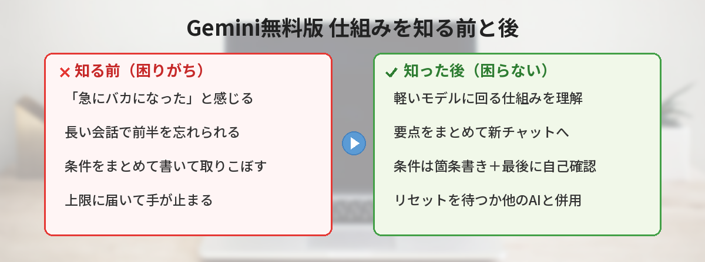
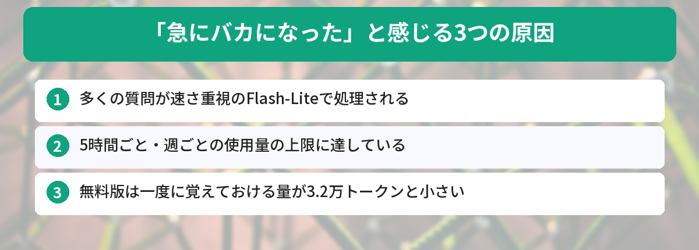
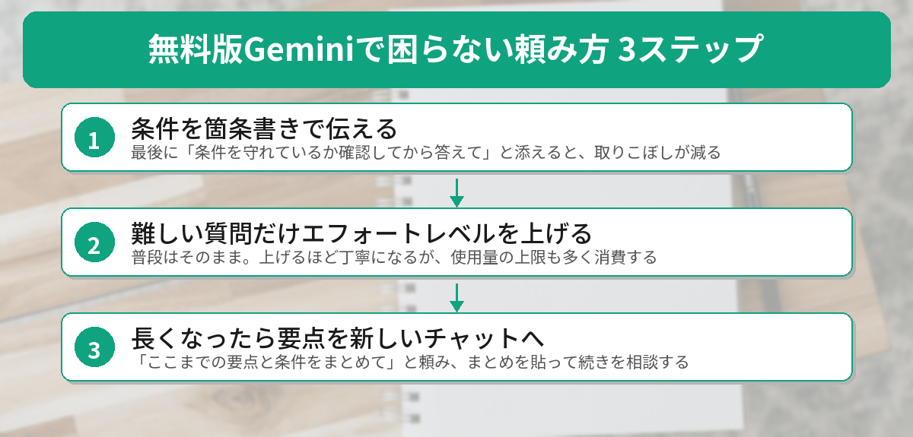
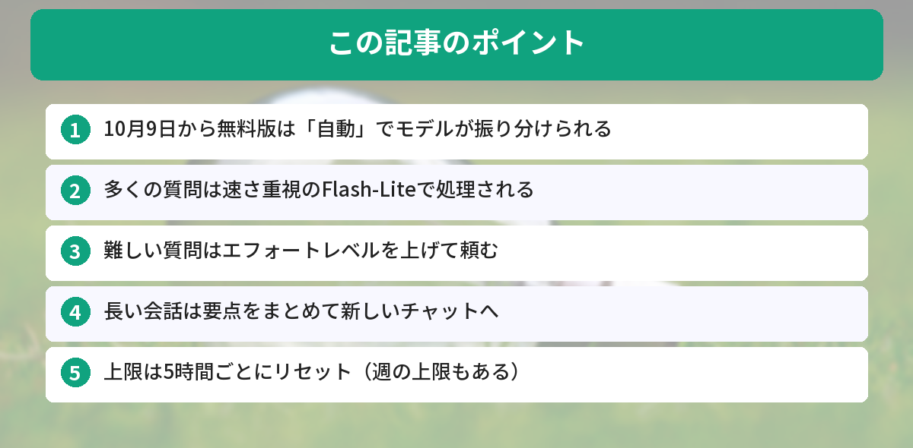

## この記事で分かること


最近Geminiが急に頭悪くなった気がするの…。前より答えが浅いし、モデルを選ぶところも「自動」しか出てこないし…私の使い方が悪いのかな？



使い方のせいじゃないよ。10月9日から、無料版のGeminiは仕組みが変わったんだ。何が変わったのかが分かれば、無料のままでもかなり困らなくなるよ。




10月に入ってから、こんな声をよく見かけるようになりました。

- 「Geminiでモデルを選べなくなった。『自動』しかない」
- 「前より答えが浅い。条件を出しても守ってくれない」
- 「長く話していると、最初に伝えたことを忘れる」

Googleの検索候補にも「gemini 自動モードしかない」「gemini 急にバカになる」「gemini 急に忘れる」といった言葉が並んでいます。困っているのはあなただけではありません。

結論から言うと、Geminiが壊れたわけでも、あなたの使い方が悪いわけでもありません。**10月9日から、無料版は質問ごとにモデルが自動で振り分けられるようになり、多くの質問が速さ重視の軽いモデルで処理されるようになった**のが大きな理由です。この記事では、Googleの公式ヘルプをもとに何が変わったのかを整理し、無料のままできる対処法を紹介します。



## Gemini無料版で何が変わったのか

### 10月9日から「自動」が標準になった

Googleの公式ヘルプ（英語版）によると、AIプランに入っていない個人アカウントでは、2026年10月9日から「Auto（自動）」が標準の設定になりました。有料のAI Plusを使っている人には、切り替わる時期がメールで知らされます。

自動では、Geminiが質問ごとに「どのモデルで答えるのがよいか」を判断して振り分けます。公式の説明は次のとおりです。

- ほとんどの質問は、いちばん速いモデル「Flash-Lite」に送られる
- 深い推論（じっくり考えること）が必要な質問は、「Flash」や「Pro」に送られることがある
- 自動でモデルを選ぶ機能（スマートなモデル選択）をオフにすると、無料版はすべてFlash-Liteで答える

つまり無料版では、**自分でモデルを選ぶのではなく、Geminiに選んでもらう形**に変わったということです。

### 3つのモデルの違い

公式ヘルプでは、3つのモデルを次のように説明しています。

| モデル | 特徴 | 向いていること |
|---|---|---|
| Flash-Lite | 速さ重視の軽いモデル | 要約、アイデア出しなどの日常的な作業 |
| Flash | 速さと推論のバランス型 | 簡単なものから複雑なものまで幅広く |
| Pro | いちばん高性能なモデル | 難しい計算、プログラミング、ファイルや画像の深い理解 |

Flash-Liteは「速く、気軽に答える」のが得意なモデルです。そのぶん、条件がたくさんある依頼や、何段階も考える必要がある質問では、上位のモデルとの差を感じやすくなります。

### 日本語の情報がまだ追いついていない

筆者がこの記事を書いた2026年10月13日の時点では、日本語版のヘルプに、英語版にある「自動」の説明文がまだ載っていませんでした。10月上旬に出た日本語の解説記事やニュースにも、「無料版はFlash-Liteだけになる」と書いたものが多くあります。

実際は、上で紹介したとおり「基本はFlash-Lite、必要に応じてFlashやProも使われる」という仕組みです。この記事では、内容が新しい英語版の公式ヘルプを基準にしています。


じゃあ、私の質問はほとんど一番軽いモデルに回ってたってこと…？



そういうことになるね。しかも、どんな質問ならFlashやProに回るのか、細かい基準は公開されていないんだ。だからこそ「これは難しい質問だよ」とGeminiに伝わる頼み方が大事になるよ。


## 「急にバカになった」と感じる3つの原因

性能が落ちたと感じる理由は、1つではありません。公式ヘルプの内容から、原因は大きく3つに分けられます。



### 原因1: 多くの質問が軽いモデルで処理される

前のセクションのとおり、無料版の質問はほとんどがFlash-Liteに回ります。いつもの質問が軽いモデルで処理されるので、「前より浅い」と感じやすくなります。

### 原因2: 使用量の上限に達している

Geminiには使用量の上限があります。公式ヘルプによると、上限は5時間ごとにリセットされ、それとは別に週単位の上限もあります。

使用量は、単純な回数ではなく「質問の複雑さ」「使う機能」「チャットの長さ」をもとに計算されます。特に次の機能は、使用量を多く消費します。

- 画像・動画・音楽の生成
- Deep Research（調べ物を自動でまとめる機能）
- Proモデル
- 拡張思考やDeep Think（長く考えさせる機能）

また、利用が集中している時間帯には、無料ユーザーはDeep Researchのような重い機能が使えなくなることがある、とも書かれています。

### 原因3: 一度に覚えておける量が小さい

AIが一度に読んで覚えておける量を「コンテキストウィンドウ」と呼びます。公式ヘルプでは、プランごとにこう案内されています。

| プラン | 一度に覚えておける量 |
|---|---|
| 無料（AIプランなし） | 3.2万トークン |
| AI Plus | 12.8万トークン |
| AI Pro / AI Ultra | 100万トークン |

トークンは、AIが文章を数えるときの単位です。公式ヘルプには「100万トークンで約1,500ページ分の文章」という目安があり、無料版の3.2万トークンはその約30分の1です。

この量を超えると、最初のほうの内容を踏まえない答えになることがあります。長い会話の途中で「最初に言った条件を忘れる」のは、これが原因になっている可能性があります。

## 無料のままできる対処法4つ

### 対処1: 難しい質問だけ「エフォートレベル」を上げる

公式ヘルプによると、使えるモデルごとに「エフォートレベル（考える度合い）」を低・中・高から選べます。上げるほど課題をこなす力が上がり、詳しい答えになりますが、使用量の上限も多く消費します。

おすすめは、**普段はそのまま、難しい質問のときだけ上げる**使い方です。上限を節約しながら、ここぞという質問の質を上げられます。

切り替えは、入力欄にあるモデル名の部分（モデルの選択メニュー）から確認してみてください。表示の場所や名前は、アプリの更新や環境によって変わることがあります。

### 対処2: 頼み方を具体的にする（条件は箇条書きで）

軽いモデルほど、ふわっとした頼み方だと意図を取りこぼしやすくなります。条件は文章に混ぜず、箇条書きで並べるのがコツです。

```text
次の条件で、3日分の夕食の献立を考えてください。
・2人分
・1食あたりの材料費は800円以内
・火曜日は帰りが遅いので、15分で作れるもの
・魚料理を1回入れる
最後に、条件をすべて守れているか自分で確認してから答えてください。
```

最後の「自分で確認してから答えて」という一文がポイントです。条件の取りこぼしに気づきやすくなります。頼み方の基本は[コピペで使えるChatGPTプロンプト10選](/posts/chatgpt-prompt-template/)でも紹介していて、考え方はGeminiでも同じです。

### 対処3: 長い会話は区切って、要点を引き継ぐ

会話が長くなってきたら、いったん要点をまとめてもらい、新しいチャットに引き継ぎます。

```text
ここまでの会話の要点と、私が出した条件を箇条書きでまとめてください。
新しいチャットに貼り付けて、続きを相談したいです。
```

まとめを新しいチャットに貼れば、覚えておく量に余裕がある状態で続きを話せます。長い資料を読ませたいときは、章ごとに分けて渡すのも有効です。長い文章の扱いが得意なAIについては、[Claudeで100ページのPDFを要約する方法](/posts/claude-long-document/)も参考になります。

### 対処4: 上限に達したら「待つ」か「使い分ける」

上限に達したときは、リセットを待つか、ほかのAIと使い分けます。公式ヘルプによると、上限は週単位の上限に達するまで、5時間ごとにリセットされます。

ChatGPTやClaudeにも、無料で使える範囲があります。それぞれ得意なことが違うので、[ChatGPTとGeminiの違いを比較した記事](/posts/gemini-vs-chatgpt/)を参考に、用途で使い分けると上限を気にしにくくなります。




条件を箇条書きにして、最後に「確認してから答えて」って付けるだけでいいの？それなら私にもできそう！



うん、軽いモデルほど効果が出やすいポイントだよ。それでも物足りない難しい質問のときだけ、エフォートレベルを上げてみよう。


## 実際に公式情報を読み比べてみた

今回の変更は、情報が混乱しやすいと感じました。筆者が実際に確かめた内容を共有します。

### やったこと

- Googleの公式ヘルプを、英語版と日本語版で読み比べた
- Yahoo!知恵袋やnoteで、同じ悩みの投稿と回答を確認した
- Googleの検索候補で、どんな言葉で調べられているかを見た

### 分かったこと

- 英語版のヘルプには「無料版は自動。多くはFlash-Lite、必要ならFlashやPro」と書かれていた
- 日本語版のヘルプには、エフォートレベルの説明はあったが、「自動」の説明文はなかった
- 知恵袋では「10月から無料で使えなくなるモデルはどれか」という質問に、回答者ごとに違う答えが付いていた
- 検索候補には「急にバカになる」「急に忘れる」「自動モードしかない」が並んでいた

### 気づき

一番の気づきは、「バカになった」の原因が1つではないことでした。軽いモデルへの振り分け、使用量の上限、覚えておける量の小ささが重なって、そう感じやすくなっています。

原因が分かれば、打つ手も変わります。「難しい質問はエフォートレベルを上げる」「条件は箇条書き」「長くなったら新しいチャット」の3つを意識するだけで、無料版でも困る場面はかなり減らせるはずです。

## 今回の変更の良い点・イマイチな点

### 良い点

- モデル選びで迷わなくていいので、初心者には分かりやすい
- 普段の質問は速いモデルが答えるので、待ち時間が短い
- 難しい質問は、上位のモデルに回ることがある
- エフォートレベルを選べるので、ここぞという質問だけ丁寧にできる

### イマイチな点

- どんな質問が上位のモデルに回るのか、細かい基準が公開されていない
- 以前より答えが浅いと感じる場面がある
- 日本語の公式情報が追いついておらず、混乱しやすい
- 上限は回数ではなく計算量で決まるので、あと何回使えるかを事前に読みにくい

## 有料プランを考えたほうがいい人・無料で十分な人

### 有料プランを考えたほうがいい人

- 長い資料や長い会話を、毎日のように扱う人
- 難しい質問で、上位のモデルを自分で選んで使いたい人
- 画像生成やDeep Researchをよく使い、上限にすぐ届く人

公式ヘルプによると、使用量の上限は無料版を「標準」として、AI Plusは2倍、AI Proは4倍、AI UltraはAI Proの5倍または20倍です。一度に覚えておける量も、上の表のとおりプランで大きく変わります。選べるモデルの範囲や料金はプランごとに違い、変わることもあるので、申し込む前に公式の案内を確認してください。

### 無料のままで十分な人

- 調べ物、文章の手直し、アイデア出しが中心の人
- 1日に数回、短めのやりとりをするくらいの人
- ほかのAIと使い分けられる人

GmailやGoogleドキュメントと組み合わせて使いたい人は、[GeminiをGmail・Googleドキュメントと連携する方法](/posts/gemini-google-workspace/)もあわせてどうぞ。

## よくある質問（FAQ）



### Q: 無料版で、Proモデルを自分で選ぶことはできますか？
A: 10月9日以降、無料版は「自動」が標準で、モデルを自分で選ぶ形ではなくなりました。深い推論が必要な質問は、自動でFlashやProに回ることがあります。

### Q: 「自動」をオフにすると、どうなりますか？
A: 公式ヘルプによると、自動でモデルを選ぶ機能をオフにすると、無料版はすべてFlash-Liteで答えます。上位のモデルに回る可能性がなくなるので、基本はオンのままがおすすめです。

### Q: 上限に達したら、いつまた使えますか？
A: 上限は5時間ごとにリセットされます。ただし、週単位の上限に達した場合は、その上限がリセットされるまで待つ必要があります。

### Q: 長いPDFを読ませると、前半の内容を無視されます。
A: 無料版は、一度に覚えておける量が3.2万トークンと小さいためです。資料を章ごとに分けて渡すか、先に要点をまとめさせてから質問すると改善しやすくなります。

### Q: 日本語のヘルプと英語のヘルプで、内容が違うのはなぜですか？
A: 変更の直後は、翻訳版の更新が遅れることがあります。この記事を書いた時点では、英語版のほうが新しい内容でした。迷ったときは英語版も確認すると安心です。


私の使い方が悪かったんじゃなくて、仕組みが変わってたんだね…！難しいことを聞くときはエフォートレベルを上げて、条件は箇条書きにしてみる！



うん、それだけでもかなり違うはずだよ。どうしても足りないと感じたら、そのとき有料プランを考えれば大丈夫。まずは無料のまま、頼み方から変えてみよう。


## まとめ

- 10月9日から、無料版のGeminiは「自動」で質問ごとにモデルが振り分けられる
- 多くの質問は速さ重視のFlash-Liteで処理され、必要に応じてFlashやProが使われる
- 「バカになった」と感じる原因は、軽いモデルへの振り分け・使用量の上限・覚えておける量の小ささ
- 難しい質問はエフォートレベルを上げ、条件は箇条書きで伝える
- 長い会話は要点をまとめて新しいチャットへ。上限は5時間ごとにリセットされる

---
### あわせて読みたい
- [【2026年版】ChatGPTとGemini、結局どっちがいい？違いを比較](/posts/gemini-vs-chatgpt/)
- [【Gemini】Gmail・Googleドキュメントと連携する方法](/posts/gemini-google-workspace/)

<!-- affiliate -->
## 関連リソース

Geminiのプランや機能を、本でまとめて確認したい方向けに、評価の高い2冊を選びました。

**Gemini完全マニュアル［第2版］**（秀和システム新社）<br>
プランやモデルの違い、各機能の使い方を初心者向けに解説した入門書の改訂版です。

- <a href="https://af.moshimo.com/af/c/click?a_id=5490814&amp;p_id=54&amp;pc_id=54&amp;pl_id=27059&amp;url=https%3A%2F%2Fitem.rakuten.co.jp%2Fbook%2F18638668%2F" rel="nofollow sponsored noopener" referrerpolicy="no-referrer-when-downgrade" target="_blank">Gemini完全マニュアル［第2版］（楽天市場）</a>
- <a href="https://af.moshimo.com/af/c/click?a_id=5490817&amp;p_id=170&amp;pc_id=185&amp;pl_id=27060&amp;url=https%3A%2F%2Fwww.amazon.co.jp%2Fdp%2F4798076767" rel="nofollow sponsored noopener" referrerpolicy="no-referrer-when-downgrade" target="_blank">Gemini完全マニュアル［第2版］（Amazon）</a>

**Gemini 超活用 完全ガイド**（晋遊舎）<br>
基本操作から、GmailやGoogleドライブとの連携、画像生成までを1冊にまとめたムックです。

- <a href="https://af.moshimo.com/af/c/click?a_id=5490814&amp;p_id=54&amp;pc_id=54&amp;pl_id=27059&amp;url=https%3A%2F%2Fitem.rakuten.co.jp%2Fbook%2F18550986%2F" rel="nofollow sponsored noopener" referrerpolicy="no-referrer-when-downgrade" target="_blank">Gemini 超活用 完全ガイド（楽天市場）</a>
- <a href="https://af.moshimo.com/af/c/click?a_id=5490817&amp;p_id=170&amp;pc_id=185&amp;pl_id=27060&amp;url=https%3A%2F%2Fwww.amazon.co.jp%2Fdp%2F4801826768" rel="nofollow sponsored noopener" referrerpolicy="no-referrer-when-downgrade" target="_blank">Gemini 超活用 完全ガイド（Amazon）</a>
<!-- /affiliate -->
