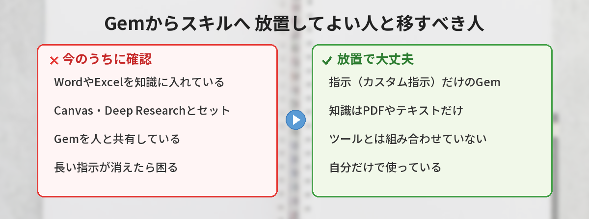
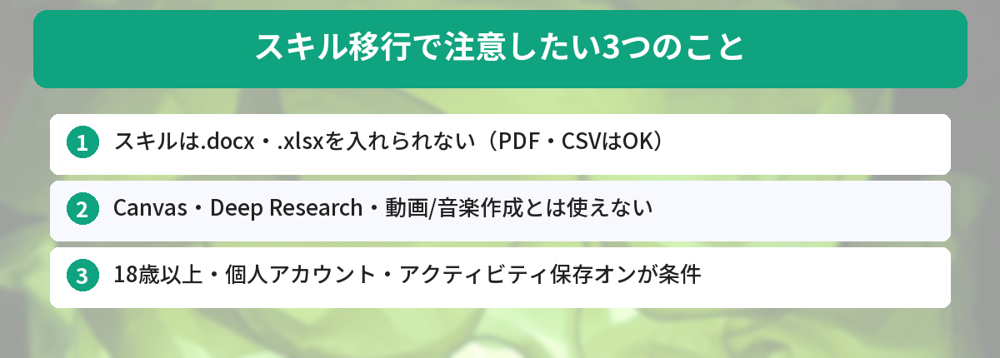
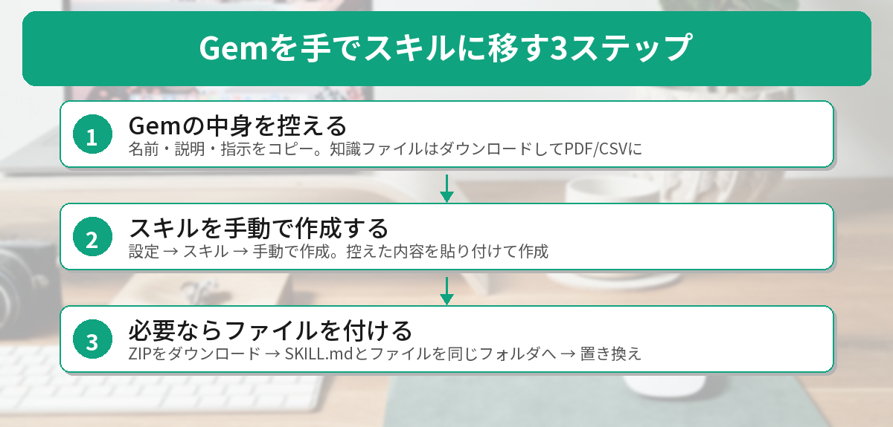
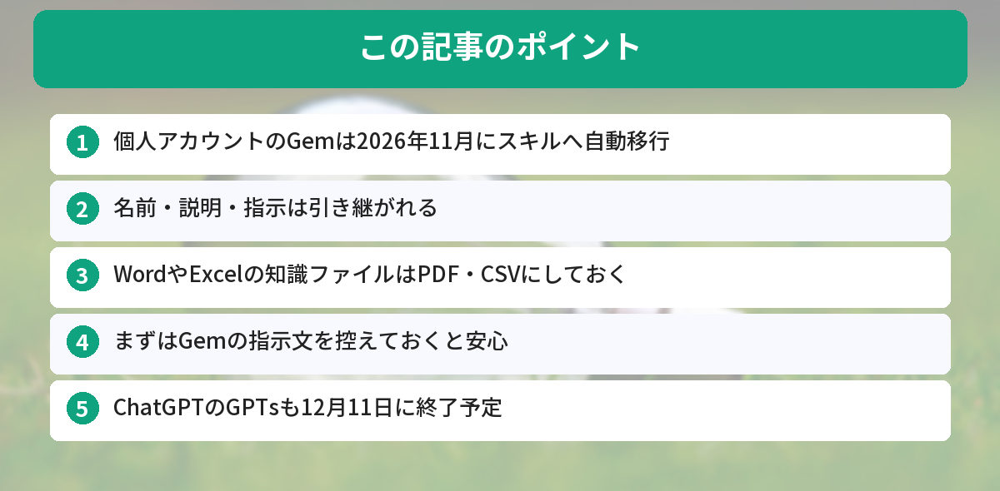

## この記事で分かること


Geminiを開いたら「Gemがスキルに変わります」って出てきたの…。せっかく作ったGem、消えちゃうの？何かしないといけない？



消えはしないよ。11月に自動で「スキル」に作り直されるんだ。ただ、一部の機能やファイルは引き継がれないから、使い方によっては今のうちに手で移したほうが安心なんだ。見分け方を説明するね。


Geminiのカスタム設定「Gem」を使っている人の間で、こんな声が増えています。

- 「Gemがスキルになるって出たけど、何もしなくていいの？」
- 「スキルにしたら、Gemと答え方が違う気がする」
- 「Gemをたくさん作ったけど、全部どうなるの？」

結論から言うと、**多くの人は何もしなくても大丈夫**です。Gemは2026年11月に、自動で「スキル」として作り直されます。ただし、**WordやExcelのファイルを知識として入れている人**や、**CanvasやDeep Researchと一緒に使っている人**は、今のうちに確認しておくのがおすすめです。

この記事では、Googleの公式ヘルプを読み比べて、引き継がれるもの・引き継がれないもの、手で移したほうがいい人の見分け方、移し方の手順をまとめます。



## Gemが「スキル」に変わるってどういうこと？

### 11月にGemのサポートが終わる

Googleの公式ヘルプによると、Gemのサポートは次の時期に終わります。

| アカウントの種類 | Gemの終了時期 |
|---|---|
| 個人のGoogleアカウント | 2026年11月 |
| Google Workspace（Business / Enterprise / Non-Profit） | 2027年3月 |
| Google Workspace（Education） | 2027年6月 |

報道によると、Gemの管理画面には「11月17日からGemがスキルに」という表示が出ています。公式ヘルプの記載は「11月」なので、正確な日付はお使いの画面の案内を確認してください。移行が終わるまでは、Gemはこれまでどおり使えます。

### スキルとは

スキルは、Gemの後継になる仕組みです。「こういう役割で、こう答えてほしい」という指示を保存しておき、チャットで呼び出せます。考え方はGemとほぼ同じですが、使い方が3つ変わります。

- **呼び出し方**：チャット欄で「/」に続けてスキル名を入力する（近いうちに「@」に変わる予定）
- **自動で使われる**：関連する質問をすると、Geminiがスキルを自動で当てはめることがある
- **組み合わせられる**：1つのチャットで、複数のスキルを重ねて使える

Gemは「Gem専用の画面に切り替えて話す」使い方でした。スキルは「いつものチャットの中で呼び出す」使い方になります。Googleは、タブを切り替えずに使えて、組み合わせもできるようにするのが目的だと説明しています。


じゃあ、名前とか指示は、そのまま引き継がれるの？



基本はそうだよ。名前・説明・指示は引き継がれる。気をつけたいのは「知識に入れたファイル」と「一緒に使っていたツール」なんだ。次で詳しく見ていこう。


## 引き継がれないもの・注意したいこと

### 注意1: WordやExcelのファイルは、スキルに入れられない

これがいちばん見落としやすいポイントです。公式ヘルプによると、スキルにアップロードできるファイルは、テキスト（.txt・.md）、PDF、CSV、JSON、HTML、画像などです。**.docx・.doc・.xlsx などは非対応**と書かれています。合計の上限は100MBです。

一方、Gemの知識ファイルには、WordやExcel、Googleドキュメントも入れられました。公式ヘルプでは、知識ファイルは「サポートされるファイルとともに」自動で移行されると説明されています。この2つを合わせると、**WordやExcelを知識に入れているGemは、自動移行でファイルが付いてこない可能性がある**と考えられます（筆者の推測です）。

心配な人は、先にファイルをPDFやCSVに変換しておくと安心です。

### 注意2: CanvasやDeep Researchとは一緒に使えない

Gemで使えたツールのうち、次のものはスキルに対応していません。

- 動画の作成
- 音楽の作成
- Canvas
- Deep Research
- ガイド付き学習

たとえば「Canvasで文章を一緒に直してくれるGem」のように、ツールとセットで使っていた人は、スキルにした後の使い勝手が変わります。

また、ほかの人との共有、Googleドライブのファイル追加、Gemini Notebookの追加は「今後数週間のうちに」対応予定と案内されています。今の時点では使えないので、Gemを人に共有している人も注意が必要です。

### 注意3: スキルを使うには条件がある

公式ヘルプによると、スキルを作ったり使ったりするには、次の3つの条件があります。

- 18歳以上であること
- 個人のGoogleアカウントであること
- 「アクティビティの保存」がオンになっていること

スキル自体は、有料プランに入っていなくても使えます。ただし、プライバシーが気になって「アクティビティの保存」をオフにしている人は、スキルを使うためにオンにする必要があります。なお、Gemは13歳以上で使えましたが、スキルは18歳以上です。

## 放置でいい人・今のうちに移したほうがいい人

ここまでの内容をもとに、どちらに当てはまるかを判断してみてください。

### 何もしなくても大丈夫な人

- 指示（カスタム指示）だけでGemを作っている
- 知識ファイルを入れていない、またはPDFやテキストだけ
- CanvasやDeep Researchとは一緒に使っていない
- Gemを人と共有していない

この場合は、11月の自動移行を待つだけで問題ありません。移行後にスキル一覧を開いて、ちゃんと引き継がれているかだけ確認しましょう。GmailやGoogleドキュメントと組み合わせて使っている人は、[GeminiをGmail・Googleドキュメントと連携する方法](/posts/gemini-google-workspace/)もあわせてどうぞ。

### 今のうちに確認・手で移したほうがいい人

- **WordやExcel、Googleドキュメントを知識に入れている** → PDFやCSVに変換して、手でスキルを作り直す
- **CanvasやDeep Researchとセットで使っている** → スキルでは使えなくなるので、使い方を見直す
- **Gemを家族や同僚と共有している** → 共有機能の対応を待つか、指示を別の方法で渡す
- **大事な指示が長く、消えたら困る** → 指示の文章をメモ帳などに控えておく

どの場合も、まず**Gemの指示文をコピーして、どこかに保存しておく**のがおすすめです。万が一うまく移らなくても、指示さえ残っていれば作り直せます。


私、指示だけのGemしか作ってないから、待ってていいんだね！でも念のため、指示はメモしておこうかな。



それがいちばん安心だね。指示の書き方のコツは、ChatGPTのカスタム指示とも共通しているよ。


指示の書き方は、[ChatGPTのカスタム指示の設定方法](/posts/chatgpt-custom-instructions/)でも紹介しています。考え方はGeminiのスキルでも同じです。

## 手でスキルに移す手順

公式ヘルプで案内されている手順を、パソコンのブラウザ版（gemini.google.com）で整理しました。表示される名前は、画面の更新で変わることがあります。

### ステップ1: Gemの中身を控える

1. gemini.google.com を開き、サイドバーの「Gem」から、移したいGemの編集画面を開く
2. 名前・説明・カスタム指示の文章を、メモ帳などにコピーしておく
3. 「知識」にファイルがあれば、1つずつ開いてダウンロードする

WordやExcelのファイルは、この時点でPDFやCSVに変換しておきます。

### ステップ2: スキルを作る

1. 新しいタブで gemini.google.com を開く
2. サイドバーの「設定」から「スキル」を開き、「手動で作成」を選ぶ
3. ステップ1で控えた名前・説明・指示を貼り付けて「作成」を押す

10月13日のアップデートで、サイドバーの「カスタマイズ」からもスキルを追加できるようになりました。チャットでGeminiに「こういうスキルを作って」と頼んで作ることもできます。

### ステップ3: ファイルを付ける（必要な人だけ）

ファイルを付けたい場合は、少し手間がかかります。

1. スキルの一覧で、作ったスキルの「スキル アクション」から「ダウンロード」を選び、ZIPファイルを保存する
2. ZIPの中にある「SKILL.md」を、知識ファイルを入れたフォルダに移す（フォルダ名は、小文字とハイフンだけにする）
3. 「スキル アクション」から「スキルを置き換える」を選び、そのフォルダをアップロードする

公式ヘルプでは、フォルダ名とスキル名を一致させるよう案内されています。ファイルを付けてスキルを作れるのは、ブラウザ版とMac版のアプリです。

### 気をつけたいこと

- スキルを削除すると、元に戻せません
- スキルの中のファイルを更新するときは、参照ファイルごとアップロードし直す必要があります
- 同時に有効にできるスキルは100個までです

## 実際に公式ヘルプを読み比べてみた

今回の変更は、情報があちこちに分かれていて分かりにくいと感じました。筆者が確かめた内容を共有します。

### やったこと

- Geminiの公式ヘルプで、「Gemからスキルへの移行」と「スキルの作り方」のページを読み比べた
- Geminiのリリースノートで、スキルの提供開始やメニューの変更を確認した
- Yahoo!リアルタイム検索で、Xに投稿されている声を確認した

### 分かったこと

- 移行の時期や引き継がれないツールは、移行のページに書かれていた
- 「スキルに入れられないファイル形式」は、スキルの作り方のページにだけ書かれていた
- そのため、移行のページだけ読むと、WordやExcelのファイルが入らないことに気づきにくい
- Xでは「スキルにしたら答え方が違う気がする」「Gemをたくさん作ったけど、どうなるの」という声が続いていた

### 気づき

一番の気づきは、**大事な注意点が別々のページに分かれている**ことでした。「自動で移るから大丈夫」と思っていても、ファイルの形式によっては付いてこない可能性があります。迷ったら、指示文を控えて、ファイルをPDFにしておく。この2つだけで、ほとんどの不安はなくせるはずです。

## ChatGPTのGPTsも12月11日に終了

同じ時期に、ChatGPTのカスタムGPT（GPTs）も終わりを迎えます。OpenAIの公式ヘルプによると、カスタムGPTは2026年12月11日に終了予定です（延長が認められたEnterpriseは2027年2月11日まで）。

自分で作ったGPTは、「プラグイン」に移行できます。手順は「My GPTs」→「Created by me」から、移したいGPTの「Migrate to plugin」を選ぶ形です。指示や知識ファイルは引き継がれますが、カスタムアクションや選んでいたモデル、共有設定などは引き継がれないと案内されています。移行すると、元のGPTは読み取り専用になります。

GeminiのGemと同じく、**大事な指示文は先に控えておく**のがおすすめです。

## よくある質問（FAQ）

### Q: 何もしないと、Gemは消えてしまいますか？
A: 消えずに、11月にスキルとして自動で作り直されます。名前・説明・指示は引き継がれます。ただし、対応していないファイル形式やツールは引き継がれない場合があります。

### Q: スキルは無料で使えますか？
A: はい。公式ヘルプによると、Google AIのサブスクリプションがなくても使えます。ただし、18歳以上、個人アカウント、「アクティビティの保存」がオンという条件があります。

### Q: Gemに入れたWordのファイルはどうなりますか？
A: スキルは.docxや.xlsxをアップロードできないため、自動移行でファイルが付いてこない可能性があります。心配な場合は、PDFやCSVに変換して、手でスキルに付け直すのが安全です。

### Q: スキルはどうやって呼び出しますか？
A: チャット欄で「/」に続けてスキル名を入力します。近いうちに「@」に変わる予定です。関連する質問では、Geminiが自動で使うこともあります。

### Q: スキルにした後、Gemと答え方が違う気がします。
A: 呼び出し方や、ほかのスキルとの組み合わせ方が変わったためかもしれません。指示文を見直したり、余計なスキルをオフにしたりして試してみてください。無料版のモデルの仕組みについては、[Gemini無料版の「自動」モードの記事](/posts/gemini-free-auto-mode/)も参考になります。


指示だけのGemなら待っていればいい、WordやExcelを入れているなら今のうちにPDFにする…だね！まずは指示をメモしておく！



完璧だよ。スキルになると、いつものチャットで呼び出せて、組み合わせもできるようになる。不安なところだけ先に手当てしておけば、むしろ便利になるはずだよ。


## まとめ

- GeminiのGemは、個人アカウントでは2026年11月にスキルへ自動で移行する
- 名前・説明・指示は引き継がれるので、指示だけのGemなら何もしなくて大丈夫
- スキルは.docx・.xlsxを入れられず、CanvasやDeep Researchとも一緒に使えない
- WordやExcelを知識に入れている人は、PDFやCSVにして手で移すのが安全
- どの場合も、まずGemの指示文を控えておく。ChatGPTのGPTsも12月11日に終了

---
### あわせて読みたい
- [【Gemini】無料版が急にバカになった？「自動」モードの正体と対処法](/posts/gemini-free-auto-mode/)
- [【ChatGPT】カスタム指示の設定方法 ― 毎回同じ説明をしなくて済む裏技](/posts/chatgpt-custom-instructions/)

<!-- affiliate -->
## 関連リソース

Geminiの機能を、本でまとめて確認したい方向けに、評価の高い1冊を選びました。

**Gemini完全マニュアル［第2版］**（秀和システム新社） 
プランやモデルの違い、各機能の使い方を初心者向けに解説した入門書の改訂版です。

- <a href="https://af.moshimo.com/af/c/click?a_id=5490814&amp;p_id=54&amp;pc_id=54&amp;pl_id=27059&amp;url=https%3A%2F%2Fitem.rakuten.co.jp%2Fbook%2F18638668%2F" rel="nofollow sponsored noopener" referrerpolicy="no-referrer-when-downgrade" target="_blank">Gemini完全マニュアル［第2版］（楽天市場）</a>
- <a href="https://af.moshimo.com/af/c/click?a_id=5490817&amp;p_id=170&amp;pc_id=185&amp;pl_id=27060&amp;url=https%3A%2F%2Fwww.amazon.co.jp%2Fdp%2F4798076767" rel="nofollow sponsored noopener" referrerpolicy="no-referrer-when-downgrade" target="_blank">Gemini完全マニュアル［第2版］（Amazon）</a>
<!-- /affiliate -->
