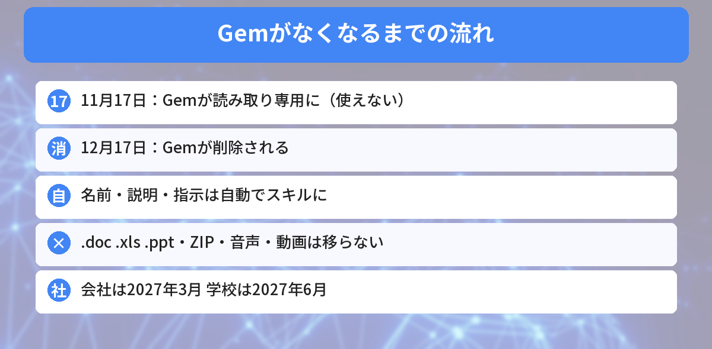
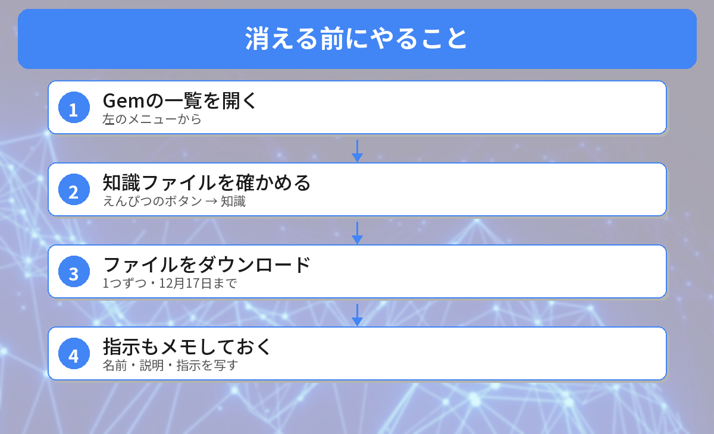

## この記事で分かること

GeminiのGem、何個か作って使ってるんだけど、「12月に消える」ってニュースを見たの。前は「放っておいても大丈夫」って聞いた気がするんだけど…。


Gemの中身は自動でスキルに移るんだけど、日程がはっきりして、移らないファイルも分かってきたんだ。11月17日まであと8日だから、今のうちに確かめておこう。


こんな疑問はありませんか？
- Gemはいつ使えなくなるの？
- 自分のGemの中身は消えちゃうの？
- 今、何をしておけばいいの？

この記事は、Googleの公式ヘルプ「[About the transition from Gems to skills](https://support.google.com/gemini/answer/18560919?hl=en)」と、[gHacksの記事](https://www.ghacks.net/2026/11/05/google-will-turn-gemini-gems-into-skills-on-november-17-and-remove-the-old-gems-on-december-17/)（2026年11月5日）をもとにまとめています（2026年11月9日に確認）。筆者は自分のアカウントの画面ではまだ確かめられていないため、画面の名前はヘルプと報道をもとにしています。

10月に書いた[Gemがスキルに移る記事](/posts/gemini-gem-to-skills-migration/)の続きです。

## いつ、何が起きるの？
| 日付 | 個人のGoogleアカウント（18歳以上） |
|------|------|
| **2026年11月17日** | Gemがスキルに切りかわり、**読み取り専用**に。見られるが、使う・直す・新しく作るはできない |
| **2026年12月17日** | **Gemが削除**され、見ることもできなくなる |

会社や学校のアカウントは、もっと後です。

| アカウント | Gemがなくなる時期 |
|------|------|
| Workspace（会社・団体） | 2027年3月 |
| Workspace（学校） | 2027年6月 |
| 18歳未満の個人アカウント | まだ発表なし |

同じ11月には、Googleの実験サービス「Opal」と「Gems by Google Labs」も終わると案内されています。



## 自動で移るもの・移らないもの
Gemは、なくなるときに**自動でスキルに作り直されます**。名前・説明・指示は引き継がれます。気をつけたいのは**知識に入れたファイル**です。

### 移らないファイルの種類
Googleの公式ヘルプでは、次の種類はスキルに移らないとされています。

- **古いOfficeの形式**：.doc、.xls、.ppt
- **圧縮ファイル**：.zip、.tar、.7z、.rar、.gz、.tgz
- **音声ファイル**
- **動画ファイル**
- **GitHubのファイル**

### 100MBをこえると、大きいファイルから外される
スキルに入れられるファイルは**合計100MBまで**です。Gemのファイルがこれをこえていると、**大きいファイルから順に外されます**。


昔のWordで作った「.doc」のマニュアルを入れてた…！これは移らないんだね。


そう。12月17日をすぎると、Gemと一緒にファイルも見られなくなるから、その前にダウンロードしておこう。.docxに保存し直すか、PDFにしておくと安心だよ。


## 今やっておきたいこと

### ステップ1: Gemの一覧を開く
Geminiの左のメニューから［**Gem**］を開きます。

### ステップ2: 知識ファイルを確かめる
使っているGemの**編集（えんぴつのボタン）**を開いて、［**知識**］に入っているファイルを見ます。移らない種類のファイルや、大きなファイルがないか確かめます。

### ステップ3: ファイルをダウンロードする
知識に入っているファイルを、**1つずつ**パソコンなどにダウンロードします。まとめてダウンロードする方法はないと案内されています。

### ステップ4: 指示もメモしておく
自動で作り直されますが、念のため、**Gemの名前・説明・指示**をメモ帳などに写しておくと安心です。

### 自分でスキルを作ることもできる
11月17日を待たずに、自分でスキルに作り直すこともできます。Geminiの［カスタマイズ］→［スキル］→［作成］→［手動で作成］を開き、Gemの名前・説明・指示を貼りつけます。ファイルは、作ったスキルに［ファイルを追加］で入れられます。

## スキルになると何が変わる？
- **どのチャットでも呼び出せる**：「/」（のちに「@」）＋スキルの名前で使えます
- **自動で使われる**：内容に合ったスキルを、Geminiが自動で使ってくれます
- **重ねて使える**：いくつかのスキルを同じチャットで組み合わせられます

ただし、いまは次のことに注意が必要です。

- **Canvas、Deep Research、学習コーチ（Guided Learning）、動画・音楽の作成**とは一緒に使えません
- **ほかの人との共有**、Googleドライブのファイル追加、Gemini Notebookの追加は、まだできません（「今後数週間で」対応予定）
- スキル専用の「最近のチャット」のページはなく、チャットは左のメニューにふつうに並びます




11月17日に使えなくなって、12月17日に消える。その前に、移らないファイルをダウンロード、だね！


その通り。指示もメモしておけば、もしものときに作り直せるよ。


## まとめ
- 個人のGoogleアカウント（18歳以上）では、Gemが2026年11月17日に読み取り専用、12月17日に削除
- Gemは自動でスキルに作り直されるが、.doc・.xls・.ppt、圧縮ファイル、音声・動画、GitHubのファイルは移らない
- ファイルが合計100MBをこえると、大きいものから外される
- 12月17日までに知識ファイルを1つずつダウンロードし、指示もメモしておく
- 会社のアカウントは2027年3月、学校は2027年6月

---
### あわせて読みたい
- [【Gemini】Gemが11月にスキルへ移行！放置でいい人・今移すべき人](/posts/gemini-gem-to-skills-migration/)
- [【Gemini】作ったPDFや資料をチャットの中で直せる！無料でも使える・スマホはPDFだけ](/posts/gemini-edit-files-in-chat/)
