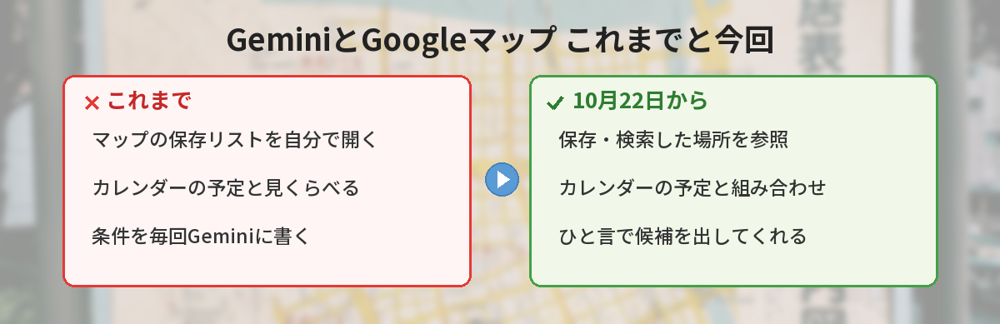
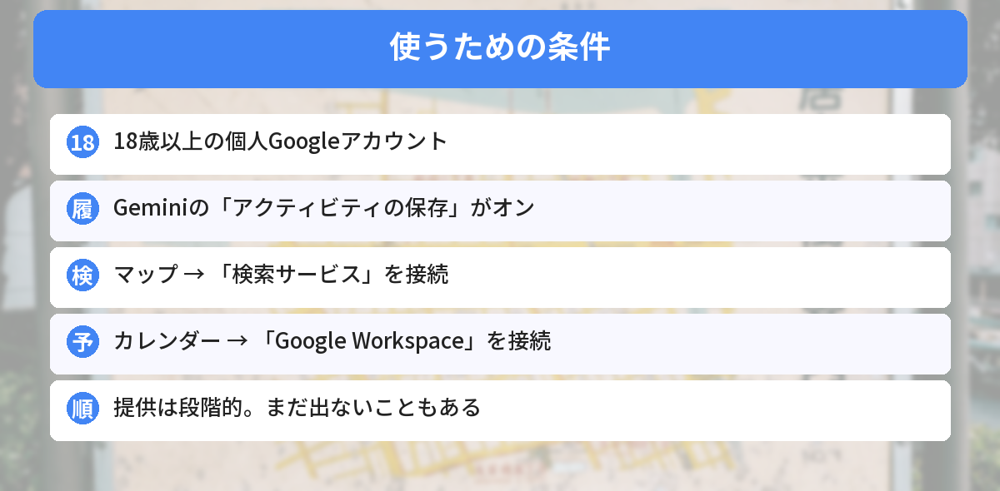
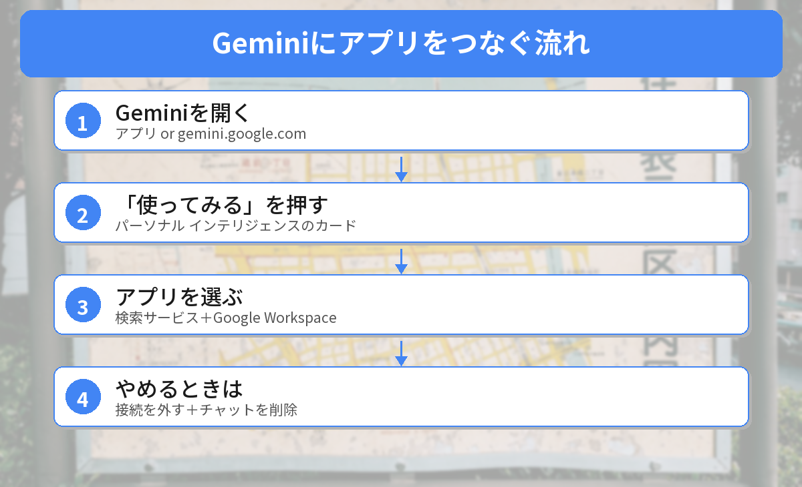

## この記事で分かること

Geminiが、マップに保存したお店と予定を見ておすすめしてくれるようになったって聞いたの。便利そうだけど、勝手に見られるのはちょっとこわいな…。


10月22日にGoogleが発表した機能だね。自分で「つなぐ」と決めたときだけ使われるしくみなんだ。何ができるか、どう設定するか、やめたいときはどうするかを順番に見ていこう。


こんな疑問はありませんか？
- マップとカレンダーがつながると、何が便利になるの？
- 使うには、どこを設定すればいいの？
- 使いたくないときは、どうやってオフにするの？

この記事は、2026年10月22日のGoogleの発表と、Geminiアプリのヘルプ「[アプリ連携によるパーソナライズについて](https://support.google.com/gemini/answer/16836988?hl=ja)」「[Google アプリを接続して Gemini のエクスペリエンスをパーソナライズ](https://support.google.com/gemini/answer/16598406?hl=ja-JP)」（2026年10月24日に確認）をもとにまとめています。

## 何が変わったの？
Geminiには、Gmailやカレンダー、検索などのGoogleアプリとつないで、自分に合った答えを返す「**パーソナル インテリジェンス**」という機能があります。日本では2026年4月14日に始まりました。

今回、このしくみで次の2つを**組み合わせて**提案できるようになりました。

- **Googleマップ**で検索した場所や、「保存」した場所
- **Googleカレンダー**の予定

たとえば、気になるカフェをマップに保存していて、土曜日に渋谷で予定がある人なら、「土曜の予定のあとに寄れるお店は？」と聞くだけで、保存したお店の中から候補を出してもらう、という使い方です。これまでは、マップの保存リストとカレンダーを自分で見くらべる必要がありました。



### 「マップに相談」とは別の機能
Googleマップの中には、8月から日本でも使える「**マップに相談**」という機能があります。こちらは**マップのアプリで**質問するものです。今回の機能は、**Geminiのアプリで**質問すると、マップの情報が使われるもの。質問する場所がちがいます。

## 使うための条件

Googleのヘルプでは、次の条件が必要とされています。

- **18歳以上**であること
- **個人のGoogleアカウント**であること（仕事用・学校用は対象外）
- Geminiの「**アクティビティの保存**」がオン
- マップの情報を使うには「**ウェブとアプリのアクティビティ**」がオン
- カレンダーの情報を使うには「**他の Google サービスのスマート機能**」がオン

マップは「**検索サービス**」（検索・マップ・ショッピングなど）のグループに、カレンダーは「**Google Workspace**」（Gmail・ドライブなど）のグループに入っています。今回の組み合わせを使うには、**この2つを両方つなぐ**必要があります。


「マップ」っていうスイッチがあるわけじゃないんだね。


そうなんだ。マップは「検索サービス」の中に入っているから、そこをつなぐ形になるよ。


## つなぎ方

1. スマホのGeminiアプリを開くか、パソコンで gemini.google.com を開く
2. 条件を満たしていれば、パーソナル インテリジェンスを始めるカードが出るので「**使ってみる**」を押す
3. 「**アプリを選択**」で、「検索サービス」と「Google Workspace」を選ぶ（全部つなぐなら「すべて接続」）
4. 画面の案内にそって進める

カードが出ない場合は、まだ自分のアカウントに順番が来ていない可能性があります。Googleは「段階的にリリースしている」と案内しています。

### 聞き方の例
- 「今週の予定のあとに寄れる、マップに保存したお店はある？」
- 「金曜の打ち合わせの場所の近くで、前に調べたランチのお店を教えて」

## 使いたくないときは
### このチャットだけオフにする
入力欄の「**ツール**」から「**パーソナル インテリジェンス**」をオフにします。そのチャットでは、つないだアプリの情報やメモリーを使いません。新しいチャットを始めると、またオンに戻ります。

履歴に残したくない話をするときは、「**一時チャット**」を使う方法もあります。

### アプリの接続を外す
Geminiの設定にある「アプリ連携」から、「検索サービス」や「Google Workspace」の接続を外せます。外したあとも、Geminiは**公開されているウェブの情報**（ふつうのGoogle検索の結果など）は使って答えます。

### 外しただけでは消えないもの
ここが大事なポイントです。ヘルプでは、次のように説明されています。

| やること | 変わること | 残るもの |
|------|------|------|
| アプリの接続を外す | これから先、そのアプリの情報を使わない | これまでのGeminiのチャット |
| Geminiのチャットを削除する | チャットに残った情報が消える | マップやカレンダーの元のデータ |
| マップの保存や履歴を消す | 元のデータが消える（反映に数日かかることも） | Geminiのチャット |

**情報を残したくないなら、「接続を外す」と「チャットを消す」の両方**が必要です。

## データの扱いで知っておきたいこと
Googleのヘルプでは、次のように書かれています。

- 「アクティビティの保存」がオンだと、**つないだアプリの情報を使ったやり取り**（要約や抜粋など）が、AIの学習に使われることがある
- つないだアプリのデータの一部は、**人によるレビュー**の対象になる。レビューの前に、アカウントとの結びつきを外すなどの対策をするとしている
- ヘルプには「学習やレビューに使われたくない情報がある場合は、アプリを接続しないで」と書かれている

また、Googleは、パーソナル インテリジェンスでは**まちがった答えや、関係ない情報を結びつけた答え**が出ることもあると説明しています。保存した場所は、「行ってみたい」だけでなく「比べて候補から外した」お店のこともあるので、提案が自分の意図に合うか確かめて、ちがえばその場で直しましょう。

Geminiの回答を自分好みにする方法は、[カスタム指示の記事](/posts/gemini-custom-instructions-customize/)で紹介しています。




自分でつないだときだけ使われて、やめたいときは「接続を外す」と「チャットを消す」の2つなんだね。


その通り。便利さとデータの扱い、両方を見て決めるのがおすすめだよ。まずはこのチャットだけで試して、合わなければツールからオフにしてもいいね。


## まとめ
- Googleは2026年10月22日、Geminiがマップの検索・保存した場所とカレンダーの予定を組み合わせて提案できると発表
- 使うには、18歳以上の個人アカウントで「検索サービス」と「Google Workspace」をGeminiにつなぐ
- アプリの接続は最初はオフ。自分で選んだときだけ使われる
- チャットごとにオフにでき、接続もいつでも外せる。ただし外してもチャット履歴は残る
- 国ごとの提供日は示されておらず、順次の提供（10月24日時点）

---
### あわせて読みたい
- [【Gemini】回答を自分好みにする「カスタム指示」の使い方 日本で使える範囲](/posts/gemini-custom-instructions-customize/)
- [【Gemini】「今日のまとめ」が出てこない？日本で使えない理由と代わりの方法](/posts/gemini-daily-brief-japan/)
