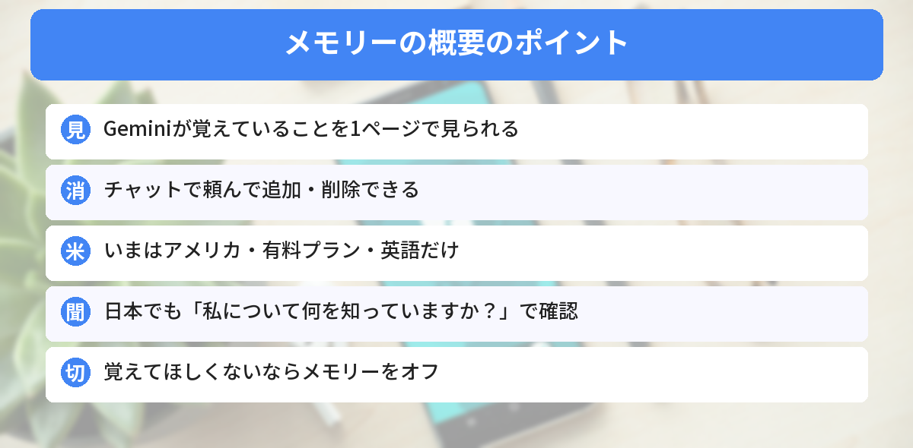
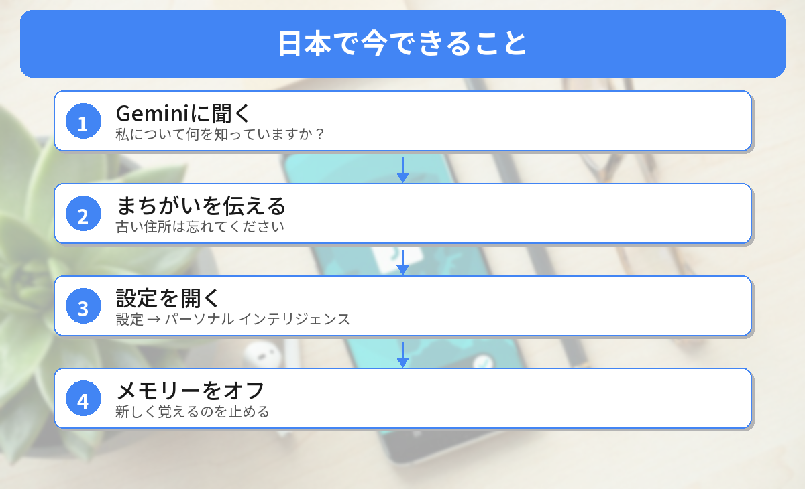

## この記事で分かること

Geminiと話してると、前に話したことを覚えてるときがあるの。何をどこまで覚えられてるのか、ちょっと気になるんだよね…。


11月9日から、それを1ページで見られる「メモリーの概要」が始まったよ。まだアメリカだけなんだけど、日本でも今すぐ確かめる方法があるから、一緒に説明するね。



こんな疑問はありませんか？
- Geminiは、わたしの何を覚えているの？
- 覚えられたことを消せるの？
- 日本でも使えるの？

この記事は、Googleの公式ヘルプ「[View & manage your memory summary in Gemini Apps](https://support.google.com/gemini/answer/18617127?co=GENIE.Platform%3DDesktop&hl=en)」と[9to5Googleの記事](https://9to5google.com/2026/11/09/google-gemini-memory-summary/)（2026年11月9日）をもとにまとめています（2026年11月10日に確認）。日本のアカウントではまだ表示されないため、筆者は実際の画面では確かめられていません。

## 「メモリーの概要」って何？
Geminiは、メモリーがオンになっていると、会話の中から**あなたについての情報**（住んでいる場所、仕事、好きなことなど）を覚えて、次からの答えに使います。

「メモリーの概要」は、その**覚えていることを1ページにまとめて見せてくれる**機能です。報道によると、次のような分類で並びます。

- **基本情報**（背景、住んでいる場所、大切な人など）
- **仕事・プロジェクト**
- **旅行・ふだんの持ち物**
- **映画・音楽などの趣味**
- **運動・生活**



## 使える人（2026年11月10日時点）
| 条件 | 内容 |
|------|------|
| 地域 | **アメリカ** |
| プラン | **有料のGoogle AIプラン** |
| 言語 | **英語** |
| 年齢 | 18歳以上、個人のGoogleアカウント |
| 設定 | 「アクティビティを保存」と「メモリー」がオン |
| 使える場所 | スマホのGeminiアプリと、Web版（gemini.google.com） |


日本はまだなんだね…。


うん。でも、覚えていることを確かめたり、覚えるのを止めたりするのは、日本でも今できるよ。


## 日本でも今できること


### 1. 「私について何を知っていますか？」と聞く
Geminiのチャットで、こう聞いてみましょう。

```text
私について何を知っていますか？
```

Googleの公式ヘルプでも、この聞き方で覚えていることを確かめられると紹介されています。

### 2. まちがいや消したいことを伝える
覚えられていることに、まちがいや消したい情報があれば、チャットで伝えます。

```text
私の古い住所は忘れてください
```

### 3. メモリーをオフにする
Geminiに覚えてほしくないときは、Web版の左下の［**設定**］→［**パーソナル インテリジェンス**］で、**メモリーをオフ**にします。オフにすると、Geminiがあなたについて新しく覚えるのを止められます。

## アメリカでは、こう使える
アメリカの対象の人は、［設定］→［パーソナル インテリジェンス］→［**メモリーの概要**］で開けます。

- **見る**：覚えていることが分類ごとに並ぶ
- **追加・削除**：下の入力欄に「日本語を話すことを覚えて」「古い電話番号を消して」のように書く。あいまいなときは、Geminiが聞き返してくれる
- **まとめて直す**：右上のえんぴつのボタン
- **メモリー履歴**：いつ何が追加・変更されたかを、時間の順に見られる

日本に来たときに迷わないよう、場所を覚えておきましょう。

## 気をつけたいこと
- メモリーには、**話した内容から読み取った個人の情報**が入ります。病気やお金のことなど、覚えてほしくない話は、そもそも入れないのが安心です
- 会話そのものの履歴は、別の［アクティビティ］の設定で管理します
- Geminiの設定は、[Geminiの「カスタム指示」の記事](/posts/gemini-custom-instructions-customize/)でも紹介しています




「私について何を知っていますか？」って聞いてみる！覚えてほしくなかったら、メモリーをオフ、だね。


その通り。日本で「メモリーの概要」が使えるようになったら、また紹介するね。


## まとめ
- Googleは11月9日、Geminiが覚えていることを1ページで見て、直して、消せる「メモリーの概要」を始めた
- いまはアメリカの有料プラン・英語・18歳以上だけが対象
- 日本でも「私について何を知っていますか？」と聞けば、覚えていることを確かめられる
- 覚えてほしくないときは、［設定］→［パーソナル インテリジェンス］でメモリーをオフ
- 覚えてほしくない話は、最初から入れないのが安心

---
### あわせて読みたい
- [【Gemini】Gemは11/17で使えなくなり12/17に削除 消えるファイルと今やること](/posts/gemini-gems-readonly-nov17-delete-dec17/)
- [【Google】Gmailや写真が広告に使われる？10月のプライバシーポリシー変更と止め方](/posts/google-privacy-policy-gemini-ads/)
