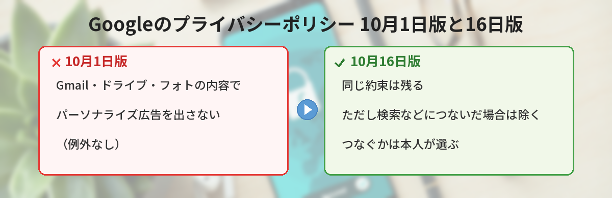
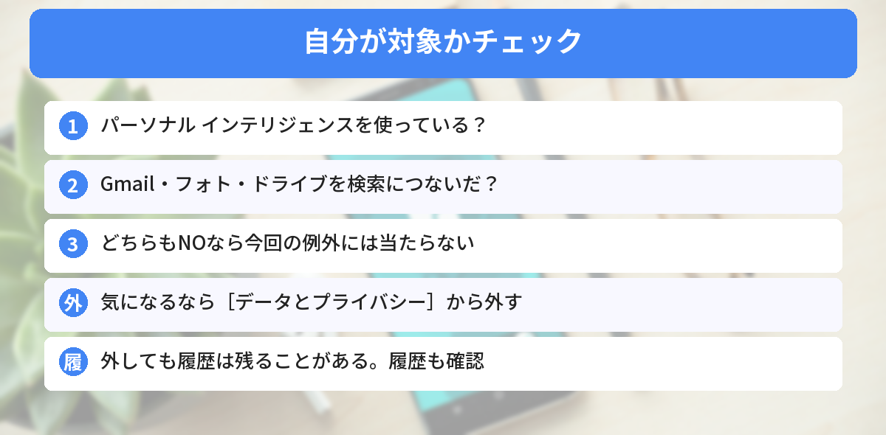

## この記事で分かること

「Googleが、Gmailや写真の中身を広告に使えるようにした」ってニュースを見たの。私のメール、広告に読まれちゃうの？


10月16日にプライバシーポリシーの文が変わった話だね。関係するのは、自分でGmailやフォトを「つないだ」人なんだ。どんな人が対象か、どう止めるかを順番に見ていこう。


こんな疑問はありませんか？
- 何もしていなくても、メールの中身で広告が出るの？
- そもそも「つなぐ」ってどういうこと？
- 気になったら、どうやって止めるの？

この記事は、Googleのプライバシーポリシー（2026年10月16日版）の変更を伝えた報道（The Next Web、Android Authority、Ars Technicaなど）と、Googleの広報のコメントをもとにまとめています（2026年10月27日に確認）。

## 何が変わったの？
Googleのプライバシーポリシーの広告の部分には、これまで次のような約束が書かれていました（10月1日版）。

> ドライブ、Gmail、フォトのコンテンツにもとづいて、パーソナライズ広告を表示することはありません。

10月16日からの版では、この一文のうしろに、次のような例外が足されました。

> ただし、これらのサービスのデータを、パーソナライズ広告に対応したほかのGoogleサービスで使えるようにした場合は除きます。

あわせて、「たとえば、検索は、アクセスを許可されたデータの一部を、広告を含むコンテンツのパーソナライズに使うことがある」という説明も加わりました。



## 対象になるのはどんな人？

ポイントは「**パーソナル インテリジェンス**」です。これは、GeminiやGoogle検索（AIモードなど）が、つないだGmailやフォト、ドライブの情報を使って、その人に合った答えを返す機能です。日本でも2026年4月から使えます。

今回の例外に当たるのは、次の人です。

- パーソナル インテリジェンスを使っていて
- **Gmail、フォト、ドライブなどを、検索サービスにつないでいる**人

たとえば、「予約したホテルの近くのレストランは？」と検索すると、Gmailの予約メールを見つけて近くのお店を出す、という使い方です。このとき、検索に許可したデータが、広告の内容に影響することがある、という意味です。


じゃあ、何もつないでいなければ関係ないってこと？


Googleの説明ではそうなるね。つなぐかどうかは、自分で選ぶしくみなんだ。逆に、前に「すべて接続」を押した覚えがある人は、一度設定を見てみるといいよ。


## Googleはどう説明している？
Googleは、Ars Technicaなどへのコメントで、次のように説明しています。

- アプリをつなぐかどうかは、**完全に本人が選ぶ**（オプトイン）
- 広告は、**検索した内容や答えの流れ、興味**などに合わせる
- 広告は、**Gmailの受信箱やフォトのライブラリを直接もとにしない**
- これまでどおり、**デリケートな情報は広告に使わない**
- 広告主に、ドライブ・Gmail・フォトの**中身や、名前・メールアドレスは渡さない**

なお、2026年10月27日時点で、**Geminiのアプリには広告は出ていない**と報じられています。一方、AIを使った検索では、スポンサーつきの内容が出ることがあります。

## 気になるときの止め方
### 検索サービスとの連携を外す
報道によると、Googleアカウントの次の場所から、ワークスペース（Gmail・ドライブなど）やフォトと検索サービスのつながりを外せます。

1. Googleアカウントを開く
2. ［**データとプライバシー**］を選ぶ
3. ［**カスタマイズの設定**］（パーソナライズの設定）を開く
4. 検索サービスの「**おすすめのパーソナライズを管理**」から、つないでいるアプリをオフにする

画面の名前は、表示する場所や時期によって少しちがうことがあります。

### Geminiアプリ側でも確かめる
Geminiアプリの［設定］→［アプリ連携］でも、検索サービスやGoogle Workspaceとのつながりを外せます。くわしくは[GeminiとGoogleマップの連携の記事](/posts/gemini-maps-personal-intelligence/)で紹介しています。

### 外しただけでは消えないこともある
Android Authorityは、連携を外したり、元のメールや写真を消したりしても、**検索サービスの履歴に残ったデータは保たれることがある**と指摘しています。気になる人は、［データとプライバシー］の履歴の設定も見ておきましょう。

## 日本では関係ある？
パーソナル インテリジェンスは、ヨーロッパ（EEA）、スイス、イギリス、ナイジェリアを除いて、世界で順次広がっています。**日本は対象地域**です。18歳以上の個人アカウントが対象で、仕事用・学校用のアカウントは対象外です。




自分でつないだときだけ関係あって、気になったら設定から外せるんだね。履歴も見ておく！


その通り。便利さと、データがどう使われるかの両方を見て、自分で決めるのが大事だよ。


## まとめ
- Googleのプライバシーポリシーが2026年10月16日に変わり、「Gmail・ドライブ・フォトの内容で広告をパーソナライズしない」に例外が加わった
- 例外に当たるのは、パーソナル インテリジェンスでこれらを検索サービスなどにつないだ人
- Googleは「つなぐかは本人が選ぶ」「受信箱や写真ライブラリを直接広告に使わない」と説明
- Geminiアプリには、10月27日時点で広告は出ていない
- 気になるときは、Googleアカウントの［データとプライバシー］やGeminiのアプリ連携から外せる。履歴も確かめる

---
### あわせて読みたい
- [【Gemini】Googleマップの保存した場所と予定から提案 使い方とオフにする方法](/posts/gemini-maps-personal-intelligence/)
- [【Gemini】回答を自分好みにする「カスタム指示」の使い方 日本で使える範囲](/posts/gemini-custom-instructions-customize/)
