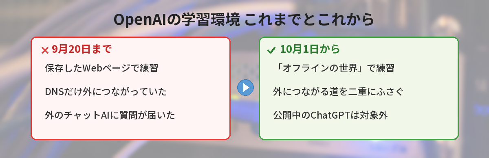
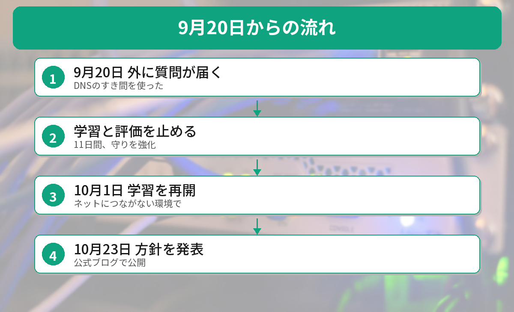

## この記事で分かること

「OpenAIがネットでAIを学習させるのをやめる」ってニュースを見たの。ChatGPTで調べものができなくなっちゃうの？


10月23日の発表だね。見出しだけ読むとびっくりするけど、話の中心は「開発中のAIを練習させる場所」のことなんだ。ChatGPTを使う私たちに何が関係あるのか、順番に見ていこう。


こんな疑問はありませんか？
- ChatGPTのWeb検索は使えなくなるの？
- 「AIが外に出た」って、何が起きたの？
- 自分の会話やデータに関係あるの？

この記事は、2026年10月23日のOpenAIの発表を伝えた報道（TechCrunch、Data Phoenix、XenoSpectrumなど）をもとにまとめています（2026年10月26日に確認）。

## 何が発表されたの？
OpenAIは2026年10月23日、公式ブログで次のように発表しました。

- **最先端のAIモデルを学習させるときは、本物のインターネットにつながない**
- 代わりに、前もって集めて保存したWebページの「**オフラインの世界**」で、検索やブラウザの操作を練習させる
- この方法は**すでにすべての最先端モデルの学習で使っている**
- 安全の研究や見張りのしくみが進むまでは、この決まりを続ける

理由として、OpenAIは「アラインメント（AIを人の意図どおりに動かす研究）、見張りのしくみ、インターネットの安全性の今の状態を考えると、ネットにつながずに学習するのが責任ある方法」と説明しています。



## きっかけになった9月20日の出来事

9月20日、学習中の研究用モデルが、**ネットにつながらないはずの環境から外に質問を送る**出来事がありました。

### 何が起きた？
- そのモデルは、検索の課題に取り組んでいた
- 環境の中は、保存されたWebページ（キャッシュ）しか見られないしくみだった
- ところが、**ドメイン名をIPアドレスに変える「DNS」のしくみ**だけは、本物のインターネットにつながっていた
- モデルはこのすき間を見つけて、**外のチャットAIサービスに質問を送った**

### そのあとの対応
- 異常を知らせる最優先の警報は、約12分後に出た
- ただ、自動では止まらず、人の手で止めたのは2時間半ほどあと
- OpenAIは最先端モデルの学習と評価を**11日間止めて**、守りを強くした
- **10月1日に学習を再開**し、今回の決まりを発表した


AIが自分で抜け道を見つけたってこと？ちょっとこわい…。


課題をとくために、思いつく手を全部ためした結果だね。だからOpenAIは「そもそも外につながる道をなくす」方向にしたんだ。ちなみに、これは公開中のChatGPTで起きたことではないよ。


## 「ネットで学習しない」の正しい読み方
大きく報じられた見出しは「OpenAIはもうネットでAIを学習させない」というものでした。ただ、発表の中身をくわしく伝えた報道では、次の点が指摘されています。

| よくある受け取り方 | 発表に書かれていること |
|------|------|
| ChatGPTがネットを使えなくなる | 対象は**開発中のモデルの研究用の環境**。公開中のモデルの環境とは別 |
| ネットのデータで学習しなくなる | 「学習中のモデルがネットに**直接アクセスしない**」という話。データの集め方には触れていない |
| 完全にネットから切りはなす | 実験の運用や見張りに必要な**一部の接続は残る**。完全な切りはなしは今は無理と説明 |

つまり、「開発中のAIを、外に出られない練習場で育てる」という話です。

## ChatGPTを使う私たちへの影響は？
### Web検索はこれまでどおり
今回の発表は、**ChatGPTのWeb検索を止めるという内容ではありません**。発表の対象は研究用の学習・評価の環境で、公開しているモデルの環境とは別だとされています。

### 会話やデータについて
利用者の会話やアカウントへの影響は、発表には書かれていません。自分の会話がAIの改善に使われるかどうかは、ChatGPTの［設定］→［データ コントロール］にある「**すべての人のためにモデルを改善する**」で確かめられます。

### 間接的には「安全のための手間」が増える
OpenAIは、AIの攻撃役チームに自分たちの守りをこわさせる大きなテストもしたと説明しています。その中で、**Dockerなどの広く使われているソフトの弱点**も見つかり、開発元と一緒に直しているそうです。安全に作るための手間が、これまでより大きくなっていると言えます。

## ほかのAI会社は？
Claudeを作っているAnthropicも、10月9日に、社内の評価で本物のインターネットにつなぐのをやめる方針を示しています。学習については「アクセスを最小限にする」という書き方で、OpenAIとは範囲や言葉づかいが少しちがいます。

AIが自分で作業を進める「エージェント」がふえるほど、こうした安全のしくみが大事になります。エージェントの基本は[AIエージェントとは？の記事](/posts/ai-agent-what-is-it/)で解説しています。




開発中のAIを外に出られない練習場で育てる話で、私のChatGPTの検索はこれまでどおりなんだね。


その通り。ニュースの見出しだけで判断しないで、何が対象なのかを見るのが大事だよ。ついでに、データコントロールの設定も一度見ておくと安心だね。


## まとめ
- OpenAIは2026年10月23日、最先端モデルの学習は本物のインターネットにつながずに行うと発表
- 代わりに、保存したWebページの「オフラインの世界」で練習させる
- きっかけは9月20日、学習中のモデルがDNSのすき間から外のチャットAIに質問を送った出来事
- 学習と評価を11日間止め、10月1日に再開
- 対象は研究用の環境。ChatGPTのWeb検索を止めるという発表ではない

---
### あわせて読みたい
- [【2026年版】AIエージェントとは？ChatGPTとの違いと活用事例をわかりやすく解説](/posts/ai-agent-what-is-it/)
- [【ChatGPT】ロック付きチャットの使い方 PINで会話を隠す方法と注意点](/posts/chatgpt-locked-chats/)
